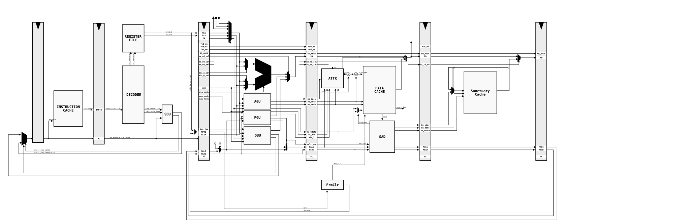

<!--
  Open points:
  * 'types' -> 'kinds': still under discussion. Preferably two different words,
    one for object kinds and one for register contents (pointer vs. primitive).
-->

<!-- Figures given as raw HTML blocks are tables. The viewer (index.html) draws them like the former
     diagrams, in light and dark mode, using the classes bf, bf-stack, t-<colour>, j and o-<edge>. -->

::: legend
This document is split into two categories:

- [ISA]{.swatch .isa}
- [Implementation]{.swatch .imp}

Whenever a chapter is highlighted in [*ISA*]{.isa} colors, an abstract ISA-Layer concept is being described.
The [*Implementation*]{.imp} sections then cover specifics on how these concepts [*could*]{.imp}
be realized.
:::

:::::: isa

# Introduction {#intro}

RISC-ViO is a processor architecture in which memory consists of objects instead of bytes.
At every moment, the hardware knows for every register and every XLEN-wide element of memory whether it holds a *pointer* or a *primitive*, and every pointer names the object it belongs to.
From this one piece of knowledge, RISC-ViO derives protections that conventional architectures can only approximate with separate mechanisms:
every access is checked against the bounds of its object, pointers cannot be forged, code can neither be read nor written, a function cannot touch a frame it does not own, a return address can be used only once,
and memory is reclaimed by exact garbage collection instead of by *free*, which rules out use-after-free errors by construction.

RISC-ViO provides these protections without giving up the memory model of C. Pointers stay XLEN bits wide, pointer arithmetic works as C programs expect, and data structures keep their layout.
The architecture is defined as a modification of the RISC-V base integer ISA, called I', together with the *zhm* extension.

<!-- FIXME: explain the name 'RISC-ViO' in one sentence. Readers currently have to guess what 'ViO' stands for. -->

## Motivation {#motivation}

### Hardware that does not know what a pointer is {#motivation_problem}

Conventional architectures treat memory as a flat array of bytes. The objects a program is made of, like structs, arrays, heap allocations or stack frames, exist only in the compiler and in the language runtime.
While executing an instruction, the hardware knows neither where these objects begin and end, nor whether a register holds a pointer or an integer that merely has the same value.
It therefore cannot check whether an access stays inside its object, cannot distinguish a valid pointer from a forged one and cannot tell which memory is still in use.

In C and C++, this lack of information is the root of the most damaging class of software defects.
In the Chromium project, around 70% of serious security bugs are memory safety problems, and about half of those are use-after-free errors[^chromium_ms].
Microsoft reports the same share of 70% for the vulnerabilities it assigns a CVE[^msrc].
Buffer overflows, use-after-free, double free, forged pointers and overwritten return addresses look like different bugs, but they share a single cause:
the machine executing the program has no notion of the objects the program consists of.

### Existing answers {#motivation_existing}

Three kinds of answers to this problem exist today. Memory-safe languages replace the vulnerable code, memory tagging protects it with hardware that is already shipping in consumer devices,
and capability architectures make it memory safe by changing what a pointer is. Of these, CHERI is the approach any architecture promising memory safety for C, including RISC-ViO, has to be measured against.

#### Memory-safe languages {#motivation_languages}

Java, C#, Go or Python keep track of pointers and object bounds in their runtime, which costs bounds checks, type checks and a garbage collector that has to find pointers using metadata maintained in software.
Rust moves most of the cost to compile time, at the price of a strict ownership discipline.
None of them protects the existing code base: operating systems, browsers, libraries and firmware written in C and C++ will not be rewritten within the lifetime of the hardware being designed today.

#### Memory tagging {#motivation_tagging}

Memory tagging protects this existing code without rewriting it. Arm's Memory Tagging Extension (MTE) assigns a 4-bit tag to every 16-byte granule of memory and places a matching tag in the unused top bits of every pointer[^mte].
On every access, the hardware compares both tags and faults on a mismatch. Allocators choose a random tag for every allocation and a new one when it is freed, so out-of-bounds accesses and stale pointers are caught as long as the tags differ.
Memory tagging is the only hardware memory safety mechanism that has made it into consumer devices today [^tiktag][^apple_mie][^riscv_mt].

Its protection is probabilistic, however. With 4-bit tags, an access through a wrong pointer goes unnoticed whenever both tags happen to match, which is the case for about one in sixteen random tags.
An attacker who can retry, or learn the tags, defeats it: the TikTag attack leaks MTE tags through speculative execution and bypassed MTE in Google Chrome and the Linux kernel[^tiktag].
Memory tagging also does not identify pointers. A tag is just a few bits of the pointer, so any integer with the right address and the right tag is a valid pointer, and pointer integrity rests entirely on keeping the tags secret.
Bounds are only as fine as the 16-byte granules, and a stale pointer becomes valid again once its memory is reallocated with the same tag.
Turning memory tagging from a debugging aid into a defence therefore requires additional layers. Apple's Memory Integrity Enforcement, for example, permits only synchronous tag checking and combines it with type-segregated allocators and dedicated measures to keep tags confidential[^apple_mie].
Control flow needs separate extensions on top: shadow stacks and landing pads (RISC-V Zicfiss and Zicfilp, Arm PAC and BTI, Intel CET) protect returns and indirect jumps, but no data.

#### Capabilities: CHERI {#motivation_cheri}

CHERI[^cheri], developed at the University of Cambridge and SRI International for more than fifteen years, replaces pointers by capabilities.
A capability holds an address together with the bounds and permissions of the memory it may access, and a tag bit kept outside the addressable memory marks it as valid.
New capabilities can only be derived from existing ones with equal or smaller bounds and permissions, and overwriting a capability with data clears its tag, so capabilities cannot be forged.
CHERI makes C and C++ deterministically and spatially memory safe, can narrow bounds down to individual fields of a struct, and supports fine-grained compartmentalisation.
It runs on Arm's Morello prototype and on CHERIoT microcontrollers, and its RISC-V version, RVY, is on its way to standardisation[^cheri_rvy]. CHERI is the most mature answer to memory safety for C today.

CHERI's central design decision is to attach protection to the pointer: every capability carries its own bounds and permissions, and every copy of a capability is an independent authority to access memory.
Most of CHERI's costs follow from this one decision:

- **Wider pointers.** Bounds and permissions next to the address make a capability twice as wide as an address, 128 bits on RV64.
  Pointers are part of a program's data as much as of its code, so every structure holding a pointer changes its size, alignment and layout, and so does every interface that fixes such a layout, from system calls to file formats and buffers shared with devices.
  Pointer-heavy programs, like interpreters, compilers or anything built on linked data structures, need correspondingly more memory and cache.
- **Compressed bounds.** To fit into these 128 bits, bounds are stored in compressed form[^cheri_concentrate]. Large allocations get exact bounds only if their size and alignment are rounded accordingly,
  and a pointer moved too far outside its object can no longer be represented and loses its tag.
- **Tags throughout the memory system.** Since any capability-sized word may hold a capability, its tag has to travel with it through every cache level, the interconnect and the memory controller, which typically keeps the tags of main memory in a separate table.
  Caching this table keeps the additional memory traffic low[^joannou_tags], but the tags reach into components far outside the processor core, and writes by any agent, DMA engines included, have to clear them.
- **Revocation instead of temporal safety.** Since every copy of a capability is an independent authority and C's *free* is kept, freeing memory does not withdraw access to it.
  Freed memory has to stay in quarantine until a revocation sweep has found and invalidated every capability still pointing into it[^cornucopia]. Temporal safety is thus a mechanism added on top of the capability model rather than a consequence of it.

### The gap RISC-ViO fills {#motivation_gap}

None of the approaches that are deployed or being standardised offers deterministic spatial and temporal memory safety for C and C++ while leaving pointers, data layouts and the memory system as they are.
Memory tagging is probabilistic and leaves pointers forgeable. CHERI is deterministic, but pays for attaching protection to the pointer with wider pointers, tags throughout the memory system and revocation.

RISC-ViO fills this gap by attaching protection to the object instead.
It takes its inspiration from Objective-RISC[^meyer_orisc][^orisc_spec] (O-RISC), which raises the hardware to the level of objects: once the hardware knows which values are pointers and which objects they belong to, bounds checks, unforgeable pointers, protected frames and exact garbage collection follow from one model.
O-RISC realizes this idea for memory-safe, garbage-collected languages and deliberately leaves C aside. RISC-ViO brings it to C.

The key to this is a different notion of a pointer. A RISC-ViO pointer consists of a reference to an object and an *index* into this object.
Pointer arithmetic changes the index, never the reference. A pointer can therefore move freely inside its object and arbitrarily far beyond its bounds, just as C pointers do, but it can never be turned into a pointer to another object, and every access through it is checked against the bounds of the object it references.
Bounds and permissions exist once per object rather than in every pointer, so a pointer stays XLEN bits wide. Since the reference always names the head of the object, the hardware and the garbage collector find the object belonging to any pointer immediately, even if the pointer points into the middle of it.
And since objects are reclaimed by a garbage collector instead of being freed, there are no stale copies of a pointer left to hunt down.

::: figure
```{=html}
<div class="fig-row">
<div class="fig-item">
<svg xmlns="http://www.w3.org/2000/svg" width="252" height="296" viewBox="-2 -2 252 296" role="img">
  <title>Conventional memory</title>
  <style>
  text { font-family: "Roboto Mono", ui-monospace, "SF Mono", Menlo, Consolas, "DejaVu Sans Mono", "Liberation Mono", monospace; font-size: 13px; font-weight: 700; fill: #1a1a1a;
          text-anchor: middle; dominant-baseline: central; }
  text.label { font-size: 10px; font-weight: 400; fill: #5a5a5a; }
  text.heading { font-size: 12px; }
  text.start { text-anchor: start; }
  text.end { text-anchor: end; }
  text.small { font-size: 10px; font-weight: 400; font-style: italic; }
  .outline { fill: none; stroke: #000; stroke-width: 2; shape-rendering: crispEdges; }
  .divider { fill: none; stroke: #000; stroke-width: 1; shape-rendering: crispEdges; }
  .diagonal { stroke: #000; stroke-width: 1; }
  .rule { stroke: #000; stroke-width: 2; shape-rendering: crispEdges; }
  .dashed { stroke-dasharray: 4 3; }
  .arrow { fill: none; stroke: #1a1a1a; stroke-width: 1.5; }
  .head, .dot { fill: #1a1a1a; }
  .bracket { fill: none; stroke: #ff55dd; stroke-width: 2; }
  .purple { fill: #ccaaff }
  .blue { fill: #80e5ff }
  .green { fill: #55ff99 }
  .cyan { fill: #55ffdd }
  .light-pink { fill: #ffaaee }
  .pink { fill: #ff55dd }
  .yellow { fill: #e5ff80 }
  .white { fill: #ffffff }
  @media (prefers-color-scheme: dark) {
    text { fill: #cccccc; }
    text.label { fill: #9a9a9a; }
    /* lines become gaps in the page colour between the tinted tiles */
    .outline, .divider, .diagonal { stroke: #1a1a1a; }
    .rule, .dashed { stroke: #cccccc; }
    .arrow { stroke: #cccccc; }
    .head, .dot { fill: #cccccc; }
    .white { fill: #ffffff1a }
    .purple { fill: #ccaaff40 }
    text.on-purple { fill: #ccaaff }
    .blue { fill: #80e5ff40 }
    text.on-blue { fill: #80e5ff }
    .green { fill: #55ff9940 }
    text.on-green { fill: #55ff99 }
    .cyan { fill: #55ffdd40 }
    text.on-cyan { fill: #55ffdd }
    .light-pink { fill: #ffaaee40 }
    text.on-light-pink { fill: #ffaaee }
    .pink { fill: #ff55dd40 }
    text.on-pink { fill: #ff55dd }
    .yellow { fill: #e5ff8040 }
    text.on-yellow { fill: #e5ff80 }
  }
  </style>
  <rect x="90" y="30" width="100" height="26" class="white"/>
  <text x="140" y="43" class="on-white">&quot;A&quot;</text>
  <rect x="90" y="56" width="100" height="26" class="white"/>
  <text x="140" y="69" class="on-white">&quot;B&quot;</text>
  <rect x="90" y="82" width="100" height="26" class="white"/>
  <text x="140" y="95" class="on-white">0x50</text>
  <rect x="90" y="108" width="100" height="26" class="white"/>
  <text x="140" y="121" class="on-white">&quot;D&quot;</text>
  <rect x="90" y="134" width="100" height="26" class="white"/>
  <text x="140" y="147" class="on-white">&quot;E&quot;</text>
  <rect x="90" y="160" width="100" height="26" class="white"/>
  <text x="140" y="173" class="on-white">41</text>
  <rect x="90" y="186" width="100" height="26" class="white"/>
  <text x="140" y="199" class="on-white">&quot;F&quot;</text>
  <line x1="90" y1="56" x2="190" y2="56" class="divider dashed"/>
  <line x1="90" y1="82" x2="190" y2="82" class="divider dashed"/>
  <line x1="90" y1="108" x2="190" y2="108" class="divider dashed"/>
  <line x1="90" y1="134" x2="190" y2="134" class="divider dashed"/>
  <line x1="90" y1="160" x2="190" y2="160" class="divider dashed"/>
  <line x1="90" y1="186" x2="190" y2="186" class="divider dashed"/>
  <rect x="90" y="30" width="100" height="182" class="outline dashed"/>
  <line x1="90" y1="14" x2="90" y2="30" class="rule"/>
  <line x1="90" y1="212" x2="90" y2="228" class="rule"/>
  <line x1="190" y1="14" x2="190" y2="30" class="rule"/>
  <line x1="190" y1="212" x2="190" y2="228" class="rule"/>
  <rect x="4" y="30" width="60" height="26" class="white"/>
  <text x="34" y="43" class="on-white">0x40</text>
  <rect x="4" y="30" width="60" height="26" class="outline"/>
  <polyline points="64,43 90,43" class="arrow"/>
  <polygon points="90,43 83,39 83,47" class="head"/>
  <circle cx="64" cy="43" r="3" class="dot"/>
  <text x="77" y="33" class="heading">?</text>
  <polyline points="182,95 208,95 208,147 190,147" class="arrow"/>
  <polygon points="190,147 197,143 197,151" class="head"/>
  <circle cx="182" cy="95" r="3" class="dot"/>
  <text x="218" y="121" class="heading">?</text>
  <polyline points="182,173 224,173" class="arrow"/>
  <polygon points="224,173 217,169 217,177" class="head"/>
  <circle cx="182" cy="173" r="3" class="dot"/>
  <text x="212" y="163" class="heading">?</text>
</svg>
<span class="subcaption">a) Conventional</span>
</div>
<div class="fig-item">
<svg xmlns="http://www.w3.org/2000/svg" width="252" height="296" viewBox="-2 -2 252 296" role="img">
  <title>CHERI memory</title>
  <style>
  text { font-family: "Roboto Mono", ui-monospace, "SF Mono", Menlo, Consolas, "DejaVu Sans Mono", "Liberation Mono", monospace; font-size: 13px; font-weight: 700; fill: #1a1a1a;
          text-anchor: middle; dominant-baseline: central; }
  text.label { font-size: 10px; font-weight: 400; fill: #5a5a5a; }
  text.heading { font-size: 12px; }
  text.start { text-anchor: start; }
  text.end { text-anchor: end; }
  text.small { font-size: 10px; font-weight: 400; font-style: italic; }
  .outline { fill: none; stroke: #000; stroke-width: 2; shape-rendering: crispEdges; }
  .divider { fill: none; stroke: #000; stroke-width: 1; shape-rendering: crispEdges; }
  .diagonal { stroke: #000; stroke-width: 1; }
  .rule { stroke: #000; stroke-width: 2; shape-rendering: crispEdges; }
  .dashed { stroke-dasharray: 4 3; }
  .arrow { fill: none; stroke: #1a1a1a; stroke-width: 1.5; }
  .head, .dot { fill: #1a1a1a; }
  .bracket { fill: none; stroke: #ff55dd; stroke-width: 2; }
  .purple { fill: #ccaaff }
  .blue { fill: #80e5ff }
  .green { fill: #55ff99 }
  .cyan { fill: #55ffdd }
  .light-pink { fill: #ffaaee }
  .pink { fill: #ff55dd }
  .yellow { fill: #e5ff80 }
  .white { fill: #ffffff }
  @media (prefers-color-scheme: dark) {
    text { fill: #cccccc; }
    text.label { fill: #9a9a9a; }
    /* lines become gaps in the page colour between the tinted tiles */
    .outline, .divider, .diagonal { stroke: #1a1a1a; }
    .rule, .dashed { stroke: #cccccc; }
    .arrow { stroke: #cccccc; }
    .head, .dot { fill: #cccccc; }
    .white { fill: #ffffff1a }
    .purple { fill: #ccaaff40 }
    text.on-purple { fill: #ccaaff }
    .blue { fill: #80e5ff40 }
    text.on-blue { fill: #80e5ff }
    .green { fill: #55ff9940 }
    text.on-green { fill: #55ff99 }
    .cyan { fill: #55ffdd40 }
    text.on-cyan { fill: #55ffdd }
    .light-pink { fill: #ffaaee40 }
    text.on-light-pink { fill: #ffaaee }
    .pink { fill: #ff55dd40 }
    text.on-pink { fill: #ff55dd }
    .yellow { fill: #e5ff8040 }
    text.on-yellow { fill: #e5ff80 }
  }
  </style>
  <rect x="90" y="30" width="100" height="26" class="white"/>
  <text x="140" y="43" class="on-white">&quot;A&quot;</text>
  <rect x="90" y="56" width="100" height="26" class="white"/>
  <text x="140" y="69" class="on-white">&quot;B&quot;</text>
  <rect x="90" y="82" width="100" height="52" class="pink"/>
  <text x="140" y="108" class="on-pink">cap</text>
  <rect x="90" y="134" width="100" height="26" class="white"/>
  <text x="140" y="147" class="on-white">&quot;D&quot;</text>
  <rect x="90" y="160" width="100" height="26" class="white"/>
  <text x="140" y="173" class="on-white">&quot;E&quot;</text>
  <rect x="90" y="186" width="100" height="26" class="white"/>
  <text x="140" y="199" class="on-white">41</text>
  <rect x="90" y="212" width="100" height="26" class="white"/>
  <text x="140" y="225" class="on-white">&quot;F&quot;</text>
  <line x1="90" y1="56" x2="190" y2="56" class="divider dashed"/>
  <line x1="90" y1="82" x2="190" y2="82" class="divider dashed"/>
  <line x1="90" y1="134" x2="190" y2="134" class="divider dashed"/>
  <line x1="90" y1="160" x2="190" y2="160" class="divider dashed"/>
  <line x1="90" y1="186" x2="190" y2="186" class="divider dashed"/>
  <line x1="90" y1="212" x2="190" y2="212" class="divider dashed"/>
  <rect x="90" y="30" width="100" height="208" class="outline dashed"/>
  <line x1="90" y1="14" x2="90" y2="30" class="rule"/>
  <line x1="90" y1="238" x2="90" y2="254" class="rule"/>
  <line x1="190" y1="14" x2="190" y2="30" class="rule"/>
  <line x1="190" y1="238" x2="190" y2="254" class="rule"/>
  <text x="236" y="20" class="label">tag</text>
  <rect x="228" y="30" width="16" height="52" class="white"/>
  <text x="236" y="56" class="on-white">0</text>
  <rect x="228" y="30" width="16" height="52" class="outline"/>
  <rect x="228" y="82" width="16" height="52" class="pink"/>
  <text x="236" y="108" class="on-pink">1</text>
  <rect x="228" y="82" width="16" height="52" class="outline"/>
  <rect x="228" y="134" width="16" height="52" class="white"/>
  <text x="236" y="160" class="on-white">0</text>
  <rect x="228" y="134" width="16" height="52" class="outline"/>
  <rect x="228" y="186" width="16" height="52" class="white"/>
  <text x="236" y="212" class="on-white">0</text>
  <rect x="228" y="186" width="16" height="52" class="outline"/>
  <polyline points="86,33 81,33 81,157 86,157" class="bracket"/>
  <polyline points="194,163 199,163 199,235 194,235" class="bracket"/>
  <rect x="4" y="30" width="56" height="26" class="pink"/>
  <text x="32" y="43" class="on-pink">cap</text>
  <rect x="4" y="30" width="56" height="26" class="outline"/>
  <polyline points="60,43 79,43" class="arrow"/>
  <polygon points="79,43 72,39 72,47" class="head"/>
  <circle cx="60" cy="43" r="3" class="dot"/>
  <polyline points="182,108 208,108 208,173 200,173" class="arrow"/>
  <polygon points="200,173 207,169 207,177" class="head"/>
  <circle cx="182" cy="108" r="3" class="dot"/>
</svg>
<span class="subcaption">b) CHERI</span>
</div>
<div class="fig-item">
<svg xmlns="http://www.w3.org/2000/svg" width="252" height="296" viewBox="-2 -2 252 296" role="img">
  <title>Memory tagging</title>
  <style>
  text { font-family: "Roboto Mono", ui-monospace, "SF Mono", Menlo, Consolas, "DejaVu Sans Mono", "Liberation Mono", monospace; font-size: 13px; font-weight: 700; fill: #1a1a1a;
          text-anchor: middle; dominant-baseline: central; }
  text.label { font-size: 10px; font-weight: 400; fill: #5a5a5a; }
  text.heading { font-size: 12px; }
  text.start { text-anchor: start; }
  text.end { text-anchor: end; }
  text.small { font-size: 10px; font-weight: 400; font-style: italic; }
  .outline { fill: none; stroke: #000; stroke-width: 2; shape-rendering: crispEdges; }
  .divider { fill: none; stroke: #000; stroke-width: 1; shape-rendering: crispEdges; }
  .diagonal { stroke: #000; stroke-width: 1; }
  .rule { stroke: #000; stroke-width: 2; shape-rendering: crispEdges; }
  .dashed { stroke-dasharray: 4 3; }
  .arrow { fill: none; stroke: #1a1a1a; stroke-width: 1.5; }
  .head, .dot { fill: #1a1a1a; }
  .bracket { fill: none; stroke: #ff55dd; stroke-width: 2; }
  .purple { fill: #ccaaff }
  .blue { fill: #80e5ff }
  .green { fill: #55ff99 }
  .cyan { fill: #55ffdd }
  .light-pink { fill: #ffaaee }
  .pink { fill: #ff55dd }
  .yellow { fill: #e5ff80 }
  .white { fill: #ffffff }
  @media (prefers-color-scheme: dark) {
    text { fill: #cccccc; }
    text.label { fill: #9a9a9a; }
    /* lines become gaps in the page colour between the tinted tiles */
    .outline, .divider, .diagonal { stroke: #1a1a1a; }
    .rule, .dashed { stroke: #cccccc; }
    .arrow { stroke: #cccccc; }
    .head, .dot { fill: #cccccc; }
    .white { fill: #ffffff1a }
    .purple { fill: #ccaaff40 }
    text.on-purple { fill: #ccaaff }
    .blue { fill: #80e5ff40 }
    text.on-blue { fill: #80e5ff }
    .green { fill: #55ff9940 }
    text.on-green { fill: #55ff99 }
    .cyan { fill: #55ffdd40 }
    text.on-cyan { fill: #55ffdd }
    .light-pink { fill: #ffaaee40 }
    text.on-light-pink { fill: #ffaaee }
    .pink { fill: #ff55dd40 }
    text.on-pink { fill: #ff55dd }
    .yellow { fill: #e5ff8040 }
    text.on-yellow { fill: #e5ff80 }
  }
  </style>
  <rect x="90" y="30" width="100" height="26" class="white"/>
  <text x="140" y="43" class="on-white">&quot;A&quot;</text>
  <rect x="90" y="56" width="100" height="26" class="white"/>
  <text x="140" y="69" class="on-white">&quot;B&quot;</text>
  <rect x="90" y="82" width="100" height="26" class="white"/>
  <text x="140" y="95" class="on-white">0x50</text>
  <rect x="90" y="108" width="100" height="26" class="white"/>
  <text x="140" y="121" class="on-white">&quot;D&quot;</text>
  <rect x="90" y="134" width="100" height="26" class="white"/>
  <text x="140" y="147" class="on-white">&quot;E&quot;</text>
  <rect x="90" y="160" width="100" height="26" class="white"/>
  <text x="140" y="173" class="on-white">41</text>
  <rect x="90" y="186" width="100" height="26" class="white"/>
  <text x="140" y="199" class="on-white">&quot;F&quot;</text>
  <line x1="90" y1="56" x2="190" y2="56" class="divider dashed"/>
  <line x1="90" y1="82" x2="190" y2="82" class="divider dashed"/>
  <line x1="90" y1="108" x2="190" y2="108" class="divider dashed"/>
  <line x1="90" y1="134" x2="190" y2="134" class="divider dashed"/>
  <line x1="90" y1="160" x2="190" y2="160" class="divider dashed"/>
  <line x1="90" y1="186" x2="190" y2="186" class="divider dashed"/>
  <rect x="90" y="30" width="100" height="182" class="outline dashed"/>
  <line x1="90" y1="14" x2="90" y2="30" class="rule"/>
  <line x1="90" y1="212" x2="90" y2="228" class="rule"/>
  <line x1="190" y1="14" x2="190" y2="30" class="rule"/>
  <line x1="190" y1="212" x2="190" y2="228" class="rule"/>
  <rect x="90" y="82" width="26" height="26" class="purple"/>
  <text x="103" y="95" class="on-purple">9</text>
  <line x1="116" y1="82" x2="116" y2="108" class="divider"/>
  <text x="236" y="20" class="label">tag</text>
  <rect x="228" y="30" width="16" height="104" class="yellow"/>
  <text x="236" y="82" class="on-yellow">3</text>
  <rect x="228" y="30" width="16" height="104" class="outline"/>
  <rect x="228" y="134" width="16" height="78" class="purple"/>
  <text x="236" y="173" class="on-purple">9</text>
  <rect x="228" y="134" width="16" height="78" class="outline"/>
  <rect x="4" y="30" width="22" height="26" class="yellow"/>
  <text x="15" y="43" class="on-yellow">3</text>
  <rect x="4" y="30" width="22" height="26" class="outline"/>
  <rect x="26" y="30" width="48" height="26" class="white"/>
  <text x="50" y="43" class="on-white">0x40</text>
  <rect x="26" y="30" width="48" height="26" class="outline"/>
  <polyline points="74,43 90,43" class="arrow"/>
  <polygon points="90,43 83,39 83,47" class="head"/>
  <circle cx="74" cy="43" r="3" class="dot"/>
  <polyline points="182,95 208,95 208,147 190,147" class="arrow"/>
  <polygon points="190,147 197,143 197,151" class="head"/>
  <circle cx="182" cy="95" r="3" class="dot"/>
  <text x="199" y="121" class="heading">?</text>
  <polyline points="182,173 220,173" class="arrow"/>
  <polygon points="220,173 213,169 213,177" class="head"/>
  <circle cx="182" cy="173" r="3" class="dot"/>
  <text x="208" y="163" class="heading">?</text>
</svg>
<span class="subcaption">c) Memory tagging (MTE)</span>
</div>
<div class="fig-item">
<svg xmlns="http://www.w3.org/2000/svg" width="252" height="296" viewBox="-2 -2 252 296" role="img">
  <title>RISC-ViO memory</title>
  <style>
  text { font-family: "Roboto Mono", ui-monospace, "SF Mono", Menlo, Consolas, "DejaVu Sans Mono", "Liberation Mono", monospace; font-size: 13px; font-weight: 700; fill: #1a1a1a;
          text-anchor: middle; dominant-baseline: central; }
  text.label { font-size: 10px; font-weight: 400; fill: #5a5a5a; }
  text.heading { font-size: 12px; }
  text.start { text-anchor: start; }
  text.end { text-anchor: end; }
  text.small { font-size: 10px; font-weight: 400; font-style: italic; }
  .outline { fill: none; stroke: #000; stroke-width: 2; shape-rendering: crispEdges; }
  .divider { fill: none; stroke: #000; stroke-width: 1; shape-rendering: crispEdges; }
  .diagonal { stroke: #000; stroke-width: 1; }
  .rule { stroke: #000; stroke-width: 2; shape-rendering: crispEdges; }
  .dashed { stroke-dasharray: 4 3; }
  .arrow { fill: none; stroke: #1a1a1a; stroke-width: 1.5; }
  .head, .dot { fill: #1a1a1a; }
  .bracket { fill: none; stroke: #ff55dd; stroke-width: 2; }
  .purple { fill: #ccaaff }
  .blue { fill: #80e5ff }
  .green { fill: #55ff99 }
  .cyan { fill: #55ffdd }
  .light-pink { fill: #ffaaee }
  .pink { fill: #ff55dd }
  .yellow { fill: #e5ff80 }
  .white { fill: #ffffff }
  @media (prefers-color-scheme: dark) {
    text { fill: #cccccc; }
    text.label { fill: #9a9a9a; }
    /* lines become gaps in the page colour between the tinted tiles */
    .outline, .divider, .diagonal { stroke: #1a1a1a; }
    .rule, .dashed { stroke: #cccccc; }
    .arrow { stroke: #cccccc; }
    .head, .dot { fill: #cccccc; }
    .white { fill: #ffffff1a }
    .purple { fill: #ccaaff40 }
    text.on-purple { fill: #ccaaff }
    .blue { fill: #80e5ff40 }
    text.on-blue { fill: #80e5ff }
    .green { fill: #55ff9940 }
    text.on-green { fill: #55ff99 }
    .cyan { fill: #55ffdd40 }
    text.on-cyan { fill: #55ffdd }
    .light-pink { fill: #ffaaee40 }
    text.on-light-pink { fill: #ffaaee }
    .pink { fill: #ff55dd40 }
    text.on-pink { fill: #ff55dd }
    .yellow { fill: #e5ff8040 }
    text.on-yellow { fill: #e5ff80 }
  }
  </style>
  <rect x="90" y="30" width="100" height="26" class="green"/>
  <text x="140" y="43" class="on-green">header A</text>
  <rect x="90" y="56" width="100" height="26" class="blue"/>
  <text x="140" y="69" class="on-blue">&quot;A&quot;</text>
  <rect x="90" y="82" width="100" height="26" class="blue"/>
  <text x="140" y="95" class="on-blue">&quot;B&quot;</text>
  <rect x="90" y="108" width="100" height="26" class="pink"/>
  <text x="140" y="121" class="on-pink">B.0</text>
  <rect x="90" y="134" width="100" height="26" class="blue"/>
  <text x="140" y="147" class="on-blue">&quot;D&quot;</text>
  <line x1="90" y1="56" x2="190" y2="56" class="divider"/>
  <line x1="90" y1="82" x2="190" y2="82" class="divider"/>
  <line x1="90" y1="108" x2="190" y2="108" class="divider"/>
  <line x1="90" y1="134" x2="190" y2="134" class="divider"/>
  <rect x="90" y="30" width="100" height="130" class="outline"/>
  <rect x="90" y="170" width="100" height="26" class="green"/>
  <text x="140" y="183" class="on-green">header B</text>
  <rect x="90" y="196" width="100" height="26" class="blue"/>
  <text x="140" y="209" class="on-blue">&quot;E&quot;</text>
  <rect x="90" y="222" width="100" height="26" class="blue"/>
  <text x="140" y="235" class="on-blue">41</text>
  <rect x="90" y="248" width="100" height="26" class="blue"/>
  <text x="140" y="261" class="on-blue">&quot;F&quot;</text>
  <line x1="90" y1="196" x2="190" y2="196" class="divider"/>
  <line x1="90" y1="222" x2="190" y2="222" class="divider"/>
  <line x1="90" y1="248" x2="190" y2="248" class="divider"/>
  <rect x="90" y="170" width="100" height="104" class="outline"/>
  <line x1="90" y1="14" x2="90" y2="30" class="rule"/>
  <line x1="90" y1="274" x2="90" y2="290" class="rule"/>
  <line x1="190" y1="14" x2="190" y2="30" class="rule"/>
  <line x1="190" y1="274" x2="190" y2="290" class="rule"/>
  <rect x="4" y="82" width="26" height="26" class="pink"/>
  <text x="17" y="95" class="on-pink">A</text>
  <rect x="4" y="82" width="26" height="26" class="outline"/>
  <rect x="30" y="82" width="26" height="26" class="blue"/>
  <text x="43" y="95" class="on-blue">4</text>
  <rect x="30" y="82" width="26" height="26" class="outline"/>
  <polyline points="17,82 17,43 90,43" class="arrow"/>
  <polygon points="90,43 83,39 83,47" class="head"/>
  <circle cx="17" cy="82" r="3" class="dot"/>
  <polyline points="56,95 90,95" class="arrow dashed"/>
  <polygon points="90,95 83,91 83,99" class="head"/>
  <circle cx="56" cy="95" r="3" class="dot"/>
  <polyline points="182,121 208,121 208,183 190,183" class="arrow"/>
  <polygon points="190,183 197,179 197,187" class="head"/>
  <circle cx="182" cy="121" r="3" class="dot"/>
</svg>
<span class="subcaption">d) RISC-ViO</span>
</div>
</div>
```

Two objects in memory, A ("A" to "D") holding a pointer to B ("E" to "F"), as different architectures see them: a) plain words, any of which may be a pointer; b) capabilities, recognised by a tag bit outside the addressable memory and carrying the bounds of their object; c) allocation tags per granule, matched against the tag in the upper bits of a pointer, which itself stays unrecognised; d) objects whose header holds their bounds and permissions, typed elements, and pointers naming the head of their object plus an index
:::

## Design goals {#goals}

The approaches above leave five problems open, and RISC-ViO answers each of them with one design goal. A sixth goal decides how these answers are realised. The trade-offs these goals involve are summarised in [trade-offs](#tradeoffs).

#### 1. Deterministic protection from a single source

Today's hardware defences address one class of error per mechanism: tags against out-of-bounds accesses and stale pointers, revocation against use-after-free, shadow stacks against overwritten return addresses.
Each mechanism has gaps and costs of its own, and only their combination approaches complete protection. Where a defence is probabilistic, an attacker who can retry, or leak the secret it depends on, defeats it[^tiktag].

RISC-ViO therefore derives all of its memory protection from a single property: the hardware always knows whether a value is a pointer or a primitive, and to which object a pointer belongs.
Bounds checks, pointer integrity, the protection of frames and return addresses as well as garbage collection all follow from this knowledge.
The protection is deterministic. There is no probability of a missed violation, no secret to leak, no unchecked mode and no way for user code to opt out.

#### 2. Protection for the code that exists

A memory safety mechanism is only worth as much as the code it reaches. Writing new code in memory-safe languages markedly reduces the number of new vulnerabilities[^android_safe_coding],
but the existing code stays in service and keeps being changed, and operating systems, firmware and embedded software are still written in C and C++ today.
A mechanism that requires rewriting this code protects only what gets rewritten. A mechanism that changes the representation of pointers turns adoption into a porting project,
because pointers are part of a program's data as much as of its code: every structure, every interface and every binary format containing pointers changes with them.
And a machine that forbids interior pointers or pointer arithmetic cannot run C at all.

RISC-ViO therefore keeps C's pointer model exactly as C defines it. A pointer is XLEN bits wide, may point anywhere inside its object and even beyond it,
and supports the arithmetic and comparisons C programs use, including those that rely on pointer identity.
Since every data layout stays identical to RISC-V, existing code is protected by recompiling it, not by porting it.

#### 3. No free, no dangling pointers

In Chromium, use-after-free alone accounts for about half of all memory safety bugs[^chromium_ms]. The existing answers keep *free* and try to catch its consequences:
memory tagging detects stale pointers with some probability, and CHERI finds and invalidates them in revocation sweeps.
Conservative garbage collectors for C remove *free*, but since they have to treat every value that looks like a pointer as one, they can neither move objects nor rule out retaining memory by mistake[^boehm].

RISC-ViO therefore removes *free* altogether. Objects are reclaimed by a garbage collector once they can no longer be reached, so no pointer can ever dangle.
Since the hardware knows every pointer, the collector is exact and may move objects to compact the heap, and since every pointer names the head of its object, the collector finds the object belonging to any pointer immediately.
Allocation becomes a single instruction, and the allocator keeps no metadata in memory a program could corrupt.

#### 4. Cheap enough to stay on

A protection that costs noticeable performance gets weakened or switched off. Memory tagging offers an asynchronous checking mode for this reason, which reports a violation only after the access has taken place.
Protection that requires microcode, iterates over memory or extends every part of the memory system makes processors more complex and execution less predictable.

RISC-ViO therefore follows the RISC philosophy. No instruction performs work proportional to the size of an object or to the number of pointers it holds, and none requires microcode or iterates over memory.
The checks an access needs rely only on the pointer and on the attributes of the object it references. The example implementation keeps the permissions and the length of every object in an attribute cache next to the data cache, which checks every access before the data cache performs it.
Allocation takes constant time, because objects are allocated from memory that has already been cleared.
How pointers are distinguished from primitives in memory is left to the implementation. The example implementation encodes this distinction within each memory element, so caches, interconnect and main memory remain as they are.
This keeps RISC-ViO implementable in ordinary pipelines, from small embedded cores to superscalar designs.

#### 5. Build on RISC-V

An architecture is only useful for research and adoption if it can be built, programmed and compared. An ISA designed from scratch needs its own compilers, simulators and processor cores before its first program runs, and it makes a fair comparison with existing approaches hard.

RISC-ViO therefore builds on RISC-V and keeps everything of it the object model allows: the instruction encodings, the 32 general-purpose registers, little-endian data, the privilege modes, CSRs and traps, the assembler syntax and ELF.
It changes the semantics of base instructions only where objects require it, resulting in I', and adds the zhm extension.
RISC-V's openness permits such changes, its compilers, simulators and cores are freely available, and its standard extensions, like the landing pads of Zicfilp, can be combined with RISC-ViO.
Since CHERI and memory tagging are being standardised for RISC-V as well[^cheri_rvy][^riscv_mt], RISC-ViO can be compared to them on the same base ISA and with the same toolchains.

#### 6. Make the common case fast

A protection that slows down what every program does all the time costs more than one that makes rare operations expensive.
This holds in particular for languages that are already memory safe, like Java, C# or Go. They pay for their safety in software today, with bounds checks, type checks and garbage collectors that find pointers using metadata maintained by the runtime.
On RISC-ViO, the hardware takes over this work, so these languages should run faster, not slower.

RISC-ViO therefore keeps the operations cheap that safe and unsafe languages perform constantly: calls and returns, saving and restoring registers including the return address, loads and stores of pointers to objects, bounds-checked accesses and allocation.
It accepts higher costs for operations which are rare in programs written in safe languages, like storing pointers into the middle of objects, ordering objects by identity or the privileged instructions of the system management software.
Where the safe way of doing something and the fast way differ, RISC-ViO makes the safe way the fast one.

## RISC-ViO at a glance {#overview}

This section gives an informal overview of the architecture as a whole. Every concept is specified precisely in the chapter it links to.

**Objects.** All memory a user mode program can access consists of objects: contiguous, bounded areas whose size is a multiple of XLEN/8 bytes.
User code creates objects with the instructions of the [alc family](#alc_fam), which return a pointer to a new object filled with the primitive value 0.
Every object carries tags. Its *kind* states what it may be used for: ordinary objects may hold pointers and primitives, data only objects hold primitives only, and executable objects hold instructions.
Its *permissions* state whether it may be read or written, and ordinary objects can be marked as *weak cells*, whose pointers do not keep the objects they reference alive.
I/O devices are memory mapped: their registers form data only objects, whose read-through and write-through bits make every access reach the device ([objects and I/O devices](#objects_devices), [object tags](#isa_tags)).

**Pointers and primitives.** Every register and every XLEN-wide element of an object holds either a pointer or a primitive ([pointers and primitives](#data_vs_pointers)).
Loads and stores take a pointer as base, add the instruction's offset to the pointer's index and check the result against the bounds of the object.
Arithmetic on a pointer and a primitive modifies only the index, so its result is again a pointer to the same object. Subtracting two pointers to the same object yields their distance as a primitive.
Operations which would mix up different objects, like subtracting or ordering pointers to two different objects, raise an *IncompatibleTypeException*.
A pointer occupies exactly one XLEN-wide element in memory. It can be loaded and stored as a whole, but never in parts, so its bytes can be neither read nor partially overwritten ([RISC-V I vs I'](#riscv_i_tick)).
In the following example, `obj.36` denotes a pointer to the object `obj` with index 36:

```asm
    alci    a0, 40          # a0 = obj.0: pointer to a new, zeroed object of 40 bytes
    addi    a1, a0, 36      # a1 = obj.36: still a pointer to the same object
    sw      zero, 0(a1)     # accesses bytes 36 to 39: inside the object
    sw      zero, 4(a1)     # would access byte 40: IndexOutBoundsException
    sub     a2, a1, a0      # a2 = 36: the distance of two pointers is a primitive
```

**Memory management.** No instruction frees an object. The memory of an object is reclaimed by a garbage collector once no pointer to the object is left,
so neither use-after-free nor double free can occur, and memory a program forgot to release is reclaimed as well.
Since the hardware identifies every pointer, garbage collection is exact, and the collector may move objects to compact the heap, as it is able to update every pointer to them.
Whether the collector is implemented in privileged software or in hardware is left to the implementation. For C programs, *malloc* is realized using *alc*, and *free* has nothing left to do.

**Frames.** The stack is replaced by a linked list of frame objects. A function's prologue allocates its frame with *alc* or *alci* into *sp*, which stores the previous *sp* at index 0 of the new frame. *ra* is saved in a reserved slot right behind it ([structure](#are_obj)).
Frame objects are accessible through *sp* only, *sp* cannot be copied into another register, and colours held by *sp* and *ra* let the processor recognise whether the current function owns the current frame. Accessing another function's frame raises a *StateException* ([frame ownership](#frame_ownership)).
*ret* clears *ra*, so a return address can be used only once. Since no function can access its caller's frame, arguments are never passed on the stack: arguments not fitting into *a0* to *a6* are passed in an argument object referenced by *a7* ([calling convention](#chap_calling_convention)).

**Code.** Instructions are held in executable objects, which can be executed but never read or written, and data can never be executed ([object tags](#isa_tags)).
*auipc*, *jal* and *jalr* produce pointers into executable objects, and an indirect jump requires a pointer to an executable object.
Everything outside a program's own code, from global variables and string literals to functions in shared libraries, is reached through the program's global offset table.
Every executable object holds a pointer to this table in its GOT slot at index 0, in front of its first instruction. Code running in an executable object can load this pointer, by convention into *gp*, but no code can load the GOT slot of any other executable object, so a pointer to a function never gives access to the globals of its program ([global offset table](#got)).

**System management software.** A small set of privileged instructions allows machine and supervisor mode software to create pointers from addresses (*dtp*), inspect them (*sep*, *btd*, *itd*), read and change the tags of objects (*lt*, *st*) and clear memory for reuse (*clr*) ([privileged instructions](#priv_instructions)).
Loaders, garbage collectors and device drivers are built on these instructions. User mode code has no access to them, which is what makes the guarantees below hold.

### Guarantees {#guarantees}

RISC-ViO gives every user mode program the following guarantees:

1. **Spatial safety.** Every load, store and jump through a pointer is checked against the bounds of the referenced object before it takes effect.
2. **Pointer integrity.** User code cannot create a pointer from a primitive, cannot change which object a pointer references and cannot assemble a pointer from parts of other values.
3. **Temporal safety.** The memory of an object is reused only once the object has become unreachable, so no pointer ever references memory that has been reused for another object.
4. **Separation of code and data.** The instructions held in executable objects can neither be read nor written by any instruction, and no instruction is ever fetched from an object that is not executable. The only element of an executable object that can be loaded at all, its GOT slot, can be loaded only by code running in that executable object.
5. **Frame and return integrity.** A function can access only the frame it allocated itself, and a return address can only be produced by a call and consumed once by a return.
6. **No uninitialised memory.** A newly allocated object holds nothing but the primitive value 0.

Guarantees 1, 2, 4, 5 and 6 follow from the rules of this specification alone. Guarantee 3 additionally depends on a correct garbage collector, be it implemented in software or in hardware.
All guarantees assume that the system management software uses its privileged instructions correctly.
Indirect jumps are confined to executable objects. Restricting them further to function entries is left to the landing pads of Zicfilp, which RISC-ViO can be combined with.

The following properties are deliberately not guaranteed in this version:

- Bounds are checked per object. An overflow from one field of a struct into the next field of the same struct is not detected.
- Memory that remains reachable stays allocated, even if the program never uses it again. Garbage collection removes unreachable memory, not unused memory.
- System management software is trusted. It can create arbitrary pointers and change the tags of any object.

## Trade-offs {#tradeoffs}

Memory safety does not come for free, on RISC-ViO either. Each design goal involves a deliberate trade-off, and this section gives a short overview of them.

**Objects as the unit of protection.** Keeping bounds and permissions once per object instead of in every pointer is what keeps pointers XLEN wide and makes revocation unnecessary.
Accordingly, protection reaches down to objects: an overflow between two fields of the same struct stays undetected, and a read-only view of a writable object is expressed by a separate object.

**Recompilation instead of binary compatibility.** RISC-ViO has no unprotected mode, so every program runs with the full set of guarantees. In turn, existing RISC-V binaries have to be recompiled.
The toolchain, the C library and the system management software are adapted once. Application code is recompiled and needs changes only where it treats pointers as raw integers, for example by reading the bytes of a pointer or by constructing pointers from integers, just as on CHERI.
Formally, I' is a modified base ISA rather than an extension, which is the same route CHERI takes with RVY.

<!-- FIXME: quantify the porting effort on real code bases (e.g. changed lines per package) and cite it here. -->

**Garbage collection.** Temporal safety by construction requires a garbage collector, whose cost depends on its design. RISC-ViO leaves this choice to the implementation, from a stop-the-world collector in software to a concurrent collector in hardware with real-time properties.
Allocating a frame object for every call raises the allocation rate, a pattern that copying collectors are known to handle well[^appel]. Memory remains allocated as long as it is reachable.

**Hardware.** An attribute cache next to the data cache holds the permissions and lengths of objects, and every memory element records whether it holds a pointer.
The example implementation achieves this without changes to the memory system, with an additional pipeline stage and an encoding that needs an additional memory access for some values.
Even accesses to a program's own global data go through the global offset table, whose pointer every function needing it first loads from its executable object, and again after every call that may leave this object.
How RISC-ViO's net performance compares to *malloc* and *free* combined with today's mitigations is a matter of evaluation, and this specification does not state performance figures.

<!-- FIXME: add measured results (or a reference to the evaluation) as soon as they are available. -->

## Comparison {#related}

The table summarises how RISC-ViO relates to the approaches discussed in the [motivation](#motivation).

|                         | RISC-ViO                                                 | CHERI (RVY)                                        | Memory tagging (MTE)                 | O-RISC                                        |
| :---------------------- | :------------------------------------------------------- | :------------------------------------------------- | :----------------------------------- | :-------------------------------------------- |
| Protection attached to  | the object                                               | the pointer                                        | memory granule and pointer           | the object, rights per pointer                |
| Pointer identification  | per register and element, encoding up to implementation  | tag bit per capability, throughout memory system   | none                                 | separation: own register file and index space |
| Unforgeable pointers    | yes                                                      | yes                                                | no                                   | yes                                           |
| Pointer width in memory | XLEN                                                     | 2·XLEN                                             | XLEN                                 | not visible to software                       |
| Spatial safety          | deterministic, per object                                | deterministic, per capability, sub-object possible | probabilistic, per 16-byte granule   | deterministic, per object                     |
| Temporal safety         | no *free*, exact garbage collection                      | revocation of freed memory                         | probabilistic, by retagging          | no *free*, garbage collection                 |
| Pointer arithmetic      | on the index, any distance                               | on the address, within the representable range     | unrestricted                         | none                                          |
| C and C++               | largely source compatible                                | largely source compatible                          | binary compatible                    | excluded by design                            |
| Unmodified binaries     | no                                                       | optionally, unprotected (hybrid mode)              | yes                                  | no                                            |
| Base ISA                | RISC-V, modified base (I') and zhm                       | RISC-V, new bases (RVY)                            | Arm extension, RISC-V in development | own ISA, influenced by RISC-V                 |

Compared to memory tagging, RISC-ViO trades binary compatibility for deterministic protection and unforgeable pointers.
Compared to CHERI, it trades sub-object bounds, permissions per pointer and a mode for unmodified code for XLEN-wide pointers, unchanged data layouts, a memory system without tags and temporal safety without revocation.
Compared to O-RISC, which inspired it, it trades the structural separation of pointers and data for C's pointer model and the RISC-V base.

## About this specification {#about}

**Status.** This document is a draft. Parts of the architecture are still under discussion, and the topics listed as not yet covered below will be added in later versions.

**Structure.** As the legend at the beginning states, this document consists of two kinds of chapters.
[*ISA*]{.isa} chapters define the architecture: what every RISC-ViO processor has to do and what software can rely on. They are normative.
[*Implementation*]{.imp} chapters describe one possible implementation, an in-order pipeline with an additional boxing stage. They are informative: an implementation may realize the ISA differently, as long as its behaviour matches the ISA chapters.

- [The object based memory model](#base_spec): objects, tags, pointers and primitives, and the changes to the RISC-V base ISA
- [The zhm extension](#instructions): allocation, attribute queries and the privileged instructions
- [The not so stacked frames](#frames): frame objects, the calling convention and frame ownership
- [Global offset table](#got): how programs reach their data and other code, and how they are loaded
- [Exceptions](#exceptions): the exceptions RISC-ViO adds and the registers restricted in user mode
- [Register file](#reg_fl), [objects in memory](#hard_obj) and [pointer and address generation](#ptr_addr): the example implementation
- [Tables](#tables) and [appendix](#appendix): encodings, exception codes, CSRs, boot process, supervisor services and glossary

**Scope.** This version specifies RV32I and RV64I in their modified form I' together with the zhm extension, for user, supervisor and machine mode.
Not yet covered are the interaction of pointers with the standard extensions (in particular M, A, F, D, C, V and Zicfilp), multiple harts and memory ordering, thread-local storage, *setjmp*/*longjmp* and virtual memory.

**Notation.** XLEN is the register width. A pointer is written as x.y, where x denotes the referenced object (or its base address) and y the index.
In figures, pointers are drawn in shades of pink and purple, primitives in light blue. All terms are defined in the [glossary](#abbrevs_gloss).

# The object based memory model {#base_spec}

In RISC-ViO, objects are leveraged as the way to achieve the design goals outlined in the motivational chapter.
In order to enforce the correct use of these objects and references to these objects, RISC-ViO alters the semantics of some of the instructions which are part of the RISC-V I base instruction set.
This alteration of the RISC-V base ISA is denoted as the RISC-V I' ISA.

## Objects and I/O devices {#objects_devices}

Objects are unique, bounded areas allocated in memory.
The defining traits of such objects are their XLEN-wide length as well as their tags.
These tags determine both the kind of an object and the accesses permitted on it, as described in the [object tags](#isa_tags) section.
The tags of an object may only be altered using special, privileged instructions.

::: figure
```{=html}
<svg xmlns="http://www.w3.org/2000/svg" width="520" height="122" viewBox="-2 -2 520 122" role="img">
  <title>A pointer, a primitive value and an object</title>
  <style>
  text { font-family: "Roboto Mono", ui-monospace, "SF Mono", Menlo, Consolas, "DejaVu Sans Mono", "Liberation Mono", monospace; font-size: 13px; font-weight: 700; fill: #1a1a1a;
          text-anchor: middle; dominant-baseline: central; }
  text.label { font-size: 10px; font-weight: 400; fill: #5a5a5a; }
  text.heading { font-size: 12px; }
  text.start { text-anchor: start; }
  text.end { text-anchor: end; }
  text.small { font-size: 10px; font-weight: 400; font-style: italic; }
  .outline { fill: none; stroke: #000; stroke-width: 2; shape-rendering: crispEdges; }
  .divider { fill: none; stroke: #000; stroke-width: 1; shape-rendering: crispEdges; }
  .diagonal { stroke: #000; stroke-width: 1; }
  .rule { stroke: #000; stroke-width: 2; shape-rendering: crispEdges; }
  .dashed { stroke-dasharray: 4 3; }
  .purple { fill: #ccaaff }
  .blue { fill: #80e5ff }
  .green { fill: #55ff99 }
  .cyan { fill: #55ffdd }
  .light-pink { fill: #ffaaee }
  .pink { fill: #ff55dd }
  .yellow { fill: #e5ff80 }
  .white { fill: #ffffff }
  @media (prefers-color-scheme: dark) {
    text { fill: #cccccc; }
    text.label { fill: #9a9a9a; }
    /* lines become gaps in the page colour between the tinted tiles */
    .outline, .divider, .diagonal { stroke: #1a1a1a; }
    .rule, .dashed { stroke: #cccccc; }
    .white { fill: #ffffff1a }
    .purple { fill: #ccaaff40 }
    text.on-purple { fill: #ccaaff }
    .blue { fill: #80e5ff40 }
    text.on-blue { fill: #80e5ff }
    .green { fill: #55ff9940 }
    text.on-green { fill: #55ff99 }
    .cyan { fill: #55ffdd40 }
    text.on-cyan { fill: #55ffdd }
    .light-pink { fill: #ffaaee40 }
    text.on-light-pink { fill: #ffaaee }
    .pink { fill: #ff55dd40 }
    text.on-pink { fill: #ff55dd }
    .yellow { fill: #e5ff8040 }
    text.on-yellow { fill: #e5ff80 }
  }
  </style>
  <rect x="0" y="46" width="140" height="26" class="pink"/>
  <text x="70" y="59" class="on-pink">pointer</text>
  <rect x="0" y="46" width="140" height="26" class="outline"/>
  <rect x="188" y="46" width="140" height="26" class="blue"/>
  <text x="258" y="59" class="on-blue">value</text>
  <rect x="188" y="46" width="140" height="26" class="outline"/>
  <text x="446" y="10" class="heading">Object</text>
  <polygon points="376,20 455.1,20 436.9,46 376,46" class="blue"/>
  <polygon points="455.1,20 516,20 516,46 436.9,46" class="pink"/>
  <line x1="455.1" y1="20" x2="448.912" y2="28.84" class="diagonal"/>
  <line x1="443.088" y1="37.16" x2="436.9" y2="46" class="diagonal"/>
  <text x="446" y="33" class="small">or</text>
  <text x="408.45" y="33" class="on-blue">val</text>
  <text x="483.55" y="33" class="on-pink">ptr</text>
  <polygon points="376,46 455.1,46 436.9,72 376,72" class="blue"/>
  <polygon points="455.1,46 516,46 516,72 436.9,72" class="pink"/>
  <line x1="455.1" y1="46" x2="448.912" y2="54.84" class="diagonal"/>
  <line x1="443.088" y1="63.16" x2="436.9" y2="72" class="diagonal"/>
  <text x="446" y="59" class="small">or</text>
  <text x="408.45" y="59" class="on-blue">val</text>
  <text x="483.55" y="59" class="on-pink">ptr</text>
  <line x1="376" y1="46" x2="516" y2="46" class="divider"/>
  <polygon points="376,72 455.1,72 436.9,98 376,98" class="blue"/>
  <polygon points="455.1,72 516,72 516,98 436.9,98" class="pink"/>
  <line x1="455.1" y1="72" x2="448.912" y2="80.84" class="diagonal"/>
  <line x1="443.088" y1="89.16" x2="436.9" y2="98" class="diagonal"/>
  <text x="446" y="85" class="small">or</text>
  <text x="408.45" y="85" class="on-blue">val</text>
  <text x="483.55" y="85" class="on-pink">ptr</text>
  <line x1="376" y1="72" x2="516" y2="72" class="divider"/>
  <rect x="376" y="20" width="140" height="78" class="outline"/>
  <text x="446" y="112" class="heading">...</text>
</svg>
```

Visualization of a pointer (pink), primitive (blue) and an object
:::

I/O devices are memory mapped. The registers of a device form an object at the address the device is mapped to, which is accessed through pointers like any other object.
Since devices only accept primitives, device objects are data only objects. Their length is fixed by the hardware and cannot be influenced by software.
Their tags are undefined after reset. The system management software creates a pointer to a device object using [dtp](#dtp) and sets its tags using [st](#st):
the permissions the device allows and, in general, the 'read-through' and 'write-through' bits, so that every access reaches the device ([object tags](#isa_tags)).
Device objects lie outside the heap, so the garbage collector never moves or reclaims them, and since they are data only, it never scans their contents.

::: figure
```{=html}
<div class="bf-row">
<table class="bf-stack">
<tbody>
<tr><td class="t-green o-l o-r o-t">Ordinary</td></tr>
<tr><td class="t-valptr o-l o-r"><span class="vp"><span>val</span><i>or</i><span>ptr</span></span></td></tr>
<tr><td class="t-valptr o-l o-r"><span class="vp"><span>val</span><i>or</i><span>ptr</span></span></td></tr>
<tr><td class="t-valptr o-l o-r"><span class="vp"><span>val</span><i>or</i><span>ptr</span></span></td></tr>
<tr><td class="t-valptr o-l o-r o-b"><span class="vp"><span>val</span><i>or</i><span>ptr</span></span></td></tr>
<tr><th>...</th></tr>
</tbody>
</table>
<table class="bf-stack">
<tbody>
<tr><td class="t-green o-l o-r o-t">Executable</td></tr>
<tr><td class="t-pink o-l o-r">GOT</td></tr>
<tr><td class="t-yellow o-l o-r">code</td></tr>
<tr><td class="t-yellow o-l o-r">code</td></tr>
<tr><td class="t-yellow o-l o-r o-b">code</td></tr>
<tr><th>...</th></tr>
</tbody>
</table>
<table class="bf-stack">
<tbody>
<tr><td class="t-green o-l o-r o-t">Data-Only</td></tr>
<tr><td class="t-cyan o-l o-r">value</td></tr>
<tr><td class="t-cyan o-l o-r">value</td></tr>
<tr><td class="t-cyan o-l o-r">value</td></tr>
<tr><td class="t-cyan o-l o-r o-b">value</td></tr>
<tr><th>...</th></tr>
</tbody>
</table>
</div>
```

Ordinary, executable and data-only objects
:::

## Object tags {#isa_tags}

::: {.encoding .tiles .t-green}
| implementation specific | scratch | weak | access |||| kind |||
| XLEN-1:24               | 23:8    | 7    | 6   | 5   | 4   | 3   | 2         | 1          | 0        |
| :---------------------: | :-----: | :--: | :-: | :-: | :-: | :-: | :-------: | :--------: | :------: |
| ...                     | ...     | i    | rt  | r   | wt  | w   | data only | executable | ordinary |
:::

The tags of an object are represented by an XLEN-wide word which can be read and written by the system management software using the privileged [lt](#lt) and [st](#st) instructions.
They are made up of the kind bits, the permission bits, the read-through and write-through bits, the weak bit, sixteen scratch bits and the implementation specific bits.

The kind bits determine what an object may be used for. Exactly one of them is set for every object.

Objects having their 'ordinary' bit set are denoted as ordinary objects.
Such objects may hold any data meaning both primitives and pointers may be stored in an object of this kind.
In order to enforce the separation of instructions and data however, instructions may not be fetched from such objects and executed afterwards.

Objects having their 'data only' bit set are said to be data only objects.
Data only objects, unlike ordinary objects, may not contain pointers.
Just as with ordinary objects, it is not allowed to fetch and execute instructions from such objects.
By keeping pointers out of data only objects, it is possible to achieve an improvement of memory access efficiency in some implementations.
Another advantage of objects not containing any pointers is the reduction of the effort caused by garbage collecting these objects.

Objects having their 'executable' bit set contain instructions.
The first XLEN/8 bytes of an executable object, index 0 up to XLEN/8 − 1, form its *GOT slot*. It holds a pointer to the global offset table of the program the object belongs to, or the primitive value 0 if there is none ([global pointer](#gp)). The instructions follow from index XLEN/8 on.
System management software building an executable object as an ordinary or data only object uses the same layout, so indices into its code stay the same when it is retyped.
Apart from loading the GOT slot as described in the [global pointer](#gp) section, no instruction may explicitly access the contents of an object of this kind. Only the processor may implicitly read from executable objects to fetch instructions.
This makes it necessary for system management software to load in code in the form of a data only object and then alter its kind using the *st* instruction.

The permission bits 'r' and 'w' state whether an object may be read or written using load and store instructions.
Both may be set or cleared in any combination, except for executable objects, which always have both permission bits cleared, and data only objects, which always have at least one of them set, since a data only object which can be neither read nor written has no use.

The 'read-through' bit 'rt' and the 'write-through' bit 'wt' state how loads and stores reach the memory behind an object.
Every load from an object with 'rt' set is performed on the memory or device the object is mapped to and is never answered from a cache.
Every store to an object with 'wt' set is passed on to the memory or device right away instead of being kept in a cache.
This way, accesses to device objects reach the device exactly as the program performs them ([objects and I/O devices](#objects_devices)), while objects in main memory usually have both bits cleared.
'rt' only has an effect together with 'r', 'wt' only together with 'w'.

<!-- FIXME: rt and wt have to be specified together with memory ordering: whether loads from read-through objects may be
     performed speculatively, and whether accesses to read-through and write-through objects stay in program order. -->

Objects having their 'i' bit set are called *weak cells*. The 'i' bit may only be set for ordinary objects.
Pointers held in a weak cell do not keep the objects they reference alive: the garbage collector does not consider them when determining which objects are reachable.
Once an object referenced from a weak cell has been collected, every pointer to it held in a weak cell is replaced by the primitive value 0, at the latest at the end of the collection cycle and in any case before the memory of the object is reused.
A program therefore only ever loads a valid pointer or the primitive value 0 from a weak cell, the latter comparing equal to *zero* just like a null pointer in C.
A pointer loaded from a weak cell into a register is an ordinary pointer and keeps its object alive like any other.
All pointers held in a weak cell are weak. A runtime building a weak reference with further fields, like a reference queue, keeps these fields in an ordinary object pointing to a weak cell.
Since the 'i' bit can only be set using *st*, user code obtains weak cells from the system management software ([supervisor services](#services)). Programs access weak cells only through the [runtime functions](#runtime_functions), which also provide notifications about cleared weak pointers.

<!-- FIXME: ephemerons (a value kept alive only as long as its key is) are not covered yet. -->

The sixteen scratch bits are not interpreted by the hardware and may be used freely by the system management software, e.g. for the identity numbers of the [identity number service](#services).
When the garbage collector moves an object, its tags, including the scratch bits, move along with it.
All bits above the scratch bits are implementation specific. Some of them may for example be reserved by a hardware garbage collector.
Note that information only required by an implementation, like whether an object is a frame object, is not part of the tags on ISA level.

## Pointers and primitives {#data_vs_pointers}

The RISC-V I' ISA differentiates between two data kinds in the register file and in memory: references to objects, called pointers, and regular data, being denoted as primitives.

Pointers have a total of two separate fields. One of those is a reference field containing an objects base address.\
A pointers second field always contains an index which may point to any byte of the referenced object.
The pointer encoding has to allow pointers to cover the entire address space of the processor of XLEN bits.

A primitive like a number or a character may be arbitrarily modified just as it is possible in RISC-V.

For a pointer, in contrast, some restrictions apply regarding the way in which it may be modified.
Arithmetic or logic operations on a pointer and a primitive like additions or bitwise inversions modify the pointer as a regular address would have been modified by the executed operation.
This modification is achieved by only altering a pointers index field while the reference field stays unchanged. The result of such an operation therefore is a pointer again.
Note that pointers having an index reaching out of the bounds of an object are allowed in both the register file and in memory.\
Operations on two pointers are restricted to subtraction (*sub*) as well as the logic operations *and*, *or* and *xor*. They are only allowed in the case that both pointers reference the same object.
Such an operation acts only on the indices of both pointers and its result is a primitive. Any other arithmetic operation on two pointers, like an addition or a shift, leads to an *IncompatibleTypeException*.
The same restriction applies to ordered comparisons of two pointers: they act only on the indices of both pointers and are only allowed if both pointers reference the same object.
Trying to execute any of these operations on two pointers referencing different objects leads to an *IncompatibleTypeException*.
To check whether two pointers reference the same object, the [bso](#bso) instruction is provided.\
Ordered comparisons of a pointer with a primitive are not allowed either and lead to an *IncompatibleTypeException*.
Equality comparisons (*beq*, *bne*), in contrast, are always allowed. Two pointers are equal if they reference the same object with the same index.
A pointer and a primitive are never equal. Thus, comparing a pointer with the *zero* register always yields 'not equal', which matches the semantics of a null pointer check in C.
Note that *seqz* and *snez* are realized using *sltiu*/*sltu* in RISC-V and are therefore ordered comparisons, which may not be used on pointers.
In order to write the result of an equality comparison into a register nonetheless, a branch using *beq* or *bne* has to be used:

```asm
    li    a0, 0
    bne   a1, a2, 1f      # works for any combination of pointers and primitives
    li    a0, 1
1:
```

<!-- OPEN FOR DEBATE: dedicated seq/sne instructions in zhm would turn this sequence into a single instruction.
     They are seen as an optimization rather than a necessity, so the branch is used for now. -->

::::::

:::::: imp

## Pointer Arithmetics {#imp_ptr_idx}

In the register file of the example implementation, a pointer consists of its base address and its index.

::: figure
```{=html}
<svg xmlns="http://www.w3.org/2000/svg" width="388" height="44" viewBox="-2 -2 388 44" role="img">
  <title>Composition of a pointer</title>
  <style>
  text { font-family: "Roboto Mono", ui-monospace, "SF Mono", Menlo, Consolas, "DejaVu Sans Mono", "Liberation Mono", monospace; font-size: 13px; font-weight: 700; fill: #1a1a1a;
          text-anchor: middle; dominant-baseline: central; }
  text.label { font-size: 10px; font-weight: 400; fill: #5a5a5a; }
  text.heading { font-size: 12px; }
  text.start { text-anchor: start; }
  text.end { text-anchor: end; }
  text.small { font-size: 10px; font-weight: 400; font-style: italic; }
  .outline { fill: none; stroke: #000; stroke-width: 2; shape-rendering: crispEdges; }
  .divider { fill: none; stroke: #000; stroke-width: 1; shape-rendering: crispEdges; }
  .diagonal { stroke: #000; stroke-width: 1; }
  .rule { stroke: #000; stroke-width: 2; shape-rendering: crispEdges; }
  .dashed { stroke-dasharray: 4 3; }
  .arrow { fill: none; stroke: #1a1a1a; stroke-width: 1.5; }
  .head, .dot { fill: #1a1a1a; }
  .bracket { fill: none; stroke: #ff55dd; stroke-width: 2; }
  .purple { fill: #ccaaff }
  .blue { fill: #80e5ff }
  .green { fill: #55ff99 }
  .cyan { fill: #55ffdd }
  .light-pink { fill: #ffaaee }
  .pink { fill: #ff55dd }
  .yellow { fill: #e5ff80 }
  .white { fill: #ffffff }
  @media (prefers-color-scheme: dark) {
    text { fill: #cccccc; }
    text.label { fill: #9a9a9a; }
    /* lines become gaps in the page colour between the tinted tiles */
    .outline, .divider, .diagonal { stroke: #1a1a1a; }
    .rule, .dashed { stroke: #cccccc; }
    .arrow { stroke: #cccccc; }
    .head, .dot { fill: #cccccc; }
    .white { fill: #ffffff1a }
    .purple { fill: #ccaaff40 }
    text.on-purple { fill: #ccaaff }
    .blue { fill: #80e5ff40 }
    text.on-blue { fill: #80e5ff }
    .green { fill: #55ff9940 }
    text.on-green { fill: #55ff99 }
    .cyan { fill: #55ffdd40 }
    text.on-cyan { fill: #55ffdd }
    .light-pink { fill: #ffaaee40 }
    text.on-light-pink { fill: #ffaaee }
    .pink { fill: #ff55dd40 }
    text.on-pink { fill: #ff55dd }
    .yellow { fill: #e5ff8040 }
    text.on-yellow { fill: #e5ff80 }
  }
  </style>
  <text x="382" y="5" class="label end">0</text>
  <text x="194" y="5" class="label start">31</text>
  <text x="190" y="5" class="label end">32</text>
  <text x="2" y="5" class="label start">63</text>
  <rect x="0" y="14" width="192" height="26" class="pink"/>
  <text x="96" y="27" class="on-pink">base</text>
  <rect x="192" y="14" width="192" height="26" class="blue"/>
  <text x="288" y="27" class="on-blue">index</text>
  <line x1="192" y1="14" x2="192" y2="40" class="divider"/>
  <rect x="0" y="14" width="384" height="26" class="outline"/>
</svg>
```

Composition of a pointer
:::

Arithmetic and logic instructions compute on indices and primitive values exactly as RISC-V computes on integers.
The kinds of their operands only decide which fields the result is taken from, and whether the instruction is allowed at all:

- Two primitives give a primitive, as in RISC-V.
- A pointer and a primitive give a pointer with the base of the pointer operand. Only its index takes the result of the operation.
- Two pointers with the same base give a primitive for *sub*, *and*, *or* and *xor*, computed from their indices.
- Two pointers with different bases, as well as any other operation on two pointers, like *add* or a shift, raise an *IncompatibleTypeException*.

Ordered comparisons of two pointers follow the rule of *sub*: they compare the indices of two pointers with the same base and raise an *IncompatibleTypeException* otherwise.

::: figure
```{=html}
<div class="fig-row">
<div class="fig-item">
<svg xmlns="http://www.w3.org/2000/svg" width="156" height="112" viewBox="-2 -2 156 112" role="img">
  <title>Primitive plus primitive</title>
  <style>
  text { font-family: "Roboto Mono", ui-monospace, "SF Mono", Menlo, Consolas, "DejaVu Sans Mono", "Liberation Mono", monospace; font-size: 13px; font-weight: 700; fill: #1a1a1a;
          text-anchor: middle; dominant-baseline: central; }
  text.label { font-size: 10px; font-weight: 400; fill: #5a5a5a; }
  text.heading { font-size: 12px; }
  text.start { text-anchor: start; }
  text.end { text-anchor: end; }
  text.small { font-size: 10px; font-weight: 400; font-style: italic; }
  .outline { fill: none; stroke: #000; stroke-width: 2; shape-rendering: crispEdges; }
  .divider { fill: none; stroke: #000; stroke-width: 1; shape-rendering: crispEdges; }
  .diagonal { stroke: #000; stroke-width: 1; }
  .rule { stroke: #000; stroke-width: 2; shape-rendering: crispEdges; }
  .dashed { stroke-dasharray: 4 3; }
  .arrow { fill: none; stroke: #1a1a1a; stroke-width: 1.5; }
  .head, .dot { fill: #1a1a1a; }
  .bracket { fill: none; stroke: #ff55dd; stroke-width: 2; }
  .purple { fill: #ccaaff }
  .blue { fill: #80e5ff }
  .green { fill: #55ff99 }
  .cyan { fill: #55ffdd }
  .light-pink { fill: #ffaaee }
  .pink { fill: #ff55dd }
  .yellow { fill: #e5ff80 }
  .white { fill: #ffffff }
  @media (prefers-color-scheme: dark) {
    text { fill: #cccccc; }
    text.label { fill: #9a9a9a; }
    /* lines become gaps in the page colour between the tinted tiles */
    .outline, .divider, .diagonal { stroke: #1a1a1a; }
    .rule, .dashed { stroke: #cccccc; }
    .arrow { stroke: #cccccc; }
    .head, .dot { fill: #cccccc; }
    .white { fill: #ffffff1a }
    .purple { fill: #ccaaff40 }
    text.on-purple { fill: #ccaaff }
    .blue { fill: #80e5ff40 }
    text.on-blue { fill: #80e5ff }
    .green { fill: #55ff9940 }
    text.on-green { fill: #55ff99 }
    .cyan { fill: #55ffdd40 }
    text.on-cyan { fill: #55ffdd }
    .light-pink { fill: #ffaaee40 }
    text.on-light-pink { fill: #ffaaee }
    .pink { fill: #ff55dd40 }
    text.on-pink { fill: #ff55dd }
    .yellow { fill: #e5ff8040 }
    text.on-yellow { fill: #e5ff80 }
  }
  </style>
  <rect x="80" y="0" width="72" height="26" class="blue"/>
  <text x="116" y="13" class="on-blue">12</text>
  <rect x="80" y="0" width="72" height="26" class="outline"/>
  <rect x="80" y="38" width="72" height="26" class="blue"/>
  <text x="116" y="51" class="on-blue">34</text>
  <rect x="80" y="38" width="72" height="26" class="outline"/>
  <text x="9" y="51" class="heading">+</text>
  <line x1="0" y1="72" x2="152" y2="72" class="rule"/>
  <rect x="80" y="82" width="72" height="26" class="blue"/>
  <text x="116" y="95" class="on-blue">46</text>
  <rect x="80" y="82" width="72" height="26" class="outline"/>
</svg>
<span class="subcaption">a) primitive + primitive</span>
</div>
<div class="fig-item">
<svg xmlns="http://www.w3.org/2000/svg" width="156" height="112" viewBox="-2 -2 156 112" role="img">
  <title>Pointer plus primitive</title>
  <style>
  text { font-family: "Roboto Mono", ui-monospace, "SF Mono", Menlo, Consolas, "DejaVu Sans Mono", "Liberation Mono", monospace; font-size: 13px; font-weight: 700; fill: #1a1a1a;
          text-anchor: middle; dominant-baseline: central; }
  text.label { font-size: 10px; font-weight: 400; fill: #5a5a5a; }
  text.heading { font-size: 12px; }
  text.start { text-anchor: start; }
  text.end { text-anchor: end; }
  text.small { font-size: 10px; font-weight: 400; font-style: italic; }
  .outline { fill: none; stroke: #000; stroke-width: 2; shape-rendering: crispEdges; }
  .divider { fill: none; stroke: #000; stroke-width: 1; shape-rendering: crispEdges; }
  .diagonal { stroke: #000; stroke-width: 1; }
  .rule { stroke: #000; stroke-width: 2; shape-rendering: crispEdges; }
  .dashed { stroke-dasharray: 4 3; }
  .arrow { fill: none; stroke: #1a1a1a; stroke-width: 1.5; }
  .head, .dot { fill: #1a1a1a; }
  .bracket { fill: none; stroke: #ff55dd; stroke-width: 2; }
  .purple { fill: #ccaaff }
  .blue { fill: #80e5ff }
  .green { fill: #55ff99 }
  .cyan { fill: #55ffdd }
  .light-pink { fill: #ffaaee }
  .pink { fill: #ff55dd }
  .yellow { fill: #e5ff80 }
  .white { fill: #ffffff }
  @media (prefers-color-scheme: dark) {
    text { fill: #cccccc; }
    text.label { fill: #9a9a9a; }
    /* lines become gaps in the page colour between the tinted tiles */
    .outline, .divider, .diagonal { stroke: #1a1a1a; }
    .rule, .dashed { stroke: #cccccc; }
    .arrow { stroke: #cccccc; }
    .head, .dot { fill: #cccccc; }
    .white { fill: #ffffff1a }
    .purple { fill: #ccaaff40 }
    text.on-purple { fill: #ccaaff }
    .blue { fill: #80e5ff40 }
    text.on-blue { fill: #80e5ff }
    .green { fill: #55ff9940 }
    text.on-green { fill: #55ff99 }
    .cyan { fill: #55ffdd40 }
    text.on-cyan { fill: #55ffdd }
    .light-pink { fill: #ffaaee40 }
    text.on-light-pink { fill: #ffaaee }
    .pink { fill: #ff55dd40 }
    text.on-pink { fill: #ff55dd }
    .yellow { fill: #e5ff8040 }
    text.on-yellow { fill: #e5ff80 }
  }
  </style>
  <rect x="80" y="0" width="72" height="26" class="blue"/>
  <text x="116" y="13" class="on-blue">46</text>
  <rect x="80" y="0" width="72" height="26" class="outline"/>
  <rect x="22" y="38" width="52" height="26" class="pink"/>
  <text x="48" y="51" class="on-pink">A</text>
  <rect x="22" y="38" width="52" height="26" class="outline"/>
  <rect x="80" y="38" width="72" height="26" class="blue"/>
  <text x="116" y="51" class="on-blue">12</text>
  <rect x="80" y="38" width="72" height="26" class="outline"/>
  <text x="9" y="51" class="heading">+</text>
  <line x1="0" y1="72" x2="152" y2="72" class="rule"/>
  <rect x="22" y="82" width="52" height="26" class="pink"/>
  <text x="48" y="95" class="on-pink">A</text>
  <rect x="22" y="82" width="52" height="26" class="outline"/>
  <rect x="80" y="82" width="72" height="26" class="blue"/>
  <text x="116" y="95" class="on-blue">58</text>
  <rect x="80" y="82" width="72" height="26" class="outline"/>
</svg>
<span class="subcaption">b) pointer + primitive</span>
</div>
<div class="fig-item">
<svg xmlns="http://www.w3.org/2000/svg" width="156" height="112" viewBox="-2 -2 156 112" role="img">
  <title>Pointer minus pointer to the same object</title>
  <style>
  text { font-family: "Roboto Mono", ui-monospace, "SF Mono", Menlo, Consolas, "DejaVu Sans Mono", "Liberation Mono", monospace; font-size: 13px; font-weight: 700; fill: #1a1a1a;
          text-anchor: middle; dominant-baseline: central; }
  text.label { font-size: 10px; font-weight: 400; fill: #5a5a5a; }
  text.heading { font-size: 12px; }
  text.start { text-anchor: start; }
  text.end { text-anchor: end; }
  text.small { font-size: 10px; font-weight: 400; font-style: italic; }
  .outline { fill: none; stroke: #000; stroke-width: 2; shape-rendering: crispEdges; }
  .divider { fill: none; stroke: #000; stroke-width: 1; shape-rendering: crispEdges; }
  .diagonal { stroke: #000; stroke-width: 1; }
  .rule { stroke: #000; stroke-width: 2; shape-rendering: crispEdges; }
  .dashed { stroke-dasharray: 4 3; }
  .arrow { fill: none; stroke: #1a1a1a; stroke-width: 1.5; }
  .head, .dot { fill: #1a1a1a; }
  .bracket { fill: none; stroke: #ff55dd; stroke-width: 2; }
  .purple { fill: #ccaaff }
  .blue { fill: #80e5ff }
  .green { fill: #55ff99 }
  .cyan { fill: #55ffdd }
  .light-pink { fill: #ffaaee }
  .pink { fill: #ff55dd }
  .yellow { fill: #e5ff80 }
  .white { fill: #ffffff }
  @media (prefers-color-scheme: dark) {
    text { fill: #cccccc; }
    text.label { fill: #9a9a9a; }
    /* lines become gaps in the page colour between the tinted tiles */
    .outline, .divider, .diagonal { stroke: #1a1a1a; }
    .rule, .dashed { stroke: #cccccc; }
    .arrow { stroke: #cccccc; }
    .head, .dot { fill: #cccccc; }
    .white { fill: #ffffff1a }
    .purple { fill: #ccaaff40 }
    text.on-purple { fill: #ccaaff }
    .blue { fill: #80e5ff40 }
    text.on-blue { fill: #80e5ff }
    .green { fill: #55ff9940 }
    text.on-green { fill: #55ff99 }
    .cyan { fill: #55ffdd40 }
    text.on-cyan { fill: #55ffdd }
    .light-pink { fill: #ffaaee40 }
    text.on-light-pink { fill: #ffaaee }
    .pink { fill: #ff55dd40 }
    text.on-pink { fill: #ff55dd }
    .yellow { fill: #e5ff8040 }
    text.on-yellow { fill: #e5ff80 }
  }
  </style>
  <rect x="22" y="0" width="52" height="26" class="pink"/>
  <text x="48" y="13" class="on-pink">A</text>
  <rect x="22" y="0" width="52" height="26" class="outline"/>
  <rect x="80" y="0" width="72" height="26" class="blue"/>
  <text x="116" y="13" class="on-blue">58</text>
  <rect x="80" y="0" width="72" height="26" class="outline"/>
  <rect x="22" y="38" width="52" height="26" class="pink"/>
  <text x="48" y="51" class="on-pink">A</text>
  <rect x="22" y="38" width="52" height="26" class="outline"/>
  <rect x="80" y="38" width="72" height="26" class="blue"/>
  <text x="116" y="51" class="on-blue">12</text>
  <rect x="80" y="38" width="72" height="26" class="outline"/>
  <text x="9" y="51" class="heading">−</text>
  <line x1="0" y1="72" x2="152" y2="72" class="rule"/>
  <rect x="80" y="82" width="72" height="26" class="blue"/>
  <text x="116" y="95" class="on-blue">46</text>
  <rect x="80" y="82" width="72" height="26" class="outline"/>
</svg>
<span class="subcaption">c) pointer − pointer, same object</span>
</div>
<div class="fig-item">
<svg xmlns="http://www.w3.org/2000/svg" width="156" height="112" viewBox="-2 -2 156 112" role="img">
  <title>Pointer minus pointer to another object</title>
  <style>
  text { font-family: "Roboto Mono", ui-monospace, "SF Mono", Menlo, Consolas, "DejaVu Sans Mono", "Liberation Mono", monospace; font-size: 13px; font-weight: 700; fill: #1a1a1a;
          text-anchor: middle; dominant-baseline: central; }
  text.label { font-size: 10px; font-weight: 400; fill: #5a5a5a; }
  text.heading { font-size: 12px; }
  text.start { text-anchor: start; }
  text.end { text-anchor: end; }
  text.small { font-size: 10px; font-weight: 400; font-style: italic; }
  .outline { fill: none; stroke: #000; stroke-width: 2; shape-rendering: crispEdges; }
  .divider { fill: none; stroke: #000; stroke-width: 1; shape-rendering: crispEdges; }
  .diagonal { stroke: #000; stroke-width: 1; }
  .rule { stroke: #000; stroke-width: 2; shape-rendering: crispEdges; }
  .dashed { stroke-dasharray: 4 3; }
  .arrow { fill: none; stroke: #1a1a1a; stroke-width: 1.5; }
  .head, .dot { fill: #1a1a1a; }
  .bracket { fill: none; stroke: #ff55dd; stroke-width: 2; }
  .purple { fill: #ccaaff }
  .blue { fill: #80e5ff }
  .green { fill: #55ff99 }
  .cyan { fill: #55ffdd }
  .light-pink { fill: #ffaaee }
  .pink { fill: #ff55dd }
  .yellow { fill: #e5ff80 }
  .white { fill: #ffffff }
  @media (prefers-color-scheme: dark) {
    text { fill: #cccccc; }
    text.label { fill: #9a9a9a; }
    /* lines become gaps in the page colour between the tinted tiles */
    .outline, .divider, .diagonal { stroke: #1a1a1a; }
    .rule, .dashed { stroke: #cccccc; }
    .arrow { stroke: #cccccc; }
    .head, .dot { fill: #cccccc; }
    .white { fill: #ffffff1a }
    .purple { fill: #ccaaff40 }
    text.on-purple { fill: #ccaaff }
    .blue { fill: #80e5ff40 }
    text.on-blue { fill: #80e5ff }
    .green { fill: #55ff9940 }
    text.on-green { fill: #55ff99 }
    .cyan { fill: #55ffdd40 }
    text.on-cyan { fill: #55ffdd }
    .light-pink { fill: #ffaaee40 }
    text.on-light-pink { fill: #ffaaee }
    .pink { fill: #ff55dd40 }
    text.on-pink { fill: #ff55dd }
    .yellow { fill: #e5ff8040 }
    text.on-yellow { fill: #e5ff80 }
  }
  </style>
  <rect x="22" y="0" width="52" height="26" class="pink"/>
  <text x="48" y="13" class="on-pink">A</text>
  <rect x="22" y="0" width="52" height="26" class="outline"/>
  <rect x="80" y="0" width="72" height="26" class="blue"/>
  <text x="116" y="13" class="on-blue">58</text>
  <rect x="80" y="0" width="72" height="26" class="outline"/>
  <rect x="22" y="38" width="52" height="26" class="pink"/>
  <text x="48" y="51" class="on-pink">B</text>
  <rect x="22" y="38" width="52" height="26" class="outline"/>
  <rect x="80" y="38" width="72" height="26" class="blue"/>
  <text x="116" y="51" class="on-blue">12</text>
  <rect x="80" y="38" width="72" height="26" class="outline"/>
  <text x="9" y="51" class="heading">−</text>
  <line x1="0" y1="72" x2="152" y2="72" class="rule"/>
  <rect x="22" y="82" width="130" height="26" class="white"/>
  <text x="87" y="95" class="on-white">exception</text>
  <rect x="22" y="82" width="130" height="26" class="outline dashed"/>
</svg>
<span class="subcaption">d) pointer − pointer, different objects</span>
</div>
<div class="fig-item">
<svg xmlns="http://www.w3.org/2000/svg" width="156" height="112" viewBox="-2 -2 156 112" role="img">
  <title>Pointer plus pointer</title>
  <style>
  text { font-family: "Roboto Mono", ui-monospace, "SF Mono", Menlo, Consolas, "DejaVu Sans Mono", "Liberation Mono", monospace; font-size: 13px; font-weight: 700; fill: #1a1a1a;
          text-anchor: middle; dominant-baseline: central; }
  text.label { font-size: 10px; font-weight: 400; fill: #5a5a5a; }
  text.heading { font-size: 12px; }
  text.start { text-anchor: start; }
  text.end { text-anchor: end; }
  text.small { font-size: 10px; font-weight: 400; font-style: italic; }
  .outline { fill: none; stroke: #000; stroke-width: 2; shape-rendering: crispEdges; }
  .divider { fill: none; stroke: #000; stroke-width: 1; shape-rendering: crispEdges; }
  .diagonal { stroke: #000; stroke-width: 1; }
  .rule { stroke: #000; stroke-width: 2; shape-rendering: crispEdges; }
  .dashed { stroke-dasharray: 4 3; }
  .arrow { fill: none; stroke: #1a1a1a; stroke-width: 1.5; }
  .head, .dot { fill: #1a1a1a; }
  .bracket { fill: none; stroke: #ff55dd; stroke-width: 2; }
  .purple { fill: #ccaaff }
  .blue { fill: #80e5ff }
  .green { fill: #55ff99 }
  .cyan { fill: #55ffdd }
  .light-pink { fill: #ffaaee }
  .pink { fill: #ff55dd }
  .yellow { fill: #e5ff80 }
  .white { fill: #ffffff }
  @media (prefers-color-scheme: dark) {
    text { fill: #cccccc; }
    text.label { fill: #9a9a9a; }
    /* lines become gaps in the page colour between the tinted tiles */
    .outline, .divider, .diagonal { stroke: #1a1a1a; }
    .rule, .dashed { stroke: #cccccc; }
    .arrow { stroke: #cccccc; }
    .head, .dot { fill: #cccccc; }
    .white { fill: #ffffff1a }
    .purple { fill: #ccaaff40 }
    text.on-purple { fill: #ccaaff }
    .blue { fill: #80e5ff40 }
    text.on-blue { fill: #80e5ff }
    .green { fill: #55ff9940 }
    text.on-green { fill: #55ff99 }
    .cyan { fill: #55ffdd40 }
    text.on-cyan { fill: #55ffdd }
    .light-pink { fill: #ffaaee40 }
    text.on-light-pink { fill: #ffaaee }
    .pink { fill: #ff55dd40 }
    text.on-pink { fill: #ff55dd }
    .yellow { fill: #e5ff8040 }
    text.on-yellow { fill: #e5ff80 }
  }
  </style>
  <rect x="22" y="0" width="52" height="26" class="pink"/>
  <text x="48" y="13" class="on-pink">A</text>
  <rect x="22" y="0" width="52" height="26" class="outline"/>
  <rect x="80" y="0" width="72" height="26" class="blue"/>
  <text x="116" y="13" class="on-blue">12</text>
  <rect x="80" y="0" width="72" height="26" class="outline"/>
  <rect x="22" y="38" width="52" height="26" class="pink"/>
  <text x="48" y="51" class="on-pink">A</text>
  <rect x="22" y="38" width="52" height="26" class="outline"/>
  <rect x="80" y="38" width="72" height="26" class="blue"/>
  <text x="116" y="51" class="on-blue">46</text>
  <rect x="80" y="38" width="72" height="26" class="outline"/>
  <text x="9" y="51" class="heading">+</text>
  <line x1="0" y1="72" x2="152" y2="72" class="rule"/>
  <rect x="22" y="82" width="130" height="26" class="white"/>
  <text x="87" y="95" class="on-white">exception</text>
  <rect x="22" y="82" width="130" height="26" class="outline dashed"/>
</svg>
<span class="subcaption">e) pointer + pointer</span>
</div>
</div>
```

Arithmetic and logic operations in the example implementation, with a pointer drawn as its base (pink) and its index (blue)
:::

::::::

:::::: isa

## RISC-V I vs I' {#riscv_i_tick}

For the differentiation between pointers and primitives to be meaningful, RISC-ViO mandates that only pointers may be used to access memory via the object abstraction. This includes accesses to I/O devices, which are mapped into data only objects ([objects and I/O devices](#objects_devices)).
This requirement influences all load and store instructions as listed below:

::: inline
- lb/lbu
- lh/lhu
- lw
- lwu (RV64)
- ld (RV64)
- sb
- sh
- sw
- sd (RV64)
:::

The main change for those instruction families lies in them requiring pointers to be used to select objects instead of memory locations.
Offsets from those pointers using the 12 bit immediate present in those instructions are still allowed.
Those offsets are added to the index of the pointer used to access the object to make up the offset used for the actual object access.
Being explicit memory accesses, these instructions may only access ordinary as well as data only objects.
Pointers always occupy a whole XLEN wide, aligned element of an object.
Loading only part of an element holding a pointer using a narrower load (*lb*, *lbu*, *lh*, *lhu* as well as *lw*, *lwu* on RV64) leads to an *IncompatibleTypeException*.
A narrower store (*sb*, *sh* as well as *sw* on RV64) into an element holding a pointer first clears the whole element and then writes the stored bytes, overwriting the pointer.
XLEN wide loads and stores (*lw*/*sw* on RV32, *ld*/*sd* on RV64) work on elements holding pointers and primitives alike.
Whenever one of these rules is broken, the processor raises a hardware exception. Which exception is raised in which case is listed in the [exceptions](#exceptions) chapter.

<!-- FIXME (@Leyla): create a figure showing a load/store via pointer, index and offset -->

Since instructions are managed using executable objects, the semantics of even more instructions have to be altered:

::: inline
- auipc
- jalr
- jal
:::

The *auipc* instruction for example will emit a pointer instead of a primitive value.
Due to the access to executable objects being limited as described in the [object tags](#isa_tags) section however, access to constant data is not possible using this pointer. The only element that can be loaded through it is the GOT slot of the current executable object ([global pointer](#gp)).

The encapsulation of instructions also alters the semantics of *jalr*. Its source register has to contain a pointer to an executable object. The program counter is then set to this pointer, with the immediate being added to its index.
For the separation of data and instructions, using a pointer to any other kind of object as jump target leads to an *IncompatibleTypeException*, and so does a primitive in the source register.
No code has to jump through a primitive: every jump target is derived from *auipc*, from the link register written by *jal* or *jalr*, or from a pointer stored by the loader, and arithmetic with primitives keeps it a pointer.
In turn, a function pointer field overwritten with data, which turns it into a primitive, can never be used as jump target.
*jalr* will also, just as *jal* does, write a pointer to its destination register.

Instructions are only fetched from index XLEN/8 on, since the first XLEN/8 bytes of every executable object form its GOT slot ([object tags](#isa_tags)).
A jump or branch to an index below XLEN/8 or beyond the end of the executable object raises a *JumpIndexOutBoundsException*, and so does running past its end.
A jump through a primitive, like `jalr t0, 0(zero)` or a call through a null function pointer, raises an *IncompatibleTypeException*.

To make sure that a return address cannot be used twice, RISC-ViO mandates that the variant of *jalr* which realizes the *ret* pseudoinstruction has to null out the register *ra* except for its state tracking residue required for [frame ownership](#frame_ownership) after updating the program counter.

*lui* is not changed: just as in RISC-V, it always writes a primitive to rd, regardless of what rd held before.
Indices and offsets which do not fit into a 12 bit immediate are therefore built as a primitive and added to the pointer, which only changes its index:

```asm
    lui     t0, %hi(offset)
    add     t0, a0, t0          # a0 = obj.x  ->  t0 = obj.(x + %hi(offset))
    lw      a1, %lo(offset)(t0) # accesses index x + offset of obj
```

## Register file {#register_file}

The RISC-V ISA specifies 31 general-purpose registers and one special register, *zero*.
The RISC-ViO architecture adds additional requirements to this register file definition:

- each register has to be able to hold either a primitive of width XLEN or a pointer with a XLEN wide index.
- both *ra* and *sp* have to be able to hold colour information. (see [frames](#frames) chapter)

::: note
Note: The *zero* register has to contain the primitive value 0.
:::

# The zhm extension {#instructions}

In addition to the modifications of already existing instructions which are part of the RISC-V I base ISA, RISC-ViO introduces several instructions as an interface between software and hardware regarding objects.
Those instructions are all part of the zhm ("heap management") extension.

## Unprivileged instructions {#unpriv_instructions}

### Allocation: alc/alci/alc.d/alci.d {#alc_fam}

Since RISC-ViO manages objects on the ISA level, the ISA has to provide a means to create new objects and their corresponding pointers.
The creation of ISA level objects on the heap is achieved by the alc-instruction family which comes in four flavours.
In fact the alc instruction family is the only way to create new objects in user mode.
The next section provides a short description of those instructions alongside their bit encodings.
The objects allocated by the alc-instruction family are both readable and writable but not executable on allocation (their 'read' and 'write' bits are set).
Newly allocated objects only contain the primitive value 0.

In order for the system management software to influence where new objects are placed, the zhm extension introduces an additional machine mode CSR.
The CSR *malc* contains both the current allocation address, being the address of the object last allocated, as well as the heap limit, being the lowest address still part of the heap.
Those values are represented using a pointer, where the base address field contains the current allocation address and the index field contains the heap limit.
The CSR index of the *malc* CSR can be extracted from the [CSR table](#t_csr).

#### alc-instruction {#alc}

The *alc* instruction is the most basic form in its family. This instruction allows the allocation of an ordinary object where the size of the object is given by the value passed via rs2.
The size is given in bytes as per the value in rs2. Since objects are XLEN/8 byte granular, the size is rounded up to the next multiple of XLEN/8.

::: encoding
| 31:25   | 24:20     | 19:15 | 14:12 | 11:7     | 6:0     | Instruction |
| :-----: | :-------: | :---: | :---: | :------: | :-----: | :---------: |
| 0000000 | rs2 (src) | 00010 | 000   | rd (dst) | 0001011 | alc         |
:::

Assembly syntax: `alc rd, rs2` (rs2 holds the size in bytes)

When the *alc* instruction is used to allocate a frame by specifying *sp* as the destination register, its semantic is extended. In this case *alc* not only allocates a new frame object but also stores the old *sp* at index zero of the new frame object, making it the only field in the frame object which is not of primitive 0 value.

Note that the rs1 field of *alc* and *alci* is fixed to *sp* (00010).
Regardless of the destination register and regardless of what is actually encoded in this field, the decoder always reads *sp* via rs1 for these instructions, as the old *sp* has to be available in case a new frame object is allocated.
Since *alc.d* and *alci.d* may not allocate frame objects, this field is fixed to *zero* (00000) for them.

The alc instruction may trigger the following exceptions for the given events (xtval content):

- *HeapOverflowException*: Allocating the specified object would overflow the heap. (object_size as primitive)
- *IncompatibleTypeException*: rs2 contains a pointer, not a primitive (rs2)
- *ForbiddenDstException*: rd is ra (see [restricted registers](#restricted_regs)) (-)

#### alci-instruction {#alci}

The *alci* instruction is a variation of the *alc* instruction. In contrast to *alc*, the size of the new object is given by the 12 bit wide immediate.
This immediate specifies the amount of pointers which can fit inside the object, meaning it is scaled by XLEN/8.
So for a XLEN of 32, it specifies the number of 32 bit words that fit into the object and is encoded as imm[13:2].
For a XLEN of 64, it specifies the number of 64 bit double words that fit into the object and is encoded as imm[14:3].
In assembly, the immediate is written as the size of the object in bytes (e.g. `alci a0, 16`), which has to be a multiple of XLEN/8. The assembler then encodes this size divided by XLEN/8.

::: encoding
| 31:25     | 24:20 | 19:15 | 14:12 | 11:7     | 6:0     | Instruction |
| :-------: | :---: | :---: | :---: | :------: | :-----: | :---------: |
| imm[13:2] / imm[14:3] || 00010 | 010   | rd (dst) | 0001011 | alci        |
:::

Assembly syntax: `alci rd, size` (size in bytes, a multiple of XLEN/8)

Please note that the *alci* instruction behaves the same way *alc* does when rd is *sp*.

The *alci* instruction may trigger the following exceptions for the given events (xtval content):

- *HeapOverflowException*: Allocating the specified object would overflow the heap. (object_size as primitive)
- *ForbiddenDstException*: rd is ra (see [restricted registers](#restricted_regs)) (-)

#### alc.d-instruction {#alcd}

The *alc.d* instruction is a specialization of the *alc* instruction, allowing for the allocation of data only objects.
Note that it is also forbidden to use *alc.d* to allocate a new frame object.

::: encoding
| 31:25   | 24:20     | 19:15 | 14:12 | 11:7     | 6:0     | Instruction |
| :-----: | :-------: | :---: | :---: | :------: | :-----: | :---------: |
| 0000000 | rs2 (src) | 00000 | 001   | rd (dst) | 0001011 | alc.d       |
:::

Assembly syntax: `alc.d rd, rs2`

The *alc.d* instruction may trigger the following exceptions for the given events (xtval content):

- *HeapOverflowException*: Allocating the specified object would overflow the heap. (object_size as primitive)
- *IncompatibleTypeException*: rs2 contains a pointer, not a primitive (rs2)
- *ForbiddenDstException*: rd is sp or ra (see [restricted registers](#restricted_regs)) (-)

#### alci.d-instruction {#alcid}

The *alci.d* instruction is the analogous form of *alci* regarding data only objects. It differs in the kind of allocated object and in that it also is prohibited from allocating frames.

::: encoding
| 31:25     | 24:20 | 19:15 | 14:12 | 11:7     | 6:0     | Instruction |
| :-------: | :---: | :---: | :---: | :------: | :-----: | :---------: |
| imm[13:2] / imm[14:3] || 00000 | 011   | rd (dst) | 0001011 | alci.d      |
:::

Assembly syntax: `alci.d rd, size`

The *alci.d* instruction may trigger the following exceptions for the given events (xtval content):

- *HeapOverflowException*: Allocating the specified object would overflow the heap. (object_size as primitive)
- *ForbiddenDstException*: rd is sp or ra (see [restricted registers](#restricted_regs)) (-)

### Attribute query: qsz {#qsz}

The *qsz* instruction provides a means of reading an objects size in bytes as specified at its allocation time. For this, the source register has to contain a pointer.
Since object sizes are rounded up to multiples of XLEN/8 on allocation, the size returned by *qsz* is always a multiple of XLEN/8 as well.

::: encoding
| 31:25   | 24:20 | 19:15     | 14:12 | 11:7     | 6:0     | Instruction |
| :-----: | :---: | :-------: | :---: | :------: | :-----: | :---------: |
| 0000000 | 00000 | rs1 (src) | 100   | rd (dst) | 0001011 | qsz         |
:::

Assembly syntax: `qsz rd, rs1`

The *qsz* instruction may trigger the following exceptions for the given events (xtval content):

- *IncompatibleTypeException*: rs1 contains a primitive, not a pointer (rs1)
- *ForbiddenDstException*: rd is sp or ra (see [restricted registers](#restricted_regs)) (-)

### Check object identity: bso {#bso}

Since ordered comparisons of two pointers referencing different objects are forbidden, the *bso* instruction provides a way to check whether two pointers reference the same object, e.g. for *memmove* to decide whether two buffers may overlap.
*bso* takes two pointers in rs1 and rs2 and, if they reference the same object, adds the displacement immediate to the index of the program counter, just as *beq* does. Otherwise, it does nothing.
There is no instruction writing the result of this check to a register. As for equality comparisons, a branch is used for this (see [pointers and primitives](#data_vs_pointers)).

::: encoding
| 31:25   | 24:20 | 19:15     | 14:12 | 11:7     | 6:0     | Instruction |
| :-----: | :---: | :-------: | :---: | :------: | :-----: | :---------: |
| imm[12\|10:5]  | rs2 (src)| rs1 (src) | 111   | imm[4:1\|11]  | 0001011 | bso         |
:::

Assembly syntax: `bso rs1, rs2, offset`

The *bso* instruction may trigger the following exceptions for the given events (xtval content):

- *IncompatibleTypeException*: rs1 or rs2 contain a primitive, not a pointer (rs1 or rs2)

<!-- OPEN FOR DEBATE: since a null pointer is the primitive value 0 and beq/bne never trap on mixed operands, bso could
     simply not branch if either operand is a primitive. Code like memmove would then not need a null check in front. -->

## Privileged Instructions {#priv_instructions}

With the instructions described above, it is impossible to break out of the restrictions given by the bounds check and pointer integrity safety measures. It is also not possible to influence object behaviour regarding permissions.
To enable the management of the processor system, which requires low level control over these features, additional instructions are available for all privilege modes above the user mode.

### Raw pointer access: sep/btd/itd/dtp {#raw_ptr_access}

In order to be able to create and inspect pointers a total of four instructions are provided. These allow for asserting that a register contains a pointer, reading out the integral parts of a pointer as well as creating arbitrary pointers.

#### sep-instruction {#sep}

The *sep* 'set if pointer' instruction allows for checking for the kind of value present in a register. When the register given by rs1 contains a primitive, a primitive of value 0 is written into the register given by rd.
Otherwise, a non 0 primitive value is written to this register.

::: encoding
| 31:25   | 24:20 | 19:15    | 14:12 | 11:7    | 6:0     | Instruction |
| :-----: | :---: | :------: | :---: | :-----: | :-----: | :---------: |
| 1111110 | 00000 | rs1(ptr) | 000   | rd(tag) | 1110011 | sep         |
:::

Assembly syntax: `sep rd, rs1`

#### btd-instruction {#btd}

The btd 'base to data' instruction allows for reading out a pointers base address. This primitive value is written into rd for the pointer given in rs1.

::: encoding
| 31:25   | 24:20 | 19:15    | 14:12 | 11:7    | 6:0     | Instruction |
| :-----: | :---: | :------: | :---: | :-----: | :-----: | :---------: |
| 1101111 | 00000 | rs1(ptr) | 000   | rd(dst) | 1110011 | btd         |
:::

Assembly syntax: `btd rd, rs1`

The *btd* instruction may trigger the following exceptions for the given events (xtval content):

- *IncompatibleTypeException*: rs1 contains a primitive, not a pointer (rs1)

#### itd-instruction {#itd}

The *itd* 'index to data' instruction allows for reading out a pointers raw pointer index. This primitive value is written into rd for the pointer given in rs1.

::: encoding
| 31:25   | 24:20 | 19:15     | 14:12 | 11:7     | 6:0     | Instruction |
| :-----: | :---: | :-------: | :---: | :------: | :-----: | :---------: |
| 1011111 | 00000 | rs1 (ptr) | 000   | rd (dst) | 1110011 | itd         |
:::

Assembly syntax: `itd rd, rs1`

The *itd* instruction may trigger the following exceptions for the given events (xtval content):

- *IncompatibleTypeException*: rs1 contains a primitive, not a pointer (rs1)

#### dtp-instruction {#dtp}

The dtp 'data to pointer' instruction allows for the assembly of arbitrary pointers. Both the base address and the index are set according to the values in registers rs1 and rs2 respectively. The result is stored in rd.
This way, *dtp* is also used to link a pre-existing, memory-mapped I/O device to a pointer.
The *st* instruction is then used to set the tags of this device object such that they represent how the I/O device may be used (see [objects and I/O devices](#objects_devices)).

::: encoding
| 31:25   | 24:20    | 19:15      | 14:12 | 11:7     | 6:0     | Instruction |
| :-----: | :------: | :--------: | :---: | :------: | :-----: | :---------: |
| 0111111 | rs2 (ix) | rs1 (base) | 000   | rd (dst) | 1110011 | dtp         |
:::

Assembly syntax: `dtp rd, rs1, rs2` (rs1 holds the base address, rs2 the index)

The *dtp* instruction may trigger the following exceptions for the given events (xtval content):

1. *IncompatibleTypeException*: rs1 contains a pointer, not a primitive (rs1)
2. *IncompatibleTypeException*: rs2 contains a pointer, not a primitive (rs2)

### Object tag access: lt/st {#lt_st}

In order for a system software to gain control over the tags that make up an objects traits, additional instructions are required. Both read and write access to these tags is possible using the instructions introduced below.

#### lt-instruction {#lt}

The *lt* instruction enables reading out the tags of an object by placing the tags of the object pointed to by the contents of rs1 into the register rd in the form of a primitive.
For information on how these tags are encoded, please refer to the discussion of [tags on ISA level](#isa_tags).
*lt* always returns the tags on ISA level. How an implementation represents them in memory is never visible to software.

::: encoding
| 31:25   | 24:20 | 19:15     | 14:12 | 11:7      | 6:0     | Instruction |
| :-----: | :---: | :-------: | :---: | :-------: | :-----: | :---------: |
| 1110111 | 00000 | rs1 (ptr) | 000   | rd (tags) | 1110011 | lt          |
:::

Assembly syntax: `lt rd, rs1`

The *lt* instruction may trigger the following exceptions for the given events (xtval content):

- *IncompatibleTypeException*: rs1 contains a primitive, not a pointer (rs1)

<!-- OPEN FOR DEBATE: make lt usable in user mode.
     Benefits: runtimes read identity numbers without an ecall, so the identity number service is only needed to assign
     one. The type query service becomes obsolete. Library functions like memcmp, memcpy or strlen can check whether an
     object is data only and then use byte loads freely, since such an object never holds a pointer.
     lt reveals no addresses, since the reference field stays hidden behind btd, and lt sp already raises a
     ForbiddenSrcException under the rules for restricted registers.
     Issues:
     * The implementation specific bits may hold state of a hardware garbage collector, like mark bits. User code could
       observe the progress of the collector or start depending on bits which differ between implementations, so
       user-mode lt should return them as 0.
     * Anything the system management software keeps in the scratch bits becomes readable. The field should then become
       an identity field with defined semantics, possibly leaving a few bits private to the system management software
       and masked in user mode.
     * The encoding of lt lies among the privileged SYSTEM instructions. A user-mode query fits better next to qsz in
       custom-0 (e.g. funct3 100, funct7 0000001). st stays privileged.
     Option: making sep usable in user mode as well. Knowing whether a value is a pointer does not help to forge one,
     and memcmp could then handle ordinary objects itself, so the word compare service would become obsolete, too. -->

#### st-instruction {#st}

The *st* instruction is the companion of the *lt* instruction, allowing object tags to be written. For this, *st* sets the tags of the object being referenced by the content of the rs1 register to the tags provided in rs2 in form of a primitive.
*lt* and *st* are completely symmetric: the tags returned by *lt* can be passed to *st* unchanged and vice versa.

::: encoding
| 31:25   | 24:20    | 19:15     | 14:12 | 11:7  | 6:0     | Instruction |
| :-----: | :------: | :-------: | :---: | :---: | :-----: | :---------: |
| 1111011 | rs2 (sd) | rs1 (ptr) | 000   | 00000 | 1110011 | st          |
:::

Assembly syntax: `st rs1, rs2` (rs1 holds the pointer, rs2 the tags)

The *st* instruction may trigger the following exceptions for the given events (xtval content):

1. *IncompatibleTypeException*: rs1 contains a primitive, not a pointer (rs1)
2. *IncompatibleTypeException*: rs2 contains a pointer, not a primitive (rs2)

### Memory clearing: clr {#clr}

To enable garbage collection in software, it is necessary to be able to clear out certain memory regions.
This is a consequence of mandating that newly allocated objects may only contain the primitive value 0.
A garbage collector implemented in software is able to use the *clr* instruction to ensure that this requirement is met.
This is achieved by this instruction writing the primitive value 0 of XLEN width to the memory address given by the contents of register rs1.
This address has to be aligned accordingly.

::: encoding
| 31:25   | 24:20 | 19:15    | 14:12 | 11:7  | 6:0     | Instruction |
| :-----: | :---: | :------: | :---: | :---: | :-----: | :---------: |
| 1111101 | 00000 | rs1(addr) | 000   | 00000 | 1110011 | clr         |
:::

Assembly syntax: `clr rs1`

The *clr* instruction may trigger the following exceptions for the given events (xtval content):

1. *IncompatibleTypeException*: rs1 contains a pointer, not a primitive (rs1)
2. *Store/AMO address misaligned*: primitive in rs1 is not aligned

# The not so stacked frames {#frames}

In order to protect the local data as well as control flow data of a function, RISC-ViO alters the concept of what is called a stack in conventional architectures.
To protect the stand-ins for this stack, the so-called frame objects or frames, from malicious or accidental modification by foreign functions, RISC-ViO introduces additional protection mechanisms for these frame objects.

Apart from objects for ordinary data storage the I' ISA also manages the stack as a series of objects. This partition of the stack in a single frame per function allows for further security mechanisms but also requires cooperation by the program.
Most notably, the stack is not grown by arithmetically modifying the stack pointer. Instead, the program has to manually allocate a new frame object. Once this frame object has been allocated, accesses to inside this object behave just the way the stack frame in RISC-V behaves.\
Due to the stack pointer register now containing a pointer, I' is able to protect older frame objects from accesses by arithmetical modification of sp.
The implications for the passing of function arguments between functions are outlined in the [calling convention](#chap_calling_convention) chapter.

Since every newly allocated frame object holds a pointer to its predecessor at index zero, the frame objects of a program form a singly linked list.
In contrast to a conventional stack, these frame objects do not have to lie next to each other in memory. Instead, they are placed on the heap just like any other object.
Returning to the previous frame object is achieved by loading *sp* from this slot, which makes the current frame object unreachable and allows it to be removed by the garbage collector.

## Structure {#are_obj}

Frame objects are based on ordinary objects but differ in the accesses which are allowed on them.
Most notably, frame objects can only be accessed through *sp* as described in the [restricted registers](#restricted_regs) section.
Frame objects are never data only which means the 'data only' flag is cleared.
To protect both the stack pointer *sp* as well as the return index *ra*, in frame objects special slots are reserved. For the 'stack' pointer *sp*, the pointer to the previous frame object, the first slot of XLEN size at byte index zero is reserved.
This is immediately followed by the *ra* slot which is also XLEN wide. For XLEN=32, this slot resides at byte index 4, for XLEN=64 at byte index 8.
In user mode, these slots of a frame object are only allowed to be used to store or load their respective register. Any other operation on these slots will lead to a *ForbiddenDstException* or *ForbiddenSrcException*.
Note that it is not only prohibited to store any other register than *sp* and *ra* in those slots, but also to store these registers anywhere else when not in a privileged mode.
This also holds for functions which do not save *ra* at all: the *ra* slot may never be used for anything else, which is why compilers have to place other spill slots behind it. The same restriction also applies when loading these registers.
These restrictions are enforced using *ForbiddenDstException* and *ForbiddenSrcException*.

::: figure
```{=html}
<table class="bf-stack bf-ix">
<colgroup><col><col style="width:2.5rem"></colgroup>
<thead><tr><th></th><th>ix</th></tr></thead>
<tbody>
<tr><td class="t-pink o-l o-r o-t">sp</td><th>0</th></tr>
<tr><td class="t-pink o-l o-r">ra</td><th>4</th></tr>
<tr><td class="t-valptr o-l o-r o-b"><span class="vp"><span>...</span><span>...</span></span></td><th>8</th></tr>
<tr><th>...</th><th>...</th></tr>
</tbody>
</table>
```

A frame object for XLEN=32
:::

All other slots are general purpose and access to them is not restricted in any way.

<!-- FIXME: setjmp/longjmp are not covered yet. User code cannot implement them, since it would have to copy ra
     out of its slot and write sp by hand. They need a supervisor service (or ISA support) that keeps the saved
     context in a protected object, otherwise a program could forge the saved return address. -->
<!-- FIXME: thread local storage (tp) is not covered yet. -->

## Calling convention {#chap_calling_convention}

As described in the introduction to this chapter, RISC-ViO denies foreign access to frame objects. As a consequence, the calling convention has to be modified slightly from the convention used by RISC-V.
Namely, it is not possible to pass function arguments on the stack. Instead, the following scheme is employed:

The registers *a0* to *a6* carry arguments, assigned just as in the conventional RISC-V calling convention (e.g. a 64 bit value takes a register pair for XLEN=32).
The register *a7* is never used as an argument register.
Arguments which would be passed on the stack in conventional RISC-V are stored in a so-called argument object instead.
The caller allocates this object using *alc*/*alci*, stores the remaining arguments at the offsets they would have had on the stack and passes a pointer to the argument object in *a7*.
Since arguments may be pointers, argument objects may not be data only. The callee loads its arguments through *a7*.
As nothing is ever passed on the stack, frame objects contain neither an outgoing argument area nor incoming arguments.

The variable arguments of variadic functions are packed into an object as well, using one XLEN wide slot per argument (2·XLEN aligned for 2·XLEN aligned types).
A pointer to this object is appended as the last fixed argument and is therefore passed in a register or in the argument object.

Return values and callee-saved registers follow the conventional RISC-V calling convention, with *ra* being saved in its slot at byte index XLEN/8 of the frame object.

The GOT pointer ([global pointer](#gp)) is neither preserved across calls nor passed between functions. A function needing it loads it from the GOT slot of its executable object.
At a call or tail call that may leave its executable object, and at the return of a function that may be called from another executable object, no register may hold a pointer into the GOT of the function. This includes registers whose value is no longer needed.
The simplest way to meet this rule is to load the GOT pointer into the very register which the following load from the GOT overwrites, as GOT calls do ([making calls](#library_calls)). A function which keeps the GOT pointer in a register for several accesses, by convention *gp*, clears this register in front of such calls and returns, and loads the GOT pointer again after a call if it still needs it.
This way, the GOT of a program never ends up in the registers of code from another executable object, be it a library the program calls or a caller of one of its functions.
Calls to functions known to be part of the same image may keep the GOT pointer, since the callee can load it anyway.

## Frame ownership {#frame_ownership}

To achieve protection of frames from foreign accesses RISC-ViO uses so-called colour tags for both the *sp* and the *ra* register.
By updating those colours at critical points such as function entries/exits and frame allocations, the processor always knows whether the frame pointed to by the
*sp* register is owned by the currently executed function.
This state is called "regular", while the current function not being the owner of the current frame is denoted as the "irregular" state.

For *sp* as well as for *ra*, there are two colours: black and white. Those colours are an integral part of those registers and cannot be read or modified separately from their registers.
Also, when storing/loading *ra* and *sp* using *sw/lw*, their colour is also stored/retrieved to/from their slots.
An overview of the transition between those colours is given in the [colour transitions figure](#fig-colour-transitions).
On every function entry, signified by a call instruction (*jal* or *jalr* with *ra* as destination register), the processor flips the colour of ra from white to black or vice versa. The same also happens when a function is exited using *jalr zero, ra, 0 (ret)*. For *sp*, this takes place on every frame allocation using the *alc/alci* instructions.
Whether the processor is currently in the regular state (light blue), is given by the equality of the colours of ra and sp.
If the colours of *sp* and *ra* both were black for example, the processor would be in the regular state, allowing access to the current frame.

::: {#fig-colour-transitions .figure}
```{=html}
<svg xmlns="http://www.w3.org/2000/svg" width="380" height="316" viewBox="-2 -2 380 316" role="img">
  <title>Colour transitions</title>
  <style>
  text { font-family: "Roboto Mono", ui-monospace, "SF Mono", Menlo, Consolas, "DejaVu Sans Mono", "Liberation Mono", monospace; font-size: 13px; font-weight: 700; fill: #1a1a1a;
          text-anchor: middle; dominant-baseline: central; }
  text.label { font-size: 10px; font-weight: 400; fill: #5a5a5a; }
  text.heading { font-size: 12px; }
  text.start { text-anchor: start; }
  text.end { text-anchor: end; }
  text.small { font-size: 10px; font-weight: 400; font-style: italic; }
  .outline { fill: none; stroke: #000; stroke-width: 2; shape-rendering: crispEdges; }
  .divider { fill: none; stroke: #000; stroke-width: 1; shape-rendering: crispEdges; }
  .diagonal { stroke: #000; stroke-width: 1; }
  .rule { stroke: #000; stroke-width: 2; shape-rendering: crispEdges; }
  .dashed { stroke-dasharray: 4 3; }
  .arrow { fill: none; stroke: #1a1a1a; stroke-width: 1.5; }
  .head, .dot { fill: #1a1a1a; }
  .bracket { fill: none; stroke: #ff55dd; stroke-width: 2; }
  text.code { font-size: 12px; font-weight: 400; text-anchor: start; }
  .c-white { fill: #ffffff; stroke: #000; stroke-width: 2; }
  .c-black { fill: #1a1a1a; stroke: #000; stroke-width: 2; }
  .red { fill: #ff7a7a }
  .edge { fill: none; stroke: #000; stroke-width: 1; shape-rendering: crispEdges; }
  .grey { fill: #d0d0d0 }
  .dark-grey { fill: #a0a0a0 }
  .purple { fill: #ccaaff }
  .blue { fill: #80e5ff }
  .green { fill: #55ff99 }
  .cyan { fill: #55ffdd }
  .light-pink { fill: #ffaaee }
  .pink { fill: #ff55dd }
  .yellow { fill: #e5ff80 }
  .white { fill: #ffffff }
  @media (prefers-color-scheme: dark) {
    text { fill: #cccccc; }
    text.label { fill: #9a9a9a; }
    /* lines become gaps in the page colour between the tinted tiles */
    .outline, .divider, .diagonal { stroke: #1a1a1a; }
    .rule, .dashed { stroke: #cccccc; }
    .arrow { stroke: #cccccc; }
    .head, .dot { fill: #cccccc; }
    .c-white { fill: #cccccc; stroke: #cccccc; }
    .c-black { fill: #000000; stroke: #cccccc; }
    .red { fill: #ff7a7a40 }
    .edge { stroke: #9a9a9a; }
    text.on-red { fill: #ff7a7a }
    .grey { fill: #ffffff26 }
    .dark-grey { fill: #ffffff4d }
    .white { fill: #ffffff1a }
    .purple { fill: #ccaaff40 }
    text.on-purple { fill: #ccaaff }
    .blue { fill: #80e5ff40 }
    text.on-blue { fill: #80e5ff }
    .green { fill: #55ff9940 }
    text.on-green { fill: #55ff99 }
    .cyan { fill: #55ffdd40 }
    text.on-cyan { fill: #55ffdd }
    .light-pink { fill: #ffaaee40 }
    text.on-light-pink { fill: #ffaaee }
    .pink { fill: #ff55dd40 }
    text.on-pink { fill: #ff55dd }
    .yellow { fill: #e5ff8040 }
    text.on-yellow { fill: #e5ff80 }
  }
  </style>
  <text x="70" y="22" class="heading">white</text>
  <text x="310" y="22" class="heading">black</text>
  <circle cx="70" cy="74" r="32" class="c-white"/>
  <circle cx="310" cy="74" r="32" class="c-black"/>
  <text x="190" y="65">ra</text>
  <text x="190" y="83">colour</text>
  <path d="M97,57 Q190,2 283,57" class="arrow"/>
  <polygon points="283.0,57.0 278.2,49.5 274.1,56.4" class="head"/>
  <text x="190" y="16" class="heading">call / ret</text>
  <path d="M283,91 Q190,146 97,91" class="arrow"/>
  <polygon points="97.0,91.0 101.8,98.5 105.9,91.6" class="head"/>
  <text x="190" y="132" class="heading">call / ret</text>
  <text x="70" y="182" class="heading">white</text>
  <text x="310" y="182" class="heading">black</text>
  <circle cx="70" cy="234" r="32" class="c-white"/>
  <circle cx="310" cy="234" r="32" class="c-black"/>
  <text x="190" y="225">sp</text>
  <text x="190" y="243">colour</text>
  <path d="M97,217 Q190,162 283,217" class="arrow"/>
  <polygon points="283.0,217.0 278.2,209.5 274.1,216.4" class="head"/>
  <text x="190" y="176" class="heading">alc / alci sp</text>
  <path d="M283,251 Q190,306 97,251" class="arrow"/>
  <polygon points="97.0,251.0 101.8,258.5 105.9,251.6" class="head"/>
  <text x="190" y="292" class="heading">alc / alci sp</text>
</svg>
```

Colour transitions
:::

The [state transitions figure](#fig-state-transitions) provides two sample program flows for which the colour and therefore state transitions are shown.
Part a) of this figure shows the behaviour of the colour mechanism during the execution of a correct stream of instructions while part b) highlights how this mechanism catches bad program behaviour.
In part b) the colour mechanism spots function b trying to access function a's frame, which leads to the processor raising a *StateException*.

::: {#fig-state-transitions .figure}
```{=html}
<div class="fig-row">
<div class="fig-item">
<svg xmlns="http://www.w3.org/2000/svg" width="392" height="446" viewBox="-2 -2 392 446" role="img">
  <title>Colours and states during normal program flow</title>
  <style>
  text { font-family: "Roboto Mono", ui-monospace, "SF Mono", Menlo, Consolas, "DejaVu Sans Mono", "Liberation Mono", monospace; font-size: 13px; font-weight: 700; fill: #1a1a1a;
          text-anchor: middle; dominant-baseline: central; }
  text.label { font-size: 10px; font-weight: 400; fill: #5a5a5a; }
  text.heading { font-size: 12px; }
  text.start { text-anchor: start; }
  text.end { text-anchor: end; }
  text.small { font-size: 10px; font-weight: 400; font-style: italic; }
  .outline { fill: none; stroke: #000; stroke-width: 2; shape-rendering: crispEdges; }
  .divider { fill: none; stroke: #000; stroke-width: 1; shape-rendering: crispEdges; }
  .diagonal { stroke: #000; stroke-width: 1; }
  .rule { stroke: #000; stroke-width: 2; shape-rendering: crispEdges; }
  .dashed { stroke-dasharray: 4 3; }
  .arrow { fill: none; stroke: #1a1a1a; stroke-width: 1.5; }
  .head, .dot { fill: #1a1a1a; }
  .bracket { fill: none; stroke: #ff55dd; stroke-width: 2; }
  text.code { font-size: 12px; font-weight: 400; text-anchor: start; }
  .c-white { fill: #ffffff; stroke: #000; stroke-width: 2; }
  .c-black { fill: #1a1a1a; stroke: #000; stroke-width: 2; }
  .red { fill: #ff7a7a }
  .edge { fill: none; stroke: #000; stroke-width: 1; shape-rendering: crispEdges; }
  .grey { fill: #d0d0d0 }
  .dark-grey { fill: #a0a0a0 }
  .purple { fill: #ccaaff }
  .blue { fill: #80e5ff }
  .green { fill: #55ff99 }
  .cyan { fill: #55ffdd }
  .light-pink { fill: #ffaaee }
  .pink { fill: #ff55dd }
  .yellow { fill: #e5ff80 }
  .white { fill: #ffffff }
  @media (prefers-color-scheme: dark) {
    text { fill: #cccccc; }
    text.label { fill: #9a9a9a; }
    /* lines become gaps in the page colour between the tinted tiles */
    .outline, .divider, .diagonal { stroke: #1a1a1a; }
    .rule, .dashed { stroke: #cccccc; }
    .arrow { stroke: #cccccc; }
    .head, .dot { fill: #cccccc; }
    .c-white { fill: #cccccc; stroke: #cccccc; }
    .c-black { fill: #000000; stroke: #cccccc; }
    .red { fill: #ff7a7a40 }
    .edge { stroke: #9a9a9a; }
    text.on-red { fill: #ff7a7a }
    .grey { fill: #ffffff26 }
    .dark-grey { fill: #ffffff4d }
    .white { fill: #ffffff1a }
    .purple { fill: #ccaaff40 }
    text.on-purple { fill: #ccaaff }
    .blue { fill: #80e5ff40 }
    text.on-blue { fill: #80e5ff }
    .green { fill: #55ff9940 }
    text.on-green { fill: #55ff99 }
    .cyan { fill: #55ffdd40 }
    text.on-cyan { fill: #55ffdd }
    .light-pink { fill: #ffaaee40 }
    text.on-light-pink { fill: #ffaaee }
    .pink { fill: #ff55dd40 }
    text.on-pink { fill: #ff55dd }
    .yellow { fill: #e5ff8040 }
    text.on-yellow { fill: #e5ff80 }
  }
  </style>
  <text x="31" y="8" class="heading">colours</text>
  <text x="17" y="24" class="heading">ra</text>
  <text x="45" y="24" class="heading">sp</text>
  <text x="77" y="24" class="heading">state</text>
  <text x="213" y="24" class="heading">instructions</text>
  <text x="360" y="24" class="heading">function</text>
  <rect x="10" y="34" width="14" height="51" class="c-white"/>
  <rect x="10" y="85" width="14" height="85" class="c-black"/>
  <rect x="10" y="170" width="14" height="153" class="c-white"/>
  <rect x="10" y="323" width="14" height="85" class="c-black"/>
  <rect x="10" y="408" width="14" height="34" class="c-white"/>
  <rect x="38" y="34" width="14" height="68" class="c-white"/>
  <rect x="38" y="102" width="14" height="85" class="c-black"/>
  <rect x="38" y="187" width="14" height="119" class="c-white"/>
  <rect x="38" y="306" width="14" height="85" class="c-black"/>
  <rect x="38" y="391" width="14" height="51" class="c-white"/>
  <rect x="66" y="34" width="22" height="51" class="blue"/>
  <rect x="66" y="85" width="22" height="17" class="yellow"/>
  <line x1="66" y1="85" x2="88" y2="85" class="divider"/>
  <rect x="66" y="102" width="22" height="68" class="blue"/>
  <line x1="66" y1="102" x2="88" y2="102" class="divider"/>
  <rect x="66" y="170" width="22" height="17" class="yellow"/>
  <line x1="66" y1="170" x2="88" y2="170" class="divider"/>
  <rect x="66" y="187" width="22" height="119" class="blue"/>
  <line x1="66" y1="187" x2="88" y2="187" class="divider"/>
  <rect x="66" y="306" width="22" height="17" class="yellow"/>
  <line x1="66" y1="306" x2="88" y2="306" class="divider"/>
  <rect x="66" y="323" width="22" height="68" class="blue"/>
  <line x1="66" y1="323" x2="88" y2="323" class="divider"/>
  <rect x="66" y="391" width="22" height="17" class="yellow"/>
  <line x1="66" y1="391" x2="88" y2="391" class="divider"/>
  <rect x="66" y="408" width="22" height="34" class="blue"/>
  <line x1="66" y1="408" x2="88" y2="408" class="divider"/>
  <rect x="66" y="34" width="22" height="408" class="outline"/>
  <rect x="98" y="34" width="230" height="408" class="white"/>
  <text x="106" y="42.5" class="code">...</text>
  <text x="150" y="42.5" class="code"></text>
  <text x="106" y="59.5" class="code">li</text>
  <text x="150" y="59.5" class="code">a0, 0x1</text>
  <text x="106" y="76.5" class="code">call</text>
  <text x="150" y="76.5" class="code">fn_a</text>
  <text x="106" y="93.5" class="code">alci</text>
  <text x="150" y="93.5" class="code">sp, 32</text>
  <text x="106" y="110.5" class="code">sw</text>
  <text x="150" y="110.5" class="code">ra, 4(sp)</text>
  <text x="106" y="127.5" class="code">sw</text>
  <text x="150" y="127.5" class="code">s0, 8(sp)</text>
  <text x="106" y="144.5" class="code">li</text>
  <text x="150" y="144.5" class="code">s0, 0x55</text>
  <text x="106" y="161.5" class="code">call</text>
  <text x="150" y="161.5" class="code">fn_b</text>
  <text x="106" y="178.5" class="code">alci</text>
  <text x="150" y="178.5" class="code">sp, 32</text>
  <text x="106" y="195.5" class="code">sw</text>
  <text x="150" y="195.5" class="code">ra, 4(sp)</text>
  <text x="106" y="212.5" class="code">sw</text>
  <text x="150" y="212.5" class="code">s0, 8(sp)</text>
  <text x="106" y="229.5" class="code">li</text>
  <text x="150" y="229.5" class="code">s0, 0x22</text>
  <text x="106" y="246.5" class="code">xor</text>
  <text x="150" y="246.5" class="code">a0, a0, s0</text>
  <text x="106" y="263.5" class="code">lw</text>
  <text x="150" y="263.5" class="code">s0, 8(sp)</text>
  <text x="106" y="280.5" class="code">lw</text>
  <text x="150" y="280.5" class="code">ra, 4(sp)</text>
  <text x="106" y="297.5" class="code">lw</text>
  <text x="150" y="297.5" class="code">sp, 0(sp)</text>
  <text x="106" y="314.5" class="code">ret</text>
  <text x="150" y="314.5" class="code"></text>
  <text x="106" y="331.5" class="code">and</text>
  <text x="150" y="331.5" class="code">a0, a0, s0</text>
  <text x="106" y="348.5" class="code">lw</text>
  <text x="150" y="348.5" class="code">s0, 8(sp)</text>
  <text x="106" y="365.5" class="code">lw</text>
  <text x="150" y="365.5" class="code">ra, 4(sp)</text>
  <text x="106" y="382.5" class="code">lw</text>
  <text x="150" y="382.5" class="code">sp, 0(sp)</text>
  <text x="106" y="399.5" class="code">ret</text>
  <text x="150" y="399.5" class="code"></text>
  <text x="106" y="416.5" class="code">mv</text>
  <text x="150" y="416.5" class="code">s0, a0</text>
  <text x="106" y="433.5" class="code">...</text>
  <text x="150" y="433.5" class="code"></text>
  <rect x="98" y="34" width="230" height="408" class="outline"/>
  <rect x="346" y="34" width="28" height="51" class="white"/>
  <rect x="346" y="85" width="28" height="85" class="grey"/>
  <text x="360" y="127.5" class="heading">a</text>
  <line x1="346" y1="85" x2="374" y2="85" class="divider"/>
  <rect x="346" y="170" width="28" height="153" class="dark-grey"/>
  <text x="360" y="246.5" class="heading">b</text>
  <line x1="346" y1="170" x2="374" y2="170" class="divider"/>
  <rect x="346" y="323" width="28" height="85" class="grey"/>
  <text x="360" y="365.5" class="heading">a</text>
  <line x1="346" y1="323" x2="374" y2="323" class="divider"/>
  <rect x="346" y="408" width="28" height="34" class="white"/>
  <line x1="346" y1="408" x2="374" y2="408" class="divider"/>
  <rect x="346" y="34" width="28" height="408" class="outline"/>
</svg>
<span class="subcaption">a) Transitions during normal program flow</span>
</div>
<div class="fig-item">
<svg xmlns="http://www.w3.org/2000/svg" width="392" height="208" viewBox="-2 -2 392 208" role="img">
  <title>Colours and states when fn_b accesses the frame of fn_a</title>
  <style>
  text { font-family: "Roboto Mono", ui-monospace, "SF Mono", Menlo, Consolas, "DejaVu Sans Mono", "Liberation Mono", monospace; font-size: 13px; font-weight: 700; fill: #1a1a1a;
          text-anchor: middle; dominant-baseline: central; }
  text.label { font-size: 10px; font-weight: 400; fill: #5a5a5a; }
  text.heading { font-size: 12px; }
  text.start { text-anchor: start; }
  text.end { text-anchor: end; }
  text.small { font-size: 10px; font-weight: 400; font-style: italic; }
  .outline { fill: none; stroke: #000; stroke-width: 2; shape-rendering: crispEdges; }
  .divider { fill: none; stroke: #000; stroke-width: 1; shape-rendering: crispEdges; }
  .diagonal { stroke: #000; stroke-width: 1; }
  .rule { stroke: #000; stroke-width: 2; shape-rendering: crispEdges; }
  .dashed { stroke-dasharray: 4 3; }
  .arrow { fill: none; stroke: #1a1a1a; stroke-width: 1.5; }
  .head, .dot { fill: #1a1a1a; }
  .bracket { fill: none; stroke: #ff55dd; stroke-width: 2; }
  text.code { font-size: 12px; font-weight: 400; text-anchor: start; }
  .c-white { fill: #ffffff; stroke: #000; stroke-width: 2; }
  .c-black { fill: #1a1a1a; stroke: #000; stroke-width: 2; }
  .red { fill: #ff7a7a }
  .edge { fill: none; stroke: #000; stroke-width: 1; shape-rendering: crispEdges; }
  .grey { fill: #d0d0d0 }
  .dark-grey { fill: #a0a0a0 }
  .purple { fill: #ccaaff }
  .blue { fill: #80e5ff }
  .green { fill: #55ff99 }
  .cyan { fill: #55ffdd }
  .light-pink { fill: #ffaaee }
  .pink { fill: #ff55dd }
  .yellow { fill: #e5ff80 }
  .white { fill: #ffffff }
  @media (prefers-color-scheme: dark) {
    text { fill: #cccccc; }
    text.label { fill: #9a9a9a; }
    /* lines become gaps in the page colour between the tinted tiles */
    .outline, .divider, .diagonal { stroke: #1a1a1a; }
    .rule, .dashed { stroke: #cccccc; }
    .arrow { stroke: #cccccc; }
    .head, .dot { fill: #cccccc; }
    .c-white { fill: #cccccc; stroke: #cccccc; }
    .c-black { fill: #000000; stroke: #cccccc; }
    .red { fill: #ff7a7a40 }
    .edge { stroke: #9a9a9a; }
    text.on-red { fill: #ff7a7a }
    .grey { fill: #ffffff26 }
    .dark-grey { fill: #ffffff4d }
    .white { fill: #ffffff1a }
    .purple { fill: #ccaaff40 }
    text.on-purple { fill: #ccaaff }
    .blue { fill: #80e5ff40 }
    text.on-blue { fill: #80e5ff }
    .green { fill: #55ff9940 }
    text.on-green { fill: #55ff99 }
    .cyan { fill: #55ffdd40 }
    text.on-cyan { fill: #55ffdd }
    .light-pink { fill: #ffaaee40 }
    text.on-light-pink { fill: #ffaaee }
    .pink { fill: #ff55dd40 }
    text.on-pink { fill: #ff55dd }
    .yellow { fill: #e5ff8040 }
    text.on-yellow { fill: #e5ff80 }
  }
  </style>
  <text x="31" y="8" class="heading">colours</text>
  <text x="17" y="24" class="heading">ra</text>
  <text x="45" y="24" class="heading">sp</text>
  <text x="77" y="24" class="heading">state</text>
  <text x="213" y="24" class="heading">instructions</text>
  <text x="360" y="24" class="heading">function</text>
  <rect x="10" y="34" width="14" height="51" class="c-white"/>
  <rect x="10" y="85" width="14" height="85" class="c-black"/>
  <rect x="10" y="170" width="14" height="34" class="c-white"/>
  <rect x="38" y="34" width="14" height="68" class="c-white"/>
  <rect x="38" y="102" width="14" height="102" class="c-black"/>
  <rect x="66" y="34" width="22" height="51" class="blue"/>
  <rect x="66" y="85" width="22" height="17" class="yellow"/>
  <line x1="66" y1="85" x2="88" y2="85" class="divider"/>
  <rect x="66" y="102" width="22" height="68" class="blue"/>
  <line x1="66" y1="102" x2="88" y2="102" class="divider"/>
  <rect x="66" y="170" width="22" height="17" class="red"/>
  <line x1="66" y1="170" x2="88" y2="170" class="divider"/>
  <rect x="66" y="187" width="22" height="17" class="white"/>
  <line x1="66" y1="187" x2="88" y2="187" class="divider"/>
  <rect x="66" y="34" width="22" height="170" class="outline"/>
  <rect x="98" y="34" width="230" height="170" class="white"/>
  <text x="106" y="42.5" class="code">...</text>
  <text x="150" y="42.5" class="code"></text>
  <text x="106" y="59.5" class="code">li</text>
  <text x="150" y="59.5" class="code">a0, 0x1</text>
  <text x="106" y="76.5" class="code">call</text>
  <text x="150" y="76.5" class="code">fn_a</text>
  <text x="106" y="93.5" class="code">alci</text>
  <text x="150" y="93.5" class="code">sp, 32</text>
  <text x="106" y="110.5" class="code">sw</text>
  <text x="150" y="110.5" class="code">ra, 4(sp)</text>
  <text x="106" y="127.5" class="code">sw</text>
  <text x="150" y="127.5" class="code">s0, 8(sp)</text>
  <text x="106" y="144.5" class="code">li</text>
  <text x="150" y="144.5" class="code">s0, 0x55</text>
  <text x="106" y="161.5" class="code">call</text>
  <text x="150" y="161.5" class="code">fn_b</text>
  <rect x="98" y="170" width="230" height="17" class="red"/>
  <text x="322" y="178.5" class="label end">StateException</text>
  <text x="106" y="178.5" class="code">sw</text>
  <text x="150" y="178.5" class="code">ra, 4(sp)</text>
  <text x="106" y="195.5" class="code">...</text>
  <text x="150" y="195.5" class="code"></text>
  <rect x="98" y="34" width="230" height="170" class="outline"/>
  <rect x="346" y="34" width="28" height="51" class="white"/>
  <rect x="346" y="85" width="28" height="85" class="grey"/>
  <text x="360" y="127.5" class="heading">a</text>
  <line x1="346" y1="85" x2="374" y2="85" class="divider"/>
  <rect x="346" y="170" width="28" height="34" class="dark-grey"/>
  <text x="360" y="187" class="heading">b</text>
  <line x1="346" y1="170" x2="374" y2="170" class="divider"/>
  <rect x="346" y="34" width="28" height="170" class="outline"/>
</svg>
<span class="subcaption">b) Transitions during abnormal program flow with exception</span>
</div>
</div>
```

State transitions in two instruction streams
:::

# Global offset table {#got}

The use of executable objects rules out jumps to fixed addresses. Loading and storing data at fixed addresses is incompatible with the object approach as well, since an integral address is a primitive and not a pointer.
In conventional architectures, addresses which are unknown at compile time are resolved using Global Offset Tables (GOTs).
In RISC-ViO, the GOT becomes the only way for a program to reach anything outside of its own code: functions of other programs and libraries, but also its own data, constants and string literals.
As a consequence, RISC-ViO programs never contain absolute address relocations like *R_RISCV_HI20*/*R_RISCV_LO12*.
All code is position independent and is linked as a position independent executable (PIE).

## Global pointer {#gp}

The GOT of a program is an ordinary object of its own. Unlike conventional GOTs, its slots do not hold integral addresses but pointers.

Every executable object holds a pointer to the GOT of the program it belongs to in its GOT slot, the first XLEN/8 bytes of the object ([object tags](#isa_tags)).
This pointer always references index 0 of the GOT object. It is written by the system management software while building the executable object and, since executable objects cannot be written, never changes afterwards.

Code obtains the GOT pointer by loading the GOT slot of the executable object it is running in, through a pointer created using *auipc*.
By convention, the GOT pointer is held in *x3* (*gp*):

```asm
1:  auipc   gp, %pcrel_hi(__got_slot)
    lw      gp, %pcrel_lo(1b)(gp)       # ld on RV64
```

The linker defines the symbol *__got_slot* XLEN/8 bytes in front of the code segment, which is where the GOT slot lies once the code segment has been loaded into an executable object ([loading a program](#loading)).
The following examples show the resulting instructions for two functions of an executable object *code*:

```asm
# f starts at index 0x2a8
f:      auipc   gp, 0               # gp = code.0x2a8
        lw      gp, -0x2a8(gp)      # gp = got.0, the content of the GOT slot at index 0

# g starts at index 0x12a8, too far for the 12 bit offset alone
g:      auipc   gp, 0xfffff         # gp = code.0x2a8: the immediate is -1, i.e. 0x12a8 - 0x1000
        lw      gp, -0x2a8(gp)      # gp = got.0
```

<!-- TODO: introduce a dedicated instruction loading the GOT slot of the current executable object, e.g. 'lgp rd'
     (custom-0 opcode 0001011, funct3 101, rs1 = rs2 = 00000, the program counter being the implicit base). It would
     replace

         1:  auipc   rd, %pcrel_hi(__got_slot)
             lw      rd, %pcrel_lo(1b)(rd)

     by a single instruction, needs neither the __got_slot symbol nor a comparison of the load pointer with the program
     counter, and would make executable objects completely unreadable again (guarantee 4). GOT calls would shrink from
     four to three instructions. -->

Loading the GOT slot is the only explicit access to an executable object that is permitted. It has to be an XLEN wide load (*lw* on RV32, *ld* on RV64) of index 0,
and the pointer used for it has to reference the executable object the program counter currently references.
Any other load from an executable object raises a *LoadAccessFault*, any store a *StoreAccessFault*.
This includes loading the GOT slot of another executable object, so holding a pointer to a function of another program or library never gives access to its GOT.

The hardware never writes *gp*, neither on jumps nor on traps, *mret* or *sret*. Apart from its conventional use, *gp* is an ordinary register which may be copied, stored and used in arithmetic like any other.
A trap handler obtains the GOT of the system management software the same way as any other code, after saving the registers of the interrupted program.
How the GOT pointer is kept away from the code of other executable objects is part of the [calling convention](#chap_calling_convention).

A single load relative to *gp* reaches the offsets 0 to 2047, which covers 512 slots for XLEN=32 and 256 slots for XLEN=64. The first of those slots is reserved by the linker.
Slots beyond are reached by adding the upper part of their offset to the GOT pointer first, just like any other large index (see *lui* in [RISC-V I vs I'](#riscv_i_tick)):

```asm
lui     t0, %got_off_hi(symbol)
add     t0, gp, t0
lw      t0, %got_off_lo(symbol)(t0)     # ld on RV64
```

Since the load overwrites *t0*, no register except *gp* holds a pointer into the GOT afterwards.

<!-- FIXME: open points of the GOT slot:
     * __got_slot, %got_off_hi and %got_off_lo (and their relocations) are proposals. Alternatively, the linker could
       reserve the GOT slot at the start of the code segment, so that link-time offsets equal object indices and the
       loader no longer has to add XLEN/8 for code objects.
     * Since gp is no longer exclusive, the limit of 511 GOT slots is gone, which allows one slot per static object
       (see loading a program). Still to decide: does the compiler always emit the long form, or does the linker
       relax it to a single load?
     * A software garbage collector has to read the GOT slots of all executable objects. Whether the restriction
       above applies in supervisor and machine mode has to be specified. -->

## Accessing addresses {#static}

Addresses of functions and data objects, including string literals, constant pools and jump tables, are always loaded from the GOT.
Following the [calling convention](#chap_calling_convention), the GOT pointer is either loaded into the destination register itself, which the load from the GOT then overwrites, or kept in *gp* for several accesses:

```asm
1:  auipc   a0, %pcrel_hi(__got_slot)
    lw      a0, %pcrel_lo(1b)(a0)       # a0 = GOT pointer (ld on RV64)
    lw      a0, %got_off(symbol)(a0)    # a0 = pointer to symbol (ld on RV64)

    lw      a1, %got_off(symbol)(gp)    # with the GOT pointer kept in gp
```

To tell the linker that a GOT slot has to be created for a symbol, the assembler modifier *%got_off(symbol)* along with the relocation type *R_RISCV_GOT_OFF* is introduced.
The linker replaces *%got_off(symbol)* by the offset of the symbols slot from the start of the GOT, similar to how the assembler modifiers *%hi*, *%lo* etc. are handled.
These offsets are resolved completely at link time. Only the slots themselves require work at load time, using the standard dynamic relocations of RISC-V:
*R_RISCV_RELATIVE* for targets inside the program and *R_RISCV_32*/*R_RISCV_64* along with the symbol for targets outside of it.
A call and the address of the same function share a single slot.

Since code and read-only data are separate objects, jump tables can neither be part of the code nor hold absolute addresses.
Instead, their entries hold the distance of each target from the start of the function the jump table belongs to. The base of this distance is the address of the function itself, which is obtained using *auipc*.

## Making calls {#library_calls}

Since *ra* may only be written by jumps, call sequences use *t1* instead of *ra* as temporary register.
A pc-relative call looks just like in RISC-V:

```asm
auipc   t1, %pcrel_hi(symbol)
jalr    ra, %pcrel_lo(symbol)(t1)
```

A GOT call loads the GOT pointer into *t1* and right away overwrites it with the pointer to the callee.
This way, no register holds the GOT pointer when the call leaves the executable object, and nothing has to be cleared ([calling convention](#chap_calling_convention)):

```asm
1:  auipc   t1, %pcrel_hi(__got_slot)
    lw      t1, %pcrel_lo(1b)(t1)       # t1 = GOT pointer (ld on RV64)
    lw      t1, %got_off(symbol)(t1)    # t1 = pointer to the callee, the GOT pointer is gone (ld on RV64)
    jalr    ra, 0(t1)
```

The compiler emits a pc-relative call only if it knows that the callee is defined in the same image and not preemptible, e.g. for functions with internal linkage.
For every other callee it emits a GOT call, and the linker decides whether it stays one:

| Callee                                                                  | Call becomes                                 | GOT slot                                   |
| :---------------------------------------------------------------------- | :------------------------------------------- | :----------------------------------------- |
| defined in the programs own code and not preemptible                    | *auipc* + *jalr*, relaxable to *jal*         | none                                       |
| defined in a shared library, preemptible or forced through the GOT      | GOT call                                     | *R_RISCV_32*/*R_RISCV_64* or *R_RISCV_RELATIVE* |
| undefined weak                                                          | GOT call, guarded by the programs null check | the loader writes the primitive value 0    |

If a GOT call is not needed, the linker relaxes it to a pc-relative call, which may be relaxed further to *jal*.
Since relaxation only ever shrinks a call sequence, the compiler can always emit a GOT call when it is unsure. Without relaxation, the call stays a GOT call, which is correct but slower.
A call that remains a GOT call is never relaxed to *jal*.
There is no procedure linkage table (PLT) and no lazy binding: every slot is filled at load time and a GOT call loads its target inline.

<!-- FIXME: relocations marking the four instructions of a GOT call as one group, so that the linker can recognize and
     relax it, are not defined yet. -->

## Loading a program {#loading}

Programs and shared libraries are loaded by a loader running in supervisor mode.
For every image, starting with the program and followed by every library it depends on, the loader performs the following steps:

1. For every static object in the data and read-only segments, an object of the corresponding size is allocated using *alc* and the contents of the static object are copied into it. Since allocated objects only contain the primitive value 0, this also covers zero-initialised data like *.bss*. Static objects from read-only segments never contain pointers in a PIE. They are therefore placed in data only objects whose write permission is revoked using *st* right after copying, since relocations never write to them.
2. The GOT is placed in an ordinary object of its own.
3. For every code segment, an ordinary object of XLEN/8 bytes plus the segments memory size is allocated. The GOT pointer is stored at index 0 of this object, the object is retyped as data only, the instructions are copied in starting at index XLEN/8 and the object is finally retyped as executable (see [object tags](#isa_tags)).

Then, starting with the libraries, the loader applies the dynamic relocations:

- *R_RISCV_RELATIVE*: the addend is an address inside the same image at link time. The slot is set to a pointer into the object holding the corresponding static object or code segment, with the index being the distance of the addend from the start of it. For code objects, whose instructions start at index XLEN/8 ([object tags](#isa_tags)), XLEN/8 is added to this distance. This is plain pointer arithmetic on objects created by the loader, so no *dtp* is required.
- *R_RISCV_32*/*R_RISCV_64*: the symbol is looked up in the global scope (program first, then libraries) and the resulting pointer is stored into the slot using an XLEN wide store. An undefined weak symbol results in the primitive value 0, an undefined strong symbol is an error.

Finally, the program is entered using a pointer into its code object. Neither *gp* nor *sp* need any preparation: the startup code of the program loads *gp* from the GOT slot of its code object ([global pointer](#gp)), and the first prologue of the program allocates a new frame object using *alc*/*alci*.
Before entering the program, the loader clears every register holding a pointer of the system management software, in particular its own GOT pointer.
The only place where *dtp* is required is accessing the ELF files themselves, e.g. at a physical address where the boot code placed them.

In order for the loader to know where each static object begins and ends, the linker emits a data only header along with a size field in front of every static object in the data and read-only sections of an image, and every static object gets an entry in the GOT.
The headers are data only since the contents of an image are stored untagged. The loader then creates the actual objects as described above.
This way, bounds checks also apply between different static objects of a program, at the cost of one GOT slot per static object (see the size limit of the GOT in the [global pointer](#gp) section).

<!-- FIXME: the per-object headers are not implemented in the linker yet. The current toolchain allocates one object per
     segment, which only provides bounds checks at segment granularity. -->

The init arrays of a program are run by its startup code (*_start*), not by the loader.
Thread local storage, indirect functions (IFUNC), fini arrays as well as making relocated data read-only (RELRO) are not covered by this specification yet.

# Exceptions {#exceptions}

## Enforcing correct program behaviour {#gen}

To enforce the pointer based memory access scheme, the processor will raise an *IncompatibleTypeException* when a program tries to use a primitive value to access memory.
Since the object length is known on ISA level, the processor is able to raise a *IndexOutBoundsException* when an out of bound load or store instruction is executed.
In case of such an exception, *xtval* will contain the base pointer as well as the index which was beyond the object bounds.
The processor is also able to detect whether the destination object is compatible with the current access type by checking the permission tags of the object.
In consequence, *LoadAccessFault*, *StoreAccessFault* or *IncompatibleTypeException* are raised when the corresponding flag is not set as per [object tags](#isa_tags).
*LoadAccessFault*s are triggered when the 'read' flag is cleared while *StoreAccessFault* is raised in case of a store access to an object with cleared 'write' flag.
Since executable objects have both flags cleared, every load from or store to an executable object raises one of these faults, except for loading the GOT slot of the current executable object ([global pointer](#gp)).
Trying to store pointers to a data only object marked by a set 'data only' flag will lead to a *IncompatibleTypeException*.
The same exception is triggered when trying to jump to an object which is not executable or through a primitive using *jalr*, when trying to do an arithmetic, logic or ordered comparison operation on two pointers referencing different objects, when trying any arithmetic operation other than *sub* on two pointers, when comparing a pointer with a primitive using an ordered comparison or when loading only part of an element holding a pointer.

To inform the software that an access to an ordinary or executable object would violate its bounds, a *JumpIndexOutBoundsException* is raised in case of an executable object or an *IndexOutBoundsException* in case of an ordinary object.
For executable objects, the bounds of instruction fetches start at index XLEN/8, so jumping into the GOT slot, e.g. through a pointer to index 0 of an executable object, raises a *JumpIndexOutBoundsException* as well.
Should the heap onto which new objects are allocated on reach the end of its capacity, a *HeapOverflowException* is raised.

In the context of frame objects, a total of three exceptions are added to the exception list.
A *StateException* catches access to foreign frame objects as described in [frame ownership](#frame_ownership).
Even when a frame object is owned by the currently executed function, there are still two more exceptions possible: *ForbiddenDstException* is raised when trying to store anything else than *sp* or *ra* into their slots.
*ForbiddenSrcException* checks for using these slots as specified in case of load accesses as well as for *sp* being copied into another register (see [restricted registers](#restricted_regs)).

## Restricted registers {#restricted_regs}

Some registers play a special role in RISC-ViO, which is why only certain values may be written to them in user mode:

- *sp* only accepts pointers to frame objects. Such pointers are obtained by allocating a new frame object using *alc*/*alci* or by loading the *sp* slot of a frame object.
  Moving *sp* inside its frame object by arithmetic operations writing *sp* itself, like *add sp, sp, t*, is allowed.
- *ra* only accepts the results of call and return instructions as well as values loaded from the *ra* slot of a frame object.

Writing any other value to *sp* or *ra* leads to a *ForbiddenDstException*.
*gp* is not restricted. It holds the GOT pointer by convention only ([global pointer](#gp)).

Frame objects may only be accessed through *sp*. In user mode, *sp* may therefore only be used as base register of loads and stores, as source of arithmetic operations writing *sp* itself and as source of the stores to the *sp* slot of a frame object.
Using *sp* as a source of any instruction writing another register, like *mv rX, sp*, leads to a *ForbiddenSrcException*.
This way, a pointer to a frame object can never end up in any other register or in memory outside the frame chain, which is enforced by the hardware.
The exception lists of the individual instructions refer to this section.

## Exceptions in conjunction with CSR {#exc_csr}

Since RISC-ViO allows both pointers and primitive values to be stored in the registers and also organizes code using objects, some CSR also need to be able to hold pointers.
This is the case for *xtvec* and *xepc* due to executable objects and for *xtval* and *xscratch* due to pointers in general.
To access the components of these registers, the *csrw* instruction may be used in conjunction with the *dtp*/*btd*/*itd* instructions.
Apart from this slight modification as well as the expansion of available exceptions, exceptions and interrupts behave identical to the way they do in RISC-V.

## Exception masking {#priv}

The [exception table](#t_exc) provides an overview of the exceptions corresponding to the protection schemes introduced by RISC-ViO.
In order to allow higher privilege modes to gain the access required for system management, some exceptions are suppressed in certain privilege modes.

::::::

::: divider
ISA

---

implementation
:::

:::::: imp

# Primitives and pointers in the register file {#reg_fl}

Every RISC-ViO architecture requires a register file which is able to satisfy the requirements given in the [I'](#base_spec) chapter.
Apart from these requirements, RISC-ViO does not specify how a register file of an implementation of this architecture has to look like.
This leaves room for tailoring the implemented register file to the design constraints at hand.

::: note
(Please note that in this specification, pointers are written in the form x.y where x is a pointers base address and y is the index of the pointer. To graphically set apart pointers from primitives, pointers are drawn in various shades of pink and purple.
Primitives are not denoted in any special way in text form but drawn in light blue.)
:::

## Fields {#fields}

The implementation offered here is meant only as an example and is focused on higher performance while requiring more hardware resources.
Every register holds a pointer bit ('Pointer?'), a base and an index or, for a primitive, its value.
*sp* additionally holds its colour 'c', which determines the machine state ([colouring](#coloring)).
Registers hold no attributes of the objects they reference: flags and lengths live in the attribute cache of the memory stage ([bounds and flag checks](#bounds)).

::: figure
```{=html}
<svg xmlns="http://www.w3.org/2000/svg" width="500" height="156" viewBox="-2 -2 500 156" role="img">
  <title>An example implementation of a RISC-ViO register file</title>
  <style>
  text { font-family: "Roboto Mono", ui-monospace, "SF Mono", Menlo, Consolas, "DejaVu Sans Mono", "Liberation Mono", monospace; font-size: 13px; font-weight: 700; fill: #1a1a1a;
          text-anchor: middle; dominant-baseline: central; }
  text.label { font-size: 10px; font-weight: 400; fill: #5a5a5a; }
  text.heading { font-size: 12px; }
  text.start { text-anchor: start; }
  text.end { text-anchor: end; }
  text.small { font-size: 10px; font-weight: 400; font-style: italic; }
  .outline { fill: none; stroke: #000; stroke-width: 2; shape-rendering: crispEdges; }
  .divider { fill: none; stroke: #000; stroke-width: 1; shape-rendering: crispEdges; }
  .diagonal { stroke: #000; stroke-width: 1; }
  .rule { stroke: #000; stroke-width: 2; shape-rendering: crispEdges; }
  .dashed { stroke-dasharray: 4 3; }
  .arrow { fill: none; stroke: #1a1a1a; stroke-width: 1.5; }
  .head, .dot { fill: #1a1a1a; }
  .bracket { fill: none; stroke: #ff55dd; stroke-width: 2; }
  text.code { font-size: 12px; font-weight: 400; text-anchor: start; }
  .c-white { fill: #ffffff; stroke: #000; stroke-width: 2; }
  .c-black { fill: #1a1a1a; stroke: #000; stroke-width: 2; }
  .red { fill: #ff7a7a }
  .edge { fill: none; stroke: #000; stroke-width: 1; shape-rendering: crispEdges; }
  .grey { fill: #d0d0d0 }
  .dark-grey { fill: #a0a0a0 }
  .purple { fill: #ccaaff }
  .blue { fill: #80e5ff }
  .green { fill: #55ff99 }
  .cyan { fill: #55ffdd }
  .light-pink { fill: #ffaaee }
  .pink { fill: #ff55dd }
  .yellow { fill: #e5ff80 }
  .white { fill: #ffffff }
  @media (prefers-color-scheme: dark) {
    text { fill: #cccccc; }
    text.label { fill: #9a9a9a; }
    /* lines become gaps in the page colour between the tinted tiles */
    .outline, .divider, .diagonal { stroke: #1a1a1a; }
    .rule, .dashed { stroke: #cccccc; }
    .arrow { stroke: #cccccc; }
    .head, .dot { fill: #cccccc; }
    .c-white { fill: #cccccc; stroke: #cccccc; }
    .c-black { fill: #000000; stroke: #cccccc; }
    .red { fill: #ff7a7a40 }
    .edge { stroke: #9a9a9a; }
    text.on-red { fill: #ff7a7a }
    .grey { fill: #ffffff26 }
    .dark-grey { fill: #ffffff4d }
    .white { fill: #ffffff1a }
    .purple { fill: #ccaaff40 }
    text.on-purple { fill: #ccaaff }
    .blue { fill: #80e5ff40 }
    text.on-blue { fill: #80e5ff }
    .green { fill: #55ff9940 }
    text.on-green { fill: #55ff99 }
    .cyan { fill: #55ffdd40 }
    text.on-cyan { fill: #55ffdd }
    .light-pink { fill: #ffaaee40 }
    text.on-light-pink { fill: #ffaaee }
    .pink { fill: #ff55dd40 }
    text.on-pink { fill: #ff55dd }
    .yellow { fill: #e5ff8040 }
    text.on-yellow { fill: #e5ff80 }
  }
  </style>
  <text x="69" y="8" class="heading">Pointer?</text>
  <text x="178" y="8" class="heading">Base</text>
  <text x="358" y="8" class="heading">Index / Value</text>
  <text x="475" y="8" class="heading">c</text>
  <text x="50" y="35" class="heading end">zero</text>
  <rect x="58" y="22" width="22" height="26" class="white"/>
  <text x="69" y="35" class="on-white">0</text>
  <rect x="58" y="22" width="22" height="26" class="outline"/>
  <rect x="88" y="22" width="180" height="26" class="white"/>
  <text x="178" y="35" class="on-white">0</text>
  <rect x="268" y="22" width="180" height="26" class="blue"/>
  <text x="358" y="35" class="on-blue">0</text>
  <line x1="268" y1="22" x2="268" y2="48" class="divider"/>
  <rect x="88" y="22" width="360" height="26" class="outline"/>
  <text x="50" y="69" class="heading end">ra</text>
  <rect x="58" y="56" width="22" height="26" class="white"/>
  <text x="69" y="69" class="on-white">1</text>
  <rect x="58" y="56" width="22" height="26" class="outline"/>
  <rect x="88" y="56" width="180" height="26" class="pink"/>
  <text x="178" y="69" class="on-pink">ra.base</text>
  <rect x="268" y="56" width="180" height="26" class="pink"/>
  <text x="358" y="69" class="on-pink">ra.index</text>
  <line x1="268" y1="56" x2="268" y2="82" class="divider"/>
  <rect x="88" y="56" width="360" height="26" class="outline"/>
  <text x="50" y="103" class="heading end">sp</text>
  <rect x="58" y="90" width="22" height="26" class="white"/>
  <text x="69" y="103" class="on-white">1</text>
  <rect x="58" y="90" width="22" height="26" class="outline"/>
  <rect x="88" y="90" width="180" height="26" class="pink"/>
  <text x="178" y="103" class="on-pink">sp.base</text>
  <rect x="268" y="90" width="180" height="26" class="pink"/>
  <text x="358" y="103" class="on-pink">sp.index</text>
  <line x1="268" y1="90" x2="268" y2="116" class="divider"/>
  <rect x="88" y="90" width="360" height="26" class="outline"/>
  <rect x="464" y="90" width="22" height="26" class="white"/>
  <text x="475" y="103" class="on-white">x</text>
  <rect x="464" y="90" width="22" height="26" class="outline"/>
  <text x="50" y="137" class="heading end">x3-x31</text>
  <rect x="58" y="124" width="22" height="26" class="white"/>
  <text x="69" y="137" class="on-white">x</text>
  <rect x="58" y="124" width="22" height="26" class="outline"/>
  <rect x="88" y="124" width="180" height="26" class="white"/>
  <text x="178" y="137" class="on-white">x</text>
  <rect x="268" y="124" width="180" height="26" class="white"/>
  <text x="358" y="137" class="on-white">x</text>
  <line x1="268" y1="124" x2="268" y2="150" class="divider"/>
  <rect x="88" y="124" width="360" height="26" class="outline"/>
</svg>
```

An example implementation of a RISC-ViO register file
:::

*gp* is not treated specially by this implementation.

## Colouring {#coloring}

As described in the [frames](#frames) chapter and as present in the requirements list in [I'](#base_spec), RISC-ViO calls for the ability to hold colour information for both the *ra* as well as the *sp* register.
The implementation presented here is able to satisfy this requirement using the fields as shown in the last section only. In this implementation, the colour 'black' is encoded as a cleared bit ('0') while 'white' corresponds to a bit which is set ('1').
Since the smallest possible instruction size specified by RISC-V is 16 bits or two bytes, the lowest bit of the index of *ra* always has to be 0.
This is why it is possible to encode the current colour of *ra* in this bit. For *sp*, the same is not true however since its index may be set to any value.
The colour of *sp* is instead stored in an additional bit next to *sp* in the register file, the field 'c' in the figure.

## Flags and Tags {#flgs_tgs}

In order to distinguish pointers from primitives, the provided implementation uses a pointer bit ('Pointer?' in the figure) for all registers which may hold both primitives and pointers. Primitives are tagged as '0' while pointers are identified by a '1' bit.

# Objects in memory {#hard_obj}

::::: columns

:::: column

## Headers {#headers}

Headers mark the beginning of every object. They hold all information about the object necessary to ensure proper handling of itself. Headers are always 16-Byte aligned and identified by the trailing *11111*-Bits.

::: figure
```{=html}
<table class="bf">
<colgroup><col style="width:2.4em"><col style="width:1.2em"><col style="width:1.79em"><col style="width:1.2em"><col style="width:1.79em"><col style="width:1.2em"><col style="width:1.2em"><col style="width:1.2em"><col><col style="width:1.2em"><col style="width:1.2em"><col style="width:1.2em"><col style="width:1.2em"><col style="width:1.2em"><col style="width:1.2em"><col style="width:1.2em"></colgroup>
<thead><tr><th><span class="bits"><span>31</span><span>30</span></span></th><th>29</th><th>28</th><th>27</th><th>26</th><th>25</th><th>24</th><th>23</th><th><span class="bits"><span>22</span><span>7</span></span></th><th>6</th><th>5</th><th>4</th><th>3</th><th>2</th><th>1</th><th>0</th></tr></thead>
<tbody>
<tr><td class="t-green o-t o-l">gc</td><td class="t-green o-t">r</td><td class="t-green j o-t">rt</td><td class="t-green j o-t">w</td><td class="t-green j o-t">wt</td><td class="t-green j o-t">d</td><td class="t-green j o-t">s</td><td class="t-green j o-t">i</td><td class="t-green o-t">sc</td><td class="t-green o-t">c</td><td class="t-green j o-t">f</td><td class="t-green o-t">1</td><td class="t-green j o-t">1</td><td class="t-green j o-t">1</td><td class="t-green j o-t">1</td><td class="t-green j o-t o-r">1</td></tr>
<tr><td class="t-green o-b o-l" colspan="14">λ(31:2)</td><td class="t-green o-b">0</td><td class="t-green j o-b o-r">0</td></tr>
</tbody>
</table>
```

Header bitmap on 32-bit architectures: tag word and length word
:::

| Bits   | Sym. | Details                                                  |
| :----: | :--: | :------------------------------------------------------: |
| 31:30  | gc   | Reserved for the hardware garbage collector              |
| 29     | r    | Readable                                                 |
| 28     | rt   | Read-through                                             |
| 27     | w    | Writable                                                 |
| 26     | wt   | Write-through                                            |
| 25     | d    | Data-Only                                                |
| 24     | s    | Sanctuary                                                |
| 23     | i    | Weak cell                                                |
| 22:7   | sc   | Scratch space.<br>Shifted up by one to bits 23:8 of the [object tags](#isa_tags) |
| 6      | c    | Color of frame objects.<br>See [Frames chapter](#frames) |
| 5      | f    | Frame object                                             |
| 4:0    | -    | Header identifier, always 11111                          |
|        |      |                                                          |
| 31:2<br>(63:3) | λ | Length of object<br>(only bits 31:2 on 32-Bit, 63:3 on 64-Bit) |
| _1_<br>_(2:1)_ | _-_ | _don't care_                                         |
| 0      | -    | Must be zero.<br>Guarantees a consistent memory model    |

_On a 64-Bit Architecture the upper bits of the header bitmap are shifted upwards to 64-Bit boundaries._

<!-- FIXME: device objects need a header as well, but in general no memory can be placed in front of the registers of a
     device. Either the platform provides the header words in front of every device, or the attribute cache serves the
     header of a device object from a table selected by its address range. -->

## Elements {#elements}

Elements of objects are tagged by the lowest Bit(s) in a chunk of memory.
On a 32-Bit architecture this chunk is 32 bits wide, on 64-Bit architectures 64 bits.

::: figure
```{=html}
<table class="bf">
<colgroup><col><col><col><col><col style="width:1.2em"></colgroup>
<thead><tr><th><span class="bits"><span>31</span><span>25</span></span></th><th><span class="bits"><span>24</span><span>17</span></span></th><th><span class="bits"><span>16</span><span>9</span></span></th><th><span class="bits"><span>8</span><span>1</span></span></th><th>0</th></tr></thead>
<tbody>
<tr><td class="t-blue o-t o-l" colspan="4">word(30:0)</td><td class="t-blue o-t o-r">0</td></tr>
<tr><td class="t-blue o-l" colspan="2">h1(14:0)</td><td class="t-blue" colspan="2">h0(15:0)</td><td class="t-blue o-r">0</td></tr>
<tr><td class="t-blue o-b o-l">b3</td><td class="t-blue o-b">b2</td><td class="t-blue o-b">b1</td><td class="t-blue o-b">b0</td><td class="t-blue o-b o-r">0</td></tr>
</tbody>
</table>
```

Word, half and byte locations of a primitive in an ordinary object (XLEN=32). Bit 31 of the primitive is not stored, since it equals bit 30.
:::

Primitives in ordinary objects are identified by the trailing *0*-Bit. If a Store is attempted, which would make the two uppermost bits of a chunk unequal (e.g. *bit-31 ≠ bit-30* on a 32-Bit Architecture)
then the primitive is stored to the current sanctuary object instead and the corresponding displacement pointer will be stored to the address the original store was attempted to.

::: figure
```{=html}
<table class="bf">
<colgroup><col><col style="width:1.2em"><col style="width:1.2em"></colgroup>
<thead><tr><th><span class="bits"><span>31</span><span>2</span></span></th><th>1</th><th>0</th></tr></thead>
<tbody>
<tr><td class="t-purple o-t o-b o-l">ptr(31:2)</td><td class="t-purple o-t o-b">0</td><td class="t-purple j o-t o-b o-r">1</td></tr>
</tbody>
</table>
```

Pointer to displaced data
:::

These Pointers are identified by trailing *01*-Bits.

Pointers to objects are identified by trailing *0111*-Bits. They can be generated by allocation instructions and point to the head of ordinary, data-only and executable objects.

::: figure
```{=html}
<table class="bf">
<colgroup><col><col style="width:1.2em"><col style="width:1.2em"><col style="width:1.2em"><col style="width:1.2em"></colgroup>
<thead><tr><th><span class="bits"><span>31</span><span>4</span></span></th><th>3</th><th>2</th><th>1</th><th>0</th></tr></thead>
<tbody>
<tr><td class="t-pink o-t o-b o-l">ptr(31:4)</td><td class="t-pink o-t o-b">0</td><td class="t-pink j o-t o-b">1</td><td class="t-pink j o-t o-b">1</td><td class="t-pink j o-t o-b o-r">1</td></tr>
</tbody>
</table>
```

Pointer to an object
:::

If a store is attempted on a pointer that was modified by arithmetic instructions so that its index is unequal to zero, the pointer will be displaced into the current sanctuary object and only the displacement pointer
is stored to the original address the store was attemped to.

::: figure
```{=html}
<table class="bf">
<colgroup><col><col style="width:1.2em"><col style="width:1.2em"><col style="width:1.2em"></colgroup>
<thead><tr><th><span class="bits"><span>31</span><span>3</span></span></th><th>2</th><th>1</th><th>0</th></tr></thead>
<tbody>
<tr><td class="t-lpink o-t o-b o-l">ptr(31:3)</td><td class="t-lpink o-t o-b">0</td><td class="t-lpink j o-t o-b">1</td><td class="t-lpink j o-t o-b o-r">1</td></tr>
</tbody>
</table>
```

Pointer to a displaced Pointer
:::

These pointers are identified by trailing *011*-Bits.

::::

:::: column

## Ordinaries {#ords}

Ordinary objects always start with a header and can hold every element kind defined.

::: figure
```{=html}
<table class="bf">
<colgroup><col style="width:2.4em"><col style="width:1.2em"><col style="width:1.79em"><col style="width:1.2em"><col style="width:1.79em"><col style="width:1.2em"><col style="width:1.2em"><col style="width:1.2em"><col><col style="width:1.2em"><col style="width:1.2em"><col style="width:1.2em"><col style="width:1.2em"><col style="width:1.2em"><col style="width:1.2em"><col style="width:1.2em"></colgroup>
<thead><tr><th><span class="bits"><span>31</span><span>30</span></span></th><th>29</th><th>28</th><th>27</th><th>26</th><th>25</th><th>24</th><th>23</th><th><span class="bits"><span>22</span><span>7</span></span></th><th>6</th><th>5</th><th>4</th><th>3</th><th>2</th><th>1</th><th>0</th></tr></thead>
<tbody>
<tr><td class="t-green o-t o-l">gc</td><td class="t-green o-t">r</td><td class="t-green j o-t">rt</td><td class="t-green j o-t">w</td><td class="t-green j o-t">wt</td><td class="t-green j o-t">0</td><td class="t-green j o-t">0</td><td class="t-green j o-t">i</td><td class="t-green o-t">sc</td><td class="t-green o-t">c</td><td class="t-green j o-t">f</td><td class="t-green o-t">1</td><td class="t-green j o-t">1</td><td class="t-green j o-t">1</td><td class="t-green j o-t">1</td><td class="t-green j o-t o-r">1</td></tr>
<tr><td class="t-green o-l" colspan="14">λ(31:2)</td><td class="t-green">0</td><td class="t-green j o-r">0</td></tr>
<tr><td class="t-blue o-l" colspan="15">integer(30:0)</td><td class="t-blue o-r">0</td></tr>
<tr><td class="t-purple o-l" colspan="14">ptr(31:2)</td><td class="t-purple">0</td><td class="t-purple j o-r">1</td></tr>
<tr><td class="t-lpink o-l" colspan="13">ptr(31:3)</td><td class="t-lpink">0</td><td class="t-lpink j">1</td><td class="t-lpink j o-r">1</td></tr>
<tr><td class="t-pink o-b o-l" colspan="12">ptr(31:4)</td><td class="t-pink o-b">0</td><td class="t-pink j o-b">1</td><td class="t-pink j o-b">1</td><td class="t-pink j o-b o-r">1</td></tr>
</tbody>
</table>
```

Ordinary object and its possible elements (XLEN=32)
:::

## Data-Only Objects {#data-onlies}

Data-only objects are identified by the data-only bit in the Header. Primitives inside of these objects are not tagged, so they make use of the whole 64|32 Bit per element.
Pointers are forbidden inside data-only objects.

Since primitives are stored tagged in ordinary objects but untagged in data-only objects, retyping an object holding data between these two kinds changes how its contents are interpreted.
A word of a data-only object with its lowest bit set would for example be read as a pointer once the object is retyped as ordinary.
System management software should therefore only retype objects between ordinary and data-only before filling them.

::: figure
```{=html}
<table class="bf">
<colgroup><col style="width:2.4em"><col style="width:1.2em"><col style="width:1.79em"><col style="width:1.2em"><col style="width:1.79em"><col style="width:1.2em"><col style="width:1.2em"><col style="width:1.2em"><col><col style="width:1.2em"><col style="width:1.2em"><col style="width:1.2em"><col style="width:1.2em"><col style="width:1.2em"><col style="width:1.2em"><col style="width:1.2em"></colgroup>
<thead><tr><th><span class="bits"><span>31</span><span>30</span></span></th><th>29</th><th>28</th><th>27</th><th>26</th><th>25</th><th>24</th><th>23</th><th><span class="bits"><span>22</span><span>7</span></span></th><th>6</th><th>5</th><th>4</th><th>3</th><th>2</th><th>1</th><th>0</th></tr></thead>
<tbody>
<tr><td class="t-green o-t o-l">gc</td><td class="t-green o-t">r</td><td class="t-green j o-t">rt</td><td class="t-green j o-t">w</td><td class="t-green j o-t">wt</td><td class="t-green j o-t">1</td><td class="t-green j o-t">0</td><td class="t-green j o-t">0</td><td class="t-green o-t">sc</td><td class="t-green o-t">0</td><td class="t-green j o-t">0</td><td class="t-green o-t">1</td><td class="t-green j o-t">1</td><td class="t-green j o-t">1</td><td class="t-green j o-t">1</td><td class="t-green j o-t o-r">1</td></tr>
<tr><td class="t-green o-l" colspan="14">λ(31:2)</td><td class="t-green">0</td><td class="t-green j o-r">0</td></tr>
<tr><td class="t-cyan o-l o-r" colspan="16">integer(31:0)</td></tr>
<tr><td class="t-cyan o-l o-r" colspan="16">...</td></tr>
<tr><td class="t-cyan o-b o-l o-r" colspan="16">integer(31:0)</td></tr>
</tbody>
</table>
```

Data-only object (XLEN=32)
:::

## Executables {#execs}

Executables have only the data-only bit set in their header, with both permission bits cleared. This identifies them as an executable: a data-only object which can be neither read nor written has no use, so this combination is free to encode executable objects.\
The GOT slot ([object tags](#isa_tags)) is the third (double-)word of the object, directly behind the header, and therefore index 0 of the object, just as for any other object.
The code starts at index XLEN/8. It is stored in the same fashion as in data-only objects, so instructions can harvest the full 64|32 bit of an element.

The GOT pointer always references index 0 of a separate GOT object and is held as a tagged pointer, while the instructions behind it are untagged.
Since the GOT slot is read by an ordinary XLEN wide load, a pointer with a non-zero index would work as well, but it would be displaced into a sanctuary object and cost an additional memory access on every load of the GOT pointer.

Since index 0 refers to the GOT slot regardless of whether the object is typed as ordinary, data only or executable, pointers into code created while building an executable object stay valid once it is retyped.

::: figure
```{=html}
<table class="bf">
<colgroup><col style="width:2.4em"><col style="width:1.2em"><col style="width:1.2em"><col style="width:1.2em"><col style="width:1.2em"><col style="width:1.2em"><col style="width:1.2em"><col style="width:1.2em"><col><col style="width:1.2em"><col style="width:1.2em"><col style="width:1.2em"><col style="width:1.2em"><col style="width:1.2em"><col style="width:1.2em"><col style="width:1.2em"></colgroup>
<thead><tr><th><span class="bits"><span>31</span><span>30</span></span></th><th>29</th><th>28</th><th>27</th><th>26</th><th>25</th><th>24</th><th>23</th><th><span class="bits"><span>22</span><span>7</span></span></th><th>6</th><th>5</th><th>4</th><th>3</th><th>2</th><th>1</th><th>0</th></tr></thead>
<tbody>
<tr><td class="t-green o-t o-l">gc</td><td class="t-green o-t">0</td><td class="t-green j o-t">0</td><td class="t-green j o-t">0</td><td class="t-green j o-t">0</td><td class="t-green j o-t">1</td><td class="t-green j o-t">0</td><td class="t-green j o-t">0</td><td class="t-green o-t">sc</td><td class="t-green o-t">0</td><td class="t-green j o-t">0</td><td class="t-green o-t">1</td><td class="t-green j o-t">1</td><td class="t-green j o-t">1</td><td class="t-green j o-t">1</td><td class="t-green j o-t o-r">1</td></tr>
<tr><td class="t-green o-l" colspan="14">λ(31:2)</td><td class="t-green">0</td><td class="t-green j o-r">0</td></tr>
<tr><td class="t-pink o-l" colspan="12">GOT</td><td class="t-pink">0</td><td class="t-pink j">1</td><td class="t-pink j">1</td><td class="t-pink j o-r">1</td></tr>
<tr class="tall"><td class="t-yellow o-b o-l o-r" colspan="16">CODE</td></tr>
</tbody>
</table>
```

Executable object (XLEN=32)
:::

## Sanctuaries {#sancts}

Sanctuaries only have the Sanctuary Bit set in their header. They are used as memory space for displaced primitives and displaced pointers and cannot be referenced by ordinary pointers.\
Displaced Pointers take two element slots, one for the base pointer and one for the index, thus are always aligned to 2-Element boundaries.
The base pointer is stored as an ordinary pointer and the index as data-only primitive.\
Displaced primitives only take one element slot being the (Double-)Word that was displaced. These kinds can be stored at any element position inside the Sanctuary.

Weak cells only ever hold pointers with index 0 as long as programs access them through the [runtime functions](#runtime_functions), so their pointers are never displaced.

<!-- FIXME: code bypassing the runtime functions may still store a pointer with a non-zero index into a weak cell. The
     garbage collector then has to treat the displaced pointer as strong, which keeps its object alive but is safe, or
     the hardware could reject such stores with an IncompatibleTypeException. -->

::: figure
```{=html}
<table class="bf">
<colgroup><col style="width:2.4em"><col style="width:1.2em"><col style="width:1.2em"><col style="width:1.2em"><col style="width:1.2em"><col style="width:1.2em"><col style="width:1.2em"><col style="width:1.2em"><col><col style="width:1.2em"><col style="width:1.2em"><col style="width:1.2em"><col style="width:1.2em"><col style="width:1.2em"><col style="width:1.2em"><col style="width:1.2em"></colgroup>
<thead><tr><th><span class="bits"><span>31</span><span>30</span></span></th><th>29</th><th>28</th><th>27</th><th>26</th><th>25</th><th>24</th><th>23</th><th><span class="bits"><span>22</span><span>7</span></span></th><th>6</th><th>5</th><th>4</th><th>3</th><th>2</th><th>1</th><th>0</th></tr></thead>
<tbody>
<tr><td class="t-green o-t o-l">gc</td><td class="t-green o-t">0</td><td class="t-green j o-t">0</td><td class="t-green j o-t">0</td><td class="t-green j o-t">0</td><td class="t-green j o-t">0</td><td class="t-green j o-t">1</td><td class="t-green j o-t">0</td><td class="t-green o-t">sc</td><td class="t-green o-t">0</td><td class="t-green j o-t">0</td><td class="t-green o-t">1</td><td class="t-green j o-t">1</td><td class="t-green j o-t">1</td><td class="t-green j o-t">1</td><td class="t-green j o-t o-r">1</td></tr>
<tr><td class="t-green o-l" colspan="14">λ(31:2)</td><td class="t-green">0</td><td class="t-green j o-r">0</td></tr>
<tr><td class="t-white o-l o-r" colspan="16">free</td></tr>
<tr><td class="t-white o-l o-r" colspan="16">...</td></tr>
<tr><td class="t-cyan o-l o-r" colspan="16">integer(31:0)</td></tr>
<tr><td class="t-pink o-l" colspan="12">ptr(31:4)</td><td class="t-pink">0</td><td class="t-pink j">1</td><td class="t-pink j">1</td><td class="t-pink j o-r">1</td></tr>
<tr><td class="t-cyan o-b o-l o-r" colspan="16">index(31:0)</td></tr>
</tbody>
</table>
```

Sanctuary object (XLEN=32). It is filled from the top, and the sanctuary index points to the last used slot, here index 8.
:::

::::

:::::

# Pointer and address generation {#ptr_addr}

The provided implementation example of the RISC-ViO architecture by using the object structures outlined above implies new requirements for a processor pipeline supporting this implementation.
In the next sections, a possible subarchitecture meeting those requirements shall be described.

## Allocations {#alcs}

In the presented implementation, all members of the alc instruction family place both ordinary and data only objects as well as frame objects on the heap.
<!-- FIXME: with the frame clearing engine, frame objects no longer form a linked list on the heap. Describe where the example
     implementation places them relative to sp and MPRG, and how the garbage collector treats the cleared region. -->
There the objects lie in allocation order until a garbage collection cycle occurs. The CSR *malc* is used to keep track of the heap fill level and heap limit. *malc.ptr* keeps track of the newest objects start address while *malc.ix* contains the lower limit of the heap in form of an address.
The example implementation holds *malc.ptr* in MALC and *malc.ix* in MLIM, and *msad* in MSAD, all fields of the pipeline register behind the decode stage.
The PGU reads them in the execute stage. An allocation updates MALC there, forwards the new value to following allocations and commits it to the register at the end of the pipeline, so an exception leaves it unchanged.
In the process of such a cycle, objects may be moved or overwritten in case of not being required anymore.

The allocation process starts by calculating the address of the new object header.
This is given by rounding down the value given by the expression

$$
\mathrm{malc.ptr} - (2 \cdot \mathrm{XLEN}/8 + \mathrm{size})
$$

down to next number divisible by 16, where 2·XLEN/8 is the size of the object header (8 bytes for XLEN=32, 16 bytes for XLEN=64).
If this value is larger than malc.ix the new object fits inside the heap and malc.ptr is updated to this value.
In this case, a pointer tag is added to the newly calculated address and the resulting pointer value is written to the target register.
The initial index is set to zero.

The header of the new object is written by the attribute cache in the memory stage, which holds the headers and lengths of objects.
Primitives with their two uppermost bits being unequal and pointers with a non-zero index are stored to and loaded from the sanctuary cache in the boxing stage behind the memory stage.

::: figure
```{=html}
<div class="fig-row">
<div class="fig-item">
<svg xmlns="http://www.w3.org/2000/svg" width="352" height="344" viewBox="-2 -2 352 344" role="img">
  <title>Regular heap growth</title>
  <style>
  text { font-family: "Roboto Mono", ui-monospace, "SF Mono", Menlo, Consolas, "DejaVu Sans Mono", "Liberation Mono", monospace; font-size: 13px; font-weight: 700; fill: #1a1a1a;
          text-anchor: middle; dominant-baseline: central; }
  text.label { font-size: 10px; font-weight: 400; fill: #5a5a5a; }
  text.heading { font-size: 12px; }
  text.start { text-anchor: start; }
  text.end { text-anchor: end; }
  text.small { font-size: 10px; font-weight: 400; font-style: italic; }
  .outline { fill: none; stroke: #000; stroke-width: 2; shape-rendering: crispEdges; }
  .divider { fill: none; stroke: #000; stroke-width: 1; shape-rendering: crispEdges; }
  .diagonal { stroke: #000; stroke-width: 1; }
  .rule { stroke: #000; stroke-width: 2; shape-rendering: crispEdges; }
  .dashed { stroke-dasharray: 4 3; }
  .arrow { fill: none; stroke: #1a1a1a; stroke-width: 1.5; }
  .head, .dot { fill: #1a1a1a; }
  .bracket { fill: none; stroke: #ff55dd; stroke-width: 2; }
  text.code { font-size: 12px; font-weight: 400; text-anchor: start; }
  .c-white { fill: #ffffff; stroke: #000; stroke-width: 2; }
  .c-black { fill: #1a1a1a; stroke: #000; stroke-width: 2; }
  .red { fill: #ff7a7a }
  .edge { fill: none; stroke: #000; stroke-width: 1; shape-rendering: crispEdges; }
  .grey { fill: #d0d0d0 }
  .dark-grey { fill: #a0a0a0 }
  .purple { fill: #ccaaff }
  .blue { fill: #80e5ff }
  .green { fill: #55ff99 }
  .cyan { fill: #55ffdd }
  .light-pink { fill: #ffaaee }
  .pink { fill: #ff55dd }
  .yellow { fill: #e5ff80 }
  .white { fill: #ffffff }
  @media (prefers-color-scheme: dark) {
    text { fill: #cccccc; }
    text.label { fill: #9a9a9a; }
    /* lines become gaps in the page colour between the tinted tiles */
    .outline, .divider, .diagonal { stroke: #1a1a1a; }
    .rule, .dashed { stroke: #cccccc; }
    .arrow { stroke: #cccccc; }
    .head, .dot { fill: #cccccc; }
    .c-white { fill: #cccccc; stroke: #cccccc; }
    .c-black { fill: #000000; stroke: #cccccc; }
    .red { fill: #ff7a7a40 }
    .edge { stroke: #9a9a9a; }
    text.on-red { fill: #ff7a7a }
    .grey { fill: #ffffff26 }
    .dark-grey { fill: #ffffff4d }
    .white { fill: #ffffff1a }
    .purple { fill: #ccaaff40 }
    text.on-purple { fill: #ccaaff }
    .blue { fill: #80e5ff40 }
    text.on-blue { fill: #80e5ff }
    .green { fill: #55ff9940 }
    text.on-green { fill: #55ff99 }
    .cyan { fill: #55ffdd40 }
    text.on-cyan { fill: #55ffdd }
    .light-pink { fill: #ffaaee40 }
    text.on-light-pink { fill: #ffaaee }
    .pink { fill: #ff55dd40 }
    text.on-pink { fill: #ff55dd }
    .yellow { fill: #e5ff8040 }
    text.on-yellow { fill: #e5ff80 }
  }
  </style>
  <text x="102" y="24" class="label end">0x00000000</text>
  <text x="102" y="316" class="label end">0xFFFFFFFF</text>
  <rect x="110" y="100" width="130" height="196" class="white"/>
  <line x1="110" y1="24" x2="240" y2="24" class="edge dashed"/>
  <line x1="110" y1="316" x2="240" y2="316" class="edge dashed"/>
  <line x1="110" y1="24" x2="110" y2="316" class="edge"/>
  <line x1="240" y1="24" x2="240" y2="316" class="edge"/>
  <rect x="110" y="226" width="130" height="18" class="green"/>
  <text x="175" y="235" class="on-green">header</text>
  <rect x="110" y="226" width="130" height="18" class="outline"/>
  <rect x="110" y="244" width="130" height="52" class="blue"/>
  <text x="175" y="270" class="on-blue">body</text>
  <rect x="110" y="244" width="130" height="52" class="outline"/>
  <rect x="110" y="156" width="130" height="18" class="green"/>
  <text x="175" y="165" class="on-green">header</text>
  <rect x="110" y="156" width="130" height="18" class="outline"/>
  <rect x="110" y="174" width="130" height="52" class="blue"/>
  <text x="175" y="200" class="on-blue">body</text>
  <rect x="110" y="174" width="130" height="52" class="outline"/>
  <rect x="110" y="100" width="130" height="196" class="outline"/>
  <text x="102" y="100" class="heading end">heap start</text>
  <text x="102" y="296" class="heading end">heap end</text>
  <polyline points="298,156 240,156" class="arrow"/>
  <polygon points="240,156 247,152 247,160" class="head"/>
  <text x="248" y="147" class="label start">malc.ptr</text>
  <polyline points="298,100 240,100" class="arrow"/>
  <polygon points="240,100 247,96 247,104" class="head"/>
  <text x="248" y="109" class="label start">malc.ix</text>
  <line x1="332" y1="290" x2="332" y2="126" class="arrow"/>
  <polygon points="332,118 328,126 336,126" class="head"/>
  <text x="320" y="208" class="label" transform="rotate(-90 320 208)">allocation direction</text>
</svg>
<span class="subcaption">a) Regular heap growth</span>
</div>
<div class="fig-item">
<svg xmlns="http://www.w3.org/2000/svg" width="352" height="344" viewBox="-2 -2 352 344" role="img">
  <title>Heap overflow</title>
  <style>
  text { font-family: "Roboto Mono", ui-monospace, "SF Mono", Menlo, Consolas, "DejaVu Sans Mono", "Liberation Mono", monospace; font-size: 13px; font-weight: 700; fill: #1a1a1a;
          text-anchor: middle; dominant-baseline: central; }
  text.label { font-size: 10px; font-weight: 400; fill: #5a5a5a; }
  text.heading { font-size: 12px; }
  text.start { text-anchor: start; }
  text.end { text-anchor: end; }
  text.small { font-size: 10px; font-weight: 400; font-style: italic; }
  .outline { fill: none; stroke: #000; stroke-width: 2; shape-rendering: crispEdges; }
  .divider { fill: none; stroke: #000; stroke-width: 1; shape-rendering: crispEdges; }
  .diagonal { stroke: #000; stroke-width: 1; }
  .rule { stroke: #000; stroke-width: 2; shape-rendering: crispEdges; }
  .dashed { stroke-dasharray: 4 3; }
  .arrow { fill: none; stroke: #1a1a1a; stroke-width: 1.5; }
  .head, .dot { fill: #1a1a1a; }
  .bracket { fill: none; stroke: #ff55dd; stroke-width: 2; }
  text.code { font-size: 12px; font-weight: 400; text-anchor: start; }
  .c-white { fill: #ffffff; stroke: #000; stroke-width: 2; }
  .c-black { fill: #1a1a1a; stroke: #000; stroke-width: 2; }
  .red { fill: #ff7a7a }
  .edge { fill: none; stroke: #000; stroke-width: 1; shape-rendering: crispEdges; }
  .grey { fill: #d0d0d0 }
  .dark-grey { fill: #a0a0a0 }
  .purple { fill: #ccaaff }
  .blue { fill: #80e5ff }
  .green { fill: #55ff99 }
  .cyan { fill: #55ffdd }
  .light-pink { fill: #ffaaee }
  .pink { fill: #ff55dd }
  .yellow { fill: #e5ff80 }
  .white { fill: #ffffff }
  @media (prefers-color-scheme: dark) {
    text { fill: #cccccc; }
    text.label { fill: #9a9a9a; }
    /* lines become gaps in the page colour between the tinted tiles */
    .outline, .divider, .diagonal { stroke: #1a1a1a; }
    .rule, .dashed { stroke: #cccccc; }
    .arrow { stroke: #cccccc; }
    .head, .dot { fill: #cccccc; }
    .c-white { fill: #cccccc; stroke: #cccccc; }
    .c-black { fill: #000000; stroke: #cccccc; }
    .red { fill: #ff7a7a40 }
    .edge { stroke: #9a9a9a; }
    text.on-red { fill: #ff7a7a }
    .grey { fill: #ffffff26 }
    .dark-grey { fill: #ffffff4d }
    .white { fill: #ffffff1a }
    .purple { fill: #ccaaff40 }
    text.on-purple { fill: #ccaaff }
    .blue { fill: #80e5ff40 }
    text.on-blue { fill: #80e5ff }
    .green { fill: #55ff9940 }
    text.on-green { fill: #55ff99 }
    .cyan { fill: #55ffdd40 }
    text.on-cyan { fill: #55ffdd }
    .light-pink { fill: #ffaaee40 }
    text.on-light-pink { fill: #ffaaee }
    .pink { fill: #ff55dd40 }
    text.on-pink { fill: #ff55dd }
    .yellow { fill: #e5ff8040 }
    text.on-yellow { fill: #e5ff80 }
  }
  </style>
  <text x="102" y="24" class="label end">0x00000000</text>
  <text x="102" y="316" class="label end">0xFFFFFFFF</text>
  <rect x="110" y="100" width="130" height="196" class="white"/>
  <line x1="110" y1="24" x2="240" y2="24" class="edge dashed"/>
  <line x1="110" y1="316" x2="240" y2="316" class="edge dashed"/>
  <line x1="110" y1="24" x2="110" y2="316" class="edge"/>
  <line x1="240" y1="24" x2="240" y2="316" class="edge"/>
  <rect x="110" y="226" width="130" height="18" class="green"/>
  <text x="175" y="235" class="on-green">header</text>
  <rect x="110" y="226" width="130" height="18" class="outline"/>
  <rect x="110" y="244" width="130" height="52" class="blue"/>
  <text x="175" y="270" class="on-blue">body</text>
  <rect x="110" y="244" width="130" height="52" class="outline"/>
  <rect x="110" y="156" width="130" height="18" class="green"/>
  <text x="175" y="165" class="on-green">header</text>
  <rect x="110" y="156" width="130" height="18" class="outline"/>
  <rect x="110" y="174" width="130" height="52" class="blue"/>
  <text x="175" y="200" class="on-blue">body</text>
  <rect x="110" y="174" width="130" height="52" class="outline"/>
  <rect x="110" y="100" width="130" height="196" class="outline"/>
  <text x="102" y="100" class="heading end">heap start</text>
  <text x="102" y="296" class="heading end">heap end</text>
  <rect x="116" y="86" width="118" height="18" class="white"/>
  <text x="175" y="95" class="on-white">header</text>
  <rect x="116" y="86" width="118" height="18" class="outline dashed"/>
  <rect x="116" y="104" width="118" height="52" class="white"/>
  <text x="175" y="130" class="on-white">body</text>
  <rect x="116" y="104" width="118" height="52" class="outline dashed"/>
  <text x="248" y="86" class="heading start">overflow</text>
  <polyline points="298,156 240,156" class="arrow"/>
  <polygon points="240,156 247,152 247,160" class="head"/>
  <text x="248" y="147" class="label start">malc.ptr</text>
  <polyline points="298,100 240,100" class="arrow"/>
  <polygon points="240,100 247,96 247,104" class="head"/>
  <text x="248" y="109" class="label start">malc.ix</text>
  <line x1="332" y1="290" x2="332" y2="126" class="arrow"/>
  <polygon points="332,118 328,126 336,126" class="head"/>
  <text x="320" y="208" class="label" transform="rotate(-90 320 208)">allocation direction</text>
</svg>
<span class="subcaption">b) Heap overflow</span>
</div>
</div>
```

Heap limits and growth.
:::

The given implementation uses sanctuary objects to cope with the requirement to distinguish between pointers and primitives in memory.
Any time a primitive with its two uppermost bits being unequal or a pointer with a non-zero index is stored, a slot of corresponding size and alignment in the current sanctuary object is used.
For primitives this alignment and size is XLEN/8 bytes while for pointers with index it is 2·XLEN/8 bytes.
The sample implementation has the sanctuary index point to the last used slot in the sanctuary object and decrements this index on every sanctuary slot allocation.

When the current sanctuary object is full, which is signified by the sanctuary index being zero, while a new sanctuary slot is required, a new sanctuary object is allocated.
For this, the current allocation address is decremented according to the implementation-dependant sanctuary object size and the sanctuary object address is set to this value.
Also, the sanctuary slot index is set to highest possible value for the new sanctuary object to be once again be filled from the top to the bottom.
In order to ensure the garbage collector being aware of this object, the attribute cache in the memory stage also writes a header stub to the address at which the sanctuary object lies. Since the access that needs the new sanctuary object uses the attribute cache in the same cycle, the pipeline stalls and the access loops back through the memory stage.
In the flags field of this header, the sanctuary bit marks this object as a sanctuary object.

In order to allow a system management software to control the allocation of sanctuary objects, a new CSR called *msad* is introduced. Consistent with *malc*, the pointer contained in this CSR has the address of the current sanctuary object as its base address field while the current allocation index in the sanctuary object is located in the index field of this CSR.
The CSR index of the *msad* CSR can be extracted from the [CSR table](#t_csr).

## Loading and storing a pointer {#load_store}

The [instruction behaviour table](#t_instr_in_pipe) shows how the stages of the example implementation work together; this section looks at loads and stores in further detail.
Every load and store passes the attribute cache in the memory stage, which checks bounds and access rights ([bounds and flag checks](#bounds)), while the data cache performs the access.
Since registers hold no attributes of objects, loading a pointer with index 0 takes nothing but the memory stage.

Primitives with their two uppermost bits being unequal and pointers with a non-zero index are displaced into the sanctuary cache.
For these, the data cache in the memory stage only finds the displacement pointer, and the boxing stage loads the actual value from the sanctuary cache.
A displaced pointer takes two slots, its base and its index, which the boxing stage reads with one double word access.

Storing works the other way round: the data cache stores the displacement pointer, taken from *msad*, while the SAD allocates the sanctuary slot and the boxing stage writes the value into the sanctuary cache.
If the current sanctuary object is full, the SAD allocates a new one ([allocations](#alcs)), for which the pipeline stalls.

Return addresses are the most frequent pointers with a non-zero index, since every non-leaf function stores *ra* into its frame.
When *ra* is stored into the ra slot of a frame object and references the executable object the program counter references, only its index, including the colour, is stored, as a primitive.
When the ra slot is loaded into *ra*, the reference of the program counter is inserted.
This works since only the function owning a frame can access it, and this function always runs in the same executable object.
Only return addresses into other executable objects, e.g. saved by a library function called from the program, are displaced.
The garbage collector and the system management software interpret an ra slot holding only an index relative to the executable object of the frame's owner,
which is referenced by the return address in the next younger frame, or by the program counter for the youngest frame.

<!-- FIXME: an unused ra slot holds the primitive value 0, and after ret, ra holds only its colour. Inserting the reference
     of the program counter turns such values into pointers to index 0 or 1, so a ret through them raises a
     JumpIndexOutBoundsException instead of the IncompatibleTypeException required by the ISA. Loading values below
     XLEN/8 as primitives would avoid this. -->

## Frame clearing {#frame_clearing}

Frame objects are allocated and released far more often than any other object. To let them profit from the data cache instead of forming a linked list on the heap, the example implementation clears the memory for new frames ahead of time.
The frame clearing engine FrmClr in the memory stage issues a row clear to the data cache in every cycle without a load or store, at the address held in MPRG.
MPRG holds the address up to which memory has been cleared. It advances whenever a row clear has succeeded in the memory stage, without travelling through the rest of the pipeline.
A load or store at an address beyond MPRG waits until FrmClr has passed that address.
Releasing a frame with *lw sp, 0(sp)* resets MPRG to the value *sp* had before the instruction, which the decode stage reads from rs1.
Since the position of the current frame is given by *sp*, the decoder also places *sp* on rs1 for every *alc* and *alci*.

## Bounds and Flag checks {#bounds}

The attribute cache in the memory stage holds the flags of objects, stating whether they are readable, writable, read-through, write-through and data only, together with their lengths. It is accessed with the base address of the pointer, which the AGU passes along as *me_base*.
For every load and store, the attribute cache emits the length of the object, checks whether the access lies inside the object by comparing base plus length with the access address, checks the access rights and raises the corresponding exception otherwise.
Only an access passing both checks is performed by the data cache, so no store takes effect before its bounds have been checked.
Accesses to read-through and write-through objects go straight to the memory bus.

# Tables {#tables}

## Instructions (zhm extension) {#t_inst}

::: encoding
| 31:25     | 24:20    | 19:15    | 14:12 | 11:7    | 6:0     | Instruction |
| :-------: | :------: | :------: | :---: | :-----: | :-----: | :---------: |
| 0000000   | rs2(src) | 00010    | 000   | rd(dst) | 0001011 | alc         |
| imm[13:2] / imm[14:3] || 00010    | 010   | rd(dst) | 0001011 | alci        |
| 0000000   | rs2(src) | 00000    | 001   | rd(dst) | 0001011 | alc.d       |
| imm[13:2] / imm[14:3] || 00000    | 011   | rd(dst) | 0001011 | alci.d      |
| 0000000   | 00000    | rs1(src) | 100   | rd(dst) | 0001011 | qsz         |
| imm[12\|10:5] | rs2 (src)| rs1 (src) | 111 | imm[4:1\|11] | 0001011 | bso |
| 0111111   | rs2(ix)  | rs1(base) | 000  | rd(dst) | 1110011 | dtp         |
| 1011111   | 00000    | rs1(ptr) | 000   | rd(dst) | 1110011 | itd         |
| 1101111   | 00000    | rs1(ptr) | 000   | rd(dst) | 1110011 | btd         |
| 1110111   | 00000    | rs1(ptr) | 000   | rd(tags) | 1110011 | lt         |
| 1111011   | rs2(sd)  | rs1(ptr) | 000   | 00000   | 1110011 | st          |
| 1111101   | 00000    | rs1(addr) | 000  | 00000   | 1110011 | clr         |
| 1111110   | 00000    | rs1(ptr) | 000   | rd(tag) | 1110011 | sep         |
:::

## Object and pointer kinds {#t_op}

::::: columns

:::: column

#### Header

```{=html}
<table class="bf">
<colgroup><col style="width:2.4em"><col style="width:1.2em"><col style="width:1.79em"><col style="width:1.2em"><col style="width:1.79em"><col style="width:1.2em"><col style="width:1.2em"><col style="width:1.2em"><col><col style="width:1.2em"><col style="width:1.2em"><col style="width:1.2em"><col style="width:1.2em"><col style="width:1.2em"><col style="width:1.2em"><col style="width:1.2em"></colgroup>
<thead><tr><th><span class="bits"><span>31</span><span>30</span></span></th><th>29</th><th>28</th><th>27</th><th>26</th><th>25</th><th>24</th><th>23</th><th><span class="bits"><span>22</span><span>7</span></span></th><th>6</th><th>5</th><th>4</th><th>3</th><th>2</th><th>1</th><th>0</th></tr></thead>
<tbody>
<tr><td class="t-green o-t o-l">gc</td><td class="t-green o-t">r</td><td class="t-green j o-t">rt</td><td class="t-green j o-t">w</td><td class="t-green j o-t">wt</td><td class="t-green j o-t">d</td><td class="t-green j o-t">s</td><td class="t-green j o-t">i</td><td class="t-green o-t">sc</td><td class="t-green o-t">c</td><td class="t-green j o-t">f</td><td class="t-green o-t">1</td><td class="t-green j o-t">1</td><td class="t-green j o-t">1</td><td class="t-green j o-t">1</td><td class="t-green j o-t o-r">1</td></tr>
<tr><td class="t-green o-b o-l" colspan="14">λ(31:2)</td><td class="t-green o-b">0</td><td class="t-green j o-b o-r">0</td></tr>
</tbody>
</table>
```

#### Primitive

```{=html}
<table class="bf">
<colgroup><col><col><col><col><col style="width:1.2em"></colgroup>
<thead><tr><th><span class="bits"><span>31</span><span>25</span></span></th><th><span class="bits"><span>24</span><span>17</span></span></th><th><span class="bits"><span>16</span><span>9</span></span></th><th><span class="bits"><span>8</span><span>1</span></span></th><th>0</th></tr></thead>
<tbody>
<tr><td class="t-blue o-t o-l" colspan="4">word(30:0)</td><td class="t-blue o-t o-r">0</td></tr>
<tr><td class="t-blue o-l" colspan="2">h1(14:0)</td><td class="t-blue" colspan="2">h0(15:0)</td><td class="t-blue o-r">0</td></tr>
<tr><td class="t-blue o-b o-l">b3</td><td class="t-blue o-b">b2</td><td class="t-blue o-b">b1</td><td class="t-blue o-b">b0</td><td class="t-blue o-b o-r">0</td></tr>
</tbody>
</table>
```

#### Displacement pointer (primitive)

```{=html}
<table class="bf">
<colgroup><col><col style="width:1.2em"><col style="width:1.2em"></colgroup>
<thead><tr><th><span class="bits"><span>31</span><span>2</span></span></th><th>1</th><th>0</th></tr></thead>
<tbody>
<tr><td class="t-purple o-t o-b o-l">ptr(31:2)</td><td class="t-purple o-t o-b">0</td><td class="t-purple j o-t o-b o-r">1</td></tr>
</tbody>
</table>
```

#### Displacement pointer (pointer)

```{=html}
<table class="bf">
<colgroup><col><col style="width:1.2em"><col style="width:1.2em"><col style="width:1.2em"></colgroup>
<thead><tr><th><span class="bits"><span>31</span><span>3</span></span></th><th>2</th><th>1</th><th>0</th></tr></thead>
<tbody>
<tr><td class="t-lpink o-t o-b o-l">ptr(31:3)</td><td class="t-lpink o-t o-b">0</td><td class="t-lpink j o-t o-b">1</td><td class="t-lpink j o-t o-b o-r">1</td></tr>
</tbody>
</table>
```

#### Ordinary pointer

```{=html}
<table class="bf">
<colgroup><col><col style="width:1.2em"><col style="width:1.2em"><col style="width:1.2em"><col style="width:1.2em"></colgroup>
<thead><tr><th><span class="bits"><span>31</span><span>4</span></span></th><th>3</th><th>2</th><th>1</th><th>0</th></tr></thead>
<tbody>
<tr><td class="t-pink o-t o-b o-l">ptr(31:4)</td><td class="t-pink o-t o-b">0</td><td class="t-pink j o-t o-b">1</td><td class="t-pink j o-t o-b">1</td><td class="t-pink j o-t o-b o-r">1</td></tr>
</tbody>
</table>
```

::::

:::: column

#### Ordinary Object

```{=html}
<table class="bf">
<colgroup><col style="width:2.4em"><col style="width:1.2em"><col style="width:1.79em"><col style="width:1.2em"><col style="width:1.79em"><col style="width:1.2em"><col style="width:1.2em"><col style="width:1.2em"><col><col style="width:1.2em"><col style="width:1.2em"><col style="width:1.2em"><col style="width:1.2em"><col style="width:1.2em"><col style="width:1.2em"><col style="width:1.2em"></colgroup>
<thead><tr><th><span class="bits"><span>31</span><span>30</span></span></th><th>29</th><th>28</th><th>27</th><th>26</th><th>25</th><th>24</th><th>23</th><th><span class="bits"><span>22</span><span>7</span></span></th><th>6</th><th>5</th><th>4</th><th>3</th><th>2</th><th>1</th><th>0</th></tr></thead>
<tbody>
<tr><td class="t-green o-t o-l">gc</td><td class="t-green o-t">r</td><td class="t-green j o-t">rt</td><td class="t-green j o-t">w</td><td class="t-green j o-t">wt</td><td class="t-green j o-t">0</td><td class="t-green j o-t">0</td><td class="t-green j o-t">i</td><td class="t-green o-t">sc</td><td class="t-green o-t">c</td><td class="t-green j o-t">f</td><td class="t-green o-t">1</td><td class="t-green j o-t">1</td><td class="t-green j o-t">1</td><td class="t-green j o-t">1</td><td class="t-green j o-t o-r">1</td></tr>
<tr><td class="t-green o-l" colspan="14">λ(31:2)</td><td class="t-green">0</td><td class="t-green j o-r">0</td></tr>
<tr><td class="t-blue o-l" colspan="15">integer(30:0)</td><td class="t-blue o-r">0</td></tr>
<tr><td class="t-purple o-l" colspan="14">ptr(31:2)</td><td class="t-purple">0</td><td class="t-purple j o-r">1</td></tr>
<tr><td class="t-lpink o-l" colspan="13">ptr(31:3)</td><td class="t-lpink">0</td><td class="t-lpink j">1</td><td class="t-lpink j o-r">1</td></tr>
<tr><td class="t-pink o-b o-l" colspan="12">ptr(31:4)</td><td class="t-pink o-b">0</td><td class="t-pink j o-b">1</td><td class="t-pink j o-b">1</td><td class="t-pink j o-b o-r">1</td></tr>
</tbody>
</table>
```

#### Executable object

```{=html}
<table class="bf">
<colgroup><col style="width:2.4em"><col style="width:1.2em"><col style="width:1.2em"><col style="width:1.2em"><col style="width:1.2em"><col style="width:1.2em"><col style="width:1.2em"><col style="width:1.2em"><col><col style="width:1.2em"><col style="width:1.2em"><col style="width:1.2em"><col style="width:1.2em"><col style="width:1.2em"><col style="width:1.2em"><col style="width:1.2em"></colgroup>
<thead><tr><th><span class="bits"><span>31</span><span>30</span></span></th><th>29</th><th>28</th><th>27</th><th>26</th><th>25</th><th>24</th><th>23</th><th><span class="bits"><span>22</span><span>7</span></span></th><th>6</th><th>5</th><th>4</th><th>3</th><th>2</th><th>1</th><th>0</th></tr></thead>
<tbody>
<tr><td class="t-green o-t o-l">gc</td><td class="t-green o-t">0</td><td class="t-green j o-t">0</td><td class="t-green j o-t">0</td><td class="t-green j o-t">0</td><td class="t-green j o-t">1</td><td class="t-green j o-t">0</td><td class="t-green j o-t">0</td><td class="t-green o-t">sc</td><td class="t-green o-t">0</td><td class="t-green j o-t">0</td><td class="t-green o-t">1</td><td class="t-green j o-t">1</td><td class="t-green j o-t">1</td><td class="t-green j o-t">1</td><td class="t-green j o-t o-r">1</td></tr>
<tr><td class="t-green o-l" colspan="14">λ(31:2)</td><td class="t-green">0</td><td class="t-green j o-r">0</td></tr>
<tr><td class="t-pink o-l" colspan="12">GOT</td><td class="t-pink">0</td><td class="t-pink j">1</td><td class="t-pink j">1</td><td class="t-pink j o-r">1</td></tr>
<tr class="tall"><td class="t-yellow o-b o-l o-r" colspan="16">CODE</td></tr>
</tbody>
</table>
```

#### Data-only object

```{=html}
<table class="bf">
<colgroup><col style="width:2.4em"><col style="width:1.2em"><col style="width:1.79em"><col style="width:1.2em"><col style="width:1.79em"><col style="width:1.2em"><col style="width:1.2em"><col style="width:1.2em"><col><col style="width:1.2em"><col style="width:1.2em"><col style="width:1.2em"><col style="width:1.2em"><col style="width:1.2em"><col style="width:1.2em"><col style="width:1.2em"></colgroup>
<thead><tr><th><span class="bits"><span>31</span><span>30</span></span></th><th>29</th><th>28</th><th>27</th><th>26</th><th>25</th><th>24</th><th>23</th><th><span class="bits"><span>22</span><span>7</span></span></th><th>6</th><th>5</th><th>4</th><th>3</th><th>2</th><th>1</th><th>0</th></tr></thead>
<tbody>
<tr><td class="t-green o-t o-l">gc</td><td class="t-green o-t">r</td><td class="t-green j o-t">rt</td><td class="t-green j o-t">w</td><td class="t-green j o-t">wt</td><td class="t-green j o-t">1</td><td class="t-green j o-t">0</td><td class="t-green j o-t">0</td><td class="t-green o-t">sc</td><td class="t-green o-t">0</td><td class="t-green j o-t">0</td><td class="t-green o-t">1</td><td class="t-green j o-t">1</td><td class="t-green j o-t">1</td><td class="t-green j o-t">1</td><td class="t-green j o-t o-r">1</td></tr>
<tr><td class="t-green o-l" colspan="14">λ(31:2)</td><td class="t-green">0</td><td class="t-green j o-r">0</td></tr>
<tr><td class="t-cyan o-l o-r" colspan="16">integer(31:0)</td></tr>
<tr><td class="t-cyan o-l o-r" colspan="16">...</td></tr>
<tr><td class="t-cyan o-b o-l o-r" colspan="16">integer(31:0)</td></tr>
</tbody>
</table>
```

#### Sanctuary object

```{=html}
<table class="bf">
<colgroup><col style="width:2.4em"><col style="width:1.2em"><col style="width:1.2em"><col style="width:1.2em"><col style="width:1.2em"><col style="width:1.2em"><col style="width:1.2em"><col style="width:1.2em"><col><col style="width:1.2em"><col style="width:1.2em"><col style="width:1.2em"><col style="width:1.2em"><col style="width:1.2em"><col style="width:1.2em"><col style="width:1.2em"></colgroup>
<thead><tr><th><span class="bits"><span>31</span><span>30</span></span></th><th>29</th><th>28</th><th>27</th><th>26</th><th>25</th><th>24</th><th>23</th><th><span class="bits"><span>22</span><span>7</span></span></th><th>6</th><th>5</th><th>4</th><th>3</th><th>2</th><th>1</th><th>0</th></tr></thead>
<tbody>
<tr><td class="t-green o-t o-l">gc</td><td class="t-green o-t">0</td><td class="t-green j o-t">0</td><td class="t-green j o-t">0</td><td class="t-green j o-t">0</td><td class="t-green j o-t">0</td><td class="t-green j o-t">1</td><td class="t-green j o-t">0</td><td class="t-green o-t">sc</td><td class="t-green o-t">0</td><td class="t-green j o-t">0</td><td class="t-green o-t">1</td><td class="t-green j o-t">1</td><td class="t-green j o-t">1</td><td class="t-green j o-t">1</td><td class="t-green j o-t o-r">1</td></tr>
<tr><td class="t-green o-l" colspan="14">λ(31:2)</td><td class="t-green">0</td><td class="t-green j o-r">0</td></tr>
<tr><td class="t-white o-l o-r" colspan="16">free</td></tr>
<tr><td class="t-white o-l o-r" colspan="16">...</td></tr>
<tr><td class="t-cyan o-l o-r" colspan="16">integer(31:0)</td></tr>
<tr><td class="t-pink o-l" colspan="12">ptr(31:4)</td><td class="t-pink">0</td><td class="t-pink j">1</td><td class="t-pink j">1</td><td class="t-pink j o-r">1</td></tr>
<tr><td class="t-cyan o-b o-l o-r" colspan="16">index(31:0)</td></tr>
</tbody>
</table>
```

::::

:::::

## Exceptions {#t_exc}

<!-- xcause 25 was GPAccessException, which became obsolete when gp became an ordinary register. -->

<!-- FIXME: the xcause indices were moved from 16-23 to the custom use range 24-31, since 16-23
     partly collide with exception codes ratified by RISC-V (e.g. double trap, software check,
     hardware error). This is not implemented in hardware like this yet. -->

| *xcause index* | *Name*                      | *may be raised in privilege mode* |||
| ^^             | ^^                          | *user*                            | *supervisor* | *machine* |
| :------------: | :-------------------------: | :-------------------------------: | :----------: | :-------: |
| 24             | JumpIndexOutBoundsException | ✔                                 | ✔            | ✖         |
| 25             | *reserved*                  |                                   |              |           |
| 26             | IndexOutBoundsException     | ✔                                 | ✔            | ✖         |
| 27             | HeapOverflowException       | ✔                                 | ✔            | ✖         |
| 28             | StateException              | ✔                                 | ✔            | ✖         |
| 29             | ForbiddenSrcException       | ✔                                 | ✖            | ✖         |
| 30             | ForbiddenDstException       | ✔                                 | ✖            | ✖         |
| 31             | IncompatibleTypeException   | ✔                                 | ✔<sup>1</sup> | ✔<sup>1</sup> |

::: notes
1. In supervisor and machine mode, the *IncompatibleTypeException* is only raised by the privileged instructions of the zhm extension (e.g. when trying to create a pointer from a pointer using *dtp*).
:::

## CSRs {#t_csr}

| *CSR index* | *Name* | *subfields*                       ||
| ^^          | ^^     | *ptr*                             | *index*                             |
| :---------: | :----: | :-------------------------------: | :---------------------------------: |
| 0xBC0       | MALC   | current allocation address          | heap limit address                |
| 0xBC1       | MSAD   | address of current sanctuary object | current index in sanctuary object |

## Example of a Heap {#t_heap}

::: {#heap .figure}
{width=100%}
:::

## Instructions in a sample pipeline {#t_instr_in_pipe}

::: figure


The example pipeline: fetch with the instruction cache, decode, execute, memory with attribute cache, data cache, SAD and frame clearing, and the boxing stage with the sanctuary cache
:::

This table shows how a pipeline backend implementing the RISC-ViO architecture may look like, following the pipeline drawn above.
For this, the fields of the content to be written to a register are shown in the execute (EX), memory (ME) and boxing (BX) stages.
Also, for each stage the units which are active in this stage for the given instruction are listed. A result field value of 'pass' means that this pipeline stage will only pass along the value of rd from the prior stage while '~' means that rd is invalid and this instruction will not write anything to the register file.
The table lists the load and store instructions of RV32. On RV64, *ld* and *sd* behave like *lw* and *sw* in this table, while *lw*, *lwu* and *sw* behave like the sub-element loads and stores (*lb*/*sb* etc.).

|                              ||||| Fields and Actions by Stages ||||||
|                              | register file indices |||       | EX                       || ME                                     || BX                     ||
| Instruction                  | rs1  | rs2  | rd             | imm   | Actions                  | Results                                    | Actions                                | Results                         | Actions                | Results                         |
| :--------------------------- | :--- | :--- | :------------- | :---- | :----------------------- | :----------------------------------------- | :------------------------------------- | :------------------------------ | :--------------------- | :------------------------------ |
| lui                          | zero | zero | rd             | imm20 | ALU: add                 | rd: (T:prim, P:0, I:val)                   |                                        | pass                            |                        | pass                            |
| auipc                        | zero | zero | rd             | imm20 | ALU: add                 | rd: (T:ptr, P:pc.ptr, I:val)               |                                        | pass                            |                        | pass                            |
| jal                          | zero | zero | rd             | imm20 |                          | rd: (T:ptr, P:pc.ptr, I:pc.ix)             |                                        | pass                            |                        | pass                            |
| jalr                         | rs1  | zero | rd<sup>2</sup> | imm12 | DBU: b_tgt               | rd: (T:ptr, P:pc.ptr, I:pc.ix)<sup>2</sup> |                                        | pass                            |                        | pass                            |
| bcc                          | rs1  | rs2  | zero           | disp  | ALU: comp DBU: (b_tgt)   | ~                                          |                                        | ~                               |                        | ~                               |
| arithi (any arith./logic op) | rs1  | zero | rd             | imm12 | ALU: op=imm12 X rs1      | rd: (T:rs1.T, P:rs1.P, I:val)              |                                        | pass                            |                        | pass                            |
| arithr (any arith./logic op) | rs1  | rs2  | rd             | none  | ALU: op=rs2 X rs1        | rd: (T:val, P:val, I:val)<sup>1</sup>      |                                        | pass                            |                        | pass                            |
| lb/lbu/lh/lhu                | rs1  | zero | rd             | imm12 | AGU: addr                | daddr, aaddr                               | AC: check DC: lb/lbu/lh/lhu            | rd: (T:prim, P:0, I:val)        |                        | pass                            |
| sb/sh<sup>3</sup>            | rs1  | rs2  | zero           | imm12 | AGU: addr                | daddr, aaddr                               | AC: check DC: sb/sh                    | ~                               |                        | ~                               |
| sb/sh<sup>4</sup>            | rs1  | rs2  | zero           | imm12 | AGU: addr                | daddr, aaddr                               | AC: check DC: sw [msad] SAD: alloc<sup>8</sup> | saddr                   | SC: sw                 | ~                               |
| lw (primitive<sup>3</sup>)   | rs1  | zero | rd             | imm12 | AGU: addr                | daddr, aaddr                               | AC: check DC: lw                       | rd: (T:prim, P:0, I:val)        |                        | pass                            |
| lw (primitive<sup>4</sup>)   | rs1  | zero | rd             | imm12 | AGU: addr                | daddr, aaddr                               | AC: check DC: lw                       | saddr                           | SC: lw                 | rd: (T:prim, P:0, I:val)        |
| lw pointer<sup>5</sup>       | rs1  | zero | rd             | imm12 | AGU: addr                | daddr, aaddr                               | AC: check DC: lw                       | rd: (T:ptr, P:val, I:0)         |                        | pass                            |
| lw pointer<sup>6</sup>       | rs1  | zero | rd             | imm12 | AGU: addr                | daddr, aaddr                               | AC: check DC: lw                       | saddr                           | SC: ld [base, index]   | rd: (T:ptr, P:val, I:val)       |
| lw ra (ra slot)<sup>7</sup>  | sp   | zero | ra             | imm12 | AGU: addr                | daddr, aaddr                               | AC: check DC: lw                       | rd: (T:ptr, P:pc.ptr, I:val)    |                        | pass                            |
| lw sp, 0(sp)                 | sp   | zero | sp             | 0     | AGU: addr MPRG: rs1<sup>9</sup> | daddr, aaddr                        | AC: check DC: lw                       | rd: (T:ptr, P:val, I:0)         |                        | pass                            |
| sw (primitive<sup>3</sup>)   | rs1  | rs2  | zero           | imm12 | AGU: addr                | daddr, aaddr                               | AC: check DC: sw                       | ~                               |                        | ~                               |
| sw (primitive<sup>4</sup>)   | rs1  | rs2  | zero           | imm12 | AGU: addr                | daddr, aaddr                               | AC: check DC: sw [msad] SAD: alloc<sup>8</sup> | saddr                   | SC: sw                 | ~                               |
| sw pointer<sup>5</sup>       | rs1  | rs2  | zero           | imm12 | AGU: addr                | daddr, aaddr                               | AC: check DC: sw                       | ~                               |                        | ~                               |
| sw pointer<sup>6</sup>       | rs1  | rs2  | zero           | imm12 | AGU: addr                | daddr, aaddr                               | AC: check DC: sw [msad] SAD: alloc<sup>8</sup> | saddr                   | SC: sd [base, index]   | ~                               |
| sw ra (ra slot)<sup>7</sup>  | sp   | ra   | zero           | imm12 | AGU: addr                | daddr, aaddr                               | AC: check DC: sw [ra.ix]               | ~                               |                        | ~                               |
| alc                          | sp   | rs2  | rd             | none  | PGU: alloc               | rd: (T:ptr, P:val, I:0), aaddr             | AC: sw [object header]                 | pass                            |                        | pass                            |
| alci                         | sp   | zero | rd             | imm12 | PGU: alloc               | rd: (T:ptr, P:val, I:0), aaddr             | AC: sw [object header]                 | pass                            |                        | pass                            |
| alc.d                        | zero | rs2  | rd             | none  | PGU: alloc               | rd: (T:ptr, P:val, I:0), aaddr             | AC: sw [object header]                 | pass                            |                        | pass                            |
| alci.d                       | zero | zero | rd             | imm12 | PGU: alloc               | rd: (T:ptr, P:val, I:0), aaddr             | AC: sw [object header]                 | pass                            |                        | pass                            |
| qsz                          | rs1  | zero | rd             | none  | AGU: base                | aaddr                                      | AC: lr [length]                        | rd: (T:prim, P:0, I:val)        |                        | pass                            |
| bso                          | rs1  | rs2  | zero           | disp  | ALU: comp DBU: (b_tgt)   | ~                                          |                                        | ~                               |                        | ~                               |
| dtp                          | rs1  | rs2  | rd             | none  | PGU: rd                  | rd: (T:ptr, P:rs1, I:rs2)                  |                                        | pass                            |                        | pass                            |
| btd                          | rs1  | zero | rd             | none  | PGU: rd                  | rd: (T:prim, P:0, I:val)                   |                                        | pass                            |                        | pass                            |
| itd                          | rs1  | zero | rd             | none  | PGU: rd                  | rd: (T:prim, P:0, I:val)                   |                                        | pass                            |                        | pass                            |
| sep                          | rs1  | zero | rd             | none  | PGU: rd                  | rd: (T:prim, P:0, I:val)                   |                                        | pass                            |                        | pass                            |
| lt                           | rs1  | zero | rd             | none  | AGU: base                | aaddr                                      | AC: lr [tags]                          | rd: (T:prim, P:0, I:val)        |                        | pass                            |
| st                           | rs1  | rs2  | zero           | none  | AGU: base                | aaddr                                      | AC: sw [tags]                          | ~                               |                        | ~                               |
| clr                          | rs1  | zero | zero           | none  | AGU: addr                | daddr                                      | DC: sw                                 | ~                               |                        | ~                               |

Abbreviations used in the table:

::::: columns

:::: column

- daddr: data cache address
- aaddr: base address of the object, for the attribute cache
- saddr: sanctuary slot address, taken from *msad*
- T: tag (prim=primitive, ptr=pointer)
- P: pointer base
- I: pointer index or primitive value

::::

:::: column

- AC: attribute cache (ME)
- DC: data cache (ME)
- SAD: sanctuary allocation and displacement (ME)
- SC: sanctuary cache (BX)
- MPRG: boundary of the memory cleared by FrmClr

::::

:::: column

- AGU: address generation unit
- ALU: arithmetic logic unit
- DBU: dynamic branch unit
- PGU: pointer generation unit

::::

:::::

::: notes
1. The values of T and P are dependent on both the values of rs1, rs2 as well as the given operation, following the rule outlined in the [pointers and primitives](#data_vs_pointers) section.
2. For the ret variant of jalr, the target index of rd used for the writeback into the register file is ra while the target value is only the color bit in the index field with everything else being zero.
3. For bit XLEN-1 = bit XLEN-2
4. For bit XLEN-1 ≠ bit XLEN-2
5. For index = 0
6. For index ≠ 0
7. For a return address into the executable object the program counter references (sw: ra.ptr = pc.ptr; lw: the ra slot holds only an index)
8. If the current sanctuary object is full, the SAD allocates a new one. The pipeline stalls while the attribute cache writes its header, and the access loops back through the memory stage.
9. MPRG is reset to the old value of *sp*, read from rs1 in the decode stage ([frame clearing](#frame_clearing)).
:::

::::::

# Acknowledgements {#acknowledgements}

RISC-ViO is inspired by the Objective-RISC architecture[^meyer_orisc][^orisc_spec], which showed that raising the hardware to the level of objects yields bounds checks, unforgeable pointers, protected frames and exact garbage collection from a single model.
The way the example implementation tags pointers and primitives in the low-order bits of each memory element is inspired by the object representation of MicroPython[^micropython], which tells small integers, interned strings and pointers apart by the lowest bits of a machine word.

<!-- FIXME: add the people, institutions and funding to be thanked, if any. -->

# References {#chap_refs}

::: references
[^chromium_ms]: The Chromium Projects: "Memory safety". <https://www.chromium.org/Home/chromium-security/memory-safety>, Last accessed 31.10.2026
[^msrc]: M. Miller: "Trends, challenges, and strategic shifts in the software vulnerability mitigation landscape", BlueHat IL, 2019.
[^mte]: K. Serebryany: "ARM Memory Tagging Extension and How It Improves C/C++ Memory Safety" in ;login: The USENIX Magazine 44, 2019.
[^tiktag]: J. Kim et al.: "TikTag: Breaking ARM's Memory Tagging Extension with Speculative Execution", arXiv:2406.08719, 2024.
[^apple_mie]: Apple Security Engineering and Architecture: "Memory Integrity Enforcement: A complete vision for memory safety in Apple devices", 09.09.2025. <https://security.apple.com/blog/memory-integrity-enforcement/>
[^riscv_mt]: RISC-V International: "Memory Tagging" task group (RVG-161). <https://jira.riscv.org/browse/RVG-161>, Last accessed 31.10.2026
[^cheri]: R. N. M. Watson et al.: "Capability Hardware Enhanced RISC Instructions: CHERI Instruction-Set Architecture (Version 9)", Technical Report UCAM-CL-TR-987, University of Cambridge, 2023.
[^cheri_rvy]: RISC-V International: "RISC-V Specification for CHERI Extensions". <https://riscv.github.io/riscv-cheri/>, Last accessed 31.10.2026
[^cheri_concentrate]: J. Woodruff et al.: "CHERI Concentrate: Practical Compressed Capabilities" in IEEE Transactions on Computers 68(10), 2019.
[^joannou_tags]: A. Joannou et al.: "Efficient Tagged Memory" in Proceedings of the IEEE International Conference on Computer Design (ICCD), 2017.
[^cornucopia]: N. W. Filardo et al.: "Cornucopia: Temporal Safety for CHERI Heaps" in Proceedings of the IEEE Symposium on Security and Privacy, 2020.
[^meyer_orisc]: M.Meyer: "A Novel Processor Architecture with Exact Tag-Free Pointers" in Proceedings of the 2nd Workshop on Application Specific Processors., 2003.
[^orisc_spec]: M. Meyer: "Objective-RISC User-Mode ISA Specification", draft, revision 351, University of Stuttgart, 2026. <https://content.ikr.uni-stuttgart.de/Content/Objective-RISC/objective-risc_user_mode_spec.html>
[^android_safe_coding]: J. Vander Stoep, A. Rebert: "Eliminating Memory Safety Vulnerabilities at the Source", Google Security Blog, 25.09.2024. <https://security.googleblog.com/2024/09/eliminating-memory-safety-vulnerabilities-Android.html>
[^boehm]: H.-J. Boehm, M. Weiser: "Garbage Collection in an Uncooperative Environment" in Software: Practice and Experience 18(9), 1988.
[^appel]: A. W. Appel: "Garbage Collection Can Be Faster Than Stack Allocation" in Information Processing Letters 25(4), 1987.
[^micropython]: D. P. George et al.: "MicroPython", object representations (MICROPY_OBJ_REPR) in py/mpconfig.h. <https://github.com/micropython/micropython>, Last accessed 31.10.2026
:::

# Appendix {#appendix}

## Boot Process {#boot}

After system reset, all registers are initialised with the primitive value 0. Also, both *malc* and *msad* contain the value 0x0.0x0.
Regarding [frame ownership](#frame_ownership), the colour of *sp* is white (1) after reset while the colour of *ra* is black (0), which means that the processor starts up in the irregular state.

<!-- FIXME: the reset state of the colours (sp = 1, ra = 0) needs further discussion -->

The subarchitectural register that contains the current executable object length also contains the value 0, while the index of the program counter is XLEN/8, the index of the first instruction behind the GOT slot of the code object at address zero.

### Boot image {#boot_image}

The boot image is loaded at physical address zero. Since there is no loader yet at that point, all objects of the system management software are laid out in the image by the linker, including their headers.
Each object starts at a 16 byte aligned address, and the next object follows at the next 16 byte aligned address after the end of the previous one.

| Object                      | Kind       | Content                                                                                      |
| :-------------------------- | :--------- | :------------------------------------------------------------------------------------------- |
| code                        | executable | header at address zero, followed by the GOT slot (index 0) and the first instruction (index XLEN/8, address 0xC on RV32) |
| read-only data              | data only  | constants and string literals, used in place                                                 |
| writable data (template)    | data only  | GOT, tables of pointers, initialised data and zero-initialised data                          |
| relocations                 | data only  | the dynamic relocations of the system management software                                    |
| files                       | data only  | one object per appended ELF file (program first, then libraries), ended by an empty object   |

All data objects of the image are data only, since the image holds every word untagged, just as data only objects store them in memory (see [data-only objects](#data-onlies)).
Read as ordinary objects, the same words would be interpreted differently and could even be mistaken for pointers.
As the appended files are read in place and stay in use while the program runs, the heap set up by *malc* must not overlap the image.

### Boot sequence {#boot_sequence}

Directly after reset, the program counter is not a pointer yet. In this raw mode, only straight-line code is possible. The system management software therefore starts as follows:

1. Both *malc* and *msad* are set to reasonable values using the *csrw* instruction.
2. An ordinary object of the size of the writable data template is allocated using *alc* and the template is copied into it word by word. This way, every word is stored the way ordinary objects hold primitives. Index 0 of this copy is the start of the GOT.
3. A pointer to the code object is created using *dtp*. Using *st*, the code object is retyped as ordinary, the pointer to the GOT is stored into its GOT slot at index 0 (see [executables](#execs)), and the object is retyped as executable again.
4. The system management software jumps to the instruction following the jump through a pointer into its own code object. This jump loads the attributes of the code object. Afterwards, the GOT pointer is loaded from the GOT slot into *gp*, just as in any other function ([global pointer](#gp)).

The jump of step 4 may for example look like this on RV32, with its target index being a constant:

```asm
0x0.0x4:  dtp     t0, zero, zero  # pointer to the code object at address zero (base address 0)
0x0.0x8:  jalr    zero, t0, 12    # jump in there, to index 12, the instruction just after this jalr
```

From then on, the system management software runs in pointer mode:

5. The trap vector *mtvec* is set to a pointer into the code object.
6. The dynamic relocations of the system management software are applied. The linker could only write link-time addresses into the GOT and into initialised pointers, so each of them is turned into a pointer into the code object, the read-only data object or the copy of the writable data. Since the image is linked as a static PIE, only *R_RISCV_RELATIVE* occurs.
   This step cannot be skipped: the constant data of the system management software is only reachable through the GOT, and only the boot code can turn these numbers into pointers.
7. Since the processor starts up in the irregular state, a frame object has to be allocated using *alc* or *alci* before any function can be called. With compiled code, this is done by the prologue of the first function called.
8. The program and its libraries are loaded as described in [loading a program](#loading).
9. The program is entered in user mode: *mepc* is set to a pointer to its entry point and *mstatus.MPP* is set to user mode. Before executing *mret*, all frame objects of the system management software are released, so the frames of the program do not chain onto them, and every register holding a pointer of the system management software, *gp* in particular, is cleared. The program loads its own GOT pointer in its startup code.

From then on, the system management software only runs in traps.

## Supervisor services {#services}

User code reaches the services of the system management software using *ecall*.
The number of the requested service is passed in *a7*, its arguments in *a0* to *a2*. The result is returned in *a0*, while all other registers are preserved.
The standard services use the service numbers of Linux on RISC-V so they are easy to recognize, while RISC-ViO specific services use numbers of the form 0x7a6x.

| Service      | *a7*     | Arguments                          | Result                                                        |
| :----------- | :------: | :--------------------------------- | :------------------------------------------------------------ |
| read         | 63       | *a0* fd, *a1* buffer, *a2* length  | bytes read or −errno                                          |
| write        | 64       | *a0* fd, *a1* buffer, *a2* length  | bytes written or −errno                                       |
| exit         | 93       | *a0* status                        | does not return                                               |
| abort        | 0x7a61   | none                               | does not return                                               |
| word compare | 0x7a63   | *a0*, *a1* two words               | byte order result for primitives, 1 if either is a pointer    |
| type query   | 0x7a68   | *a0* pointer                       | normalized flags of the referenced object, 0 for a primitive  |
| identity number | 0x7a69  | *a0* pointer                       | identity number of the referenced object, 0 for a primitive   |
| weak cell    | 0x7a6b   | *a0* size in bytes                 | pointer to a new weak cell or −errno                          |
| weak notify  | 0x7a6e   | *a0* weak cell, *a1* weak reference, *a2* function | 0 or −errno                                   |

The word compare service allows *memcmp* to determine the byte order of two differing words without trapping on pointers, since user code can neither load single bytes of a pointer nor tell a pointer from a primitive.
The type query service gives user code access to the kind and permissions of an object, which only *lt* can read. Its result is normalized and never contains the raw tags.
The system management software may restrict the type query to certain code objects, e.g. those of shared libraries.

Runtimes compare and hash objects by identity in user mode, e.g. for identity hash maps or ordered collections of objects.
Addresses cannot be used for this, since the garbage collector may move objects and user code cannot read the reference field of a pointer.
Whether two pointers reference the same object is checked using *bso*. For ordering and hashing, every object can be given an *identity number*, which is kept in the scratch field of its tags.
Since only *lt* and *st* can access the tags, the identity number service is the only part handled by the system management software:
it reads the tags of the referenced object using *lt* and returns the content of the scratch field. If it is still 0, the service first copies a counter kept in one of its own objects into the scratch field using *st* and increments the counter afterwards.
The counter starts at 1, so 0 always means that no identity number has been assigned yet, and the service returns 0 for a primitive.
Identity numbers are only assigned on request: objects for which no identity number is ever requested never receive one and do not advance the counter.
Since tags move along with an object when the garbage collector moves it, identity numbers stay stable for the lifetime of an object.
A runtime orders two different objects by comparing their identity numbers, and uses the identity number as hash value, e.g. keeping it in its hash table entries for rehashing.

The weak cell service allocates a new [weak cell](#isa_tags) of the given size, since user code cannot set the 'i' bit itself.

Notifications about cleared weak pointers are a task of the system management software. The weak notify service registers a weak reference of a weak cell together with a notification function.
The system management software keeps these registrations in a notification list, an ordinary object holding pointers to the registered weak cells and to their notification functions, which it reallocates every so often to drop handled entries and to make room for new ones.
Since the list holds the weak cells themselves strongly, they stay alive while they are registered.
Every so often, a task of the system management software walks the list. If it finds the primitive value 0 as base of a registered weak reference ([runtime functions](#runtime_functions)), the referenced object has been collected, and the task invokes the corresponding notification function in the program.

<!-- FIXME: open points of notifications:
     * How the system management software enters the program to invoke a notification function and how the function
       returns, e.g. like a signal handler.
     * How often the task runs. Its cost grows with the number of registrations.
     * A weak reference cleared by the program itself looks collected as well, unless the program unregisters it first. -->

The trap handler serving these requests has to save and restore registers using XLEN wide loads and stores, since they may hold pointers.
After serving a request, the saved program counter is advanced by 4 and all registers except *a0* are restored unchanged, as compilers rely on this around every *ecall*.
Services receiving a buffer check that the argument is a pointer and that the whole range lies inside its object before accessing it.
The system management software itself does not use these services, since an *ecall* would trap into itself. Its own library functions access the hardware directly instead.

<!-- OPEN FOR DEBATE: lightweight services. Short services like the type query, the identity number or the weak cell
     services could be treated like normal function calls instead of saving and restoring the whole register state: the
     callee-saved registers (s0 to s11) as well as sp, ra, gp and the colours stay unchanged, while the caller-saved
     registers may change. Such a service is short enough to run without a frame of its own.
     Programs reach these services only through the runtime functions (see runtime functions), which execute the ecall.
     Compiled code calls these functions like any other function and already expects the caller-saved registers to
     change, so neither the compiler nor the ABI has to know which registers an ecall changes. The reduced guarantee is
     a contract between the runtime functions and the system management software only.
     Remaining issues:
     * A caller-saved register the service has used must not be left holding a value of the system management software,
       like its GOT pointer or a pointer to the object keeping the identity counter. The service clears such registers
       instead of restoring them, which is still cheaper than saving and restoring them.
     * The trap handler has to recognise a lightweight service (xcause and a7) before it saves anything, so its entry
       needs a register of its own, e.g. by swapping it with xscratch.
     * Interrupts and all other exceptions still save and restore the whole state, since the interrupted code does not
       expect any register to change. -->

<!-- FIXME: open points of the identity number and weak cell services:
     * With 16 scratch bits, identity numbers repeat after 65535 assignments (the counter has to skip 0 when it wraps).
       This is acceptable for hashing, but from then on two different objects may have the same identity number, so
       ordering by identity numbers is no longer total.
     * If identity numbers were only used for ordering, the garbage collector could renumber the identity numbers of
       live objects in their existing order once the counter runs out, which only fails with more than 65535 numbered
       objects alive at once. Identity numbers used as hash values must never change, so this is not possible for them.
     * Every hash table lookup with an object as key needs the identity number of the key, i.e. an ecall. Making lt
       usable in user mode (see the OPEN FOR DEBATE note at lt) would leave the ecall to the first request of an object only.
     * The service numbers of the weak cell and weak notify services are placeholders. -->

<!-- FIXME: the word compare service is still a proposal, and the bit layout of the normalized type query flags
     (readable, writable, read-through, write-through, data only, executable, weak cell, valid) has to be fixed here. -->

## Runtime functions {#runtime_functions}

Programs reach the RISC-ViO specific services and weak cells through functions of the compiler runtime, the compiler-rt builtins, which the compiler driver links into every image.
The compiler and the linker therefore always know these functions, and compiled code calls them like any other function. Since they are linked statically, these calls stay inside the executable object of the caller.

| Function                         | Purpose                                                                                        |
| :------------------------------- | :--------------------------------------------------------------------------------------------- |
| `__vio_type(p)`                  | type query service                                                                             |
| `__vio_identity(p)`              | identity number service                                                                        |
| `__vio_weak_alloc(n)`            | allocates a weak cell holding *n* weak references, using the weak cell service                 |
| `__vio_weak_store(cell, i, p)`   | stores the pointer *p* as weak reference *i* of a weak cell                                    |
| `__vio_weak_load(cell, i)`       | loads weak reference *i* of a weak cell, a null pointer once its object has been collected     |
| `__vio_weak_notify(cell, i, fn)` | registers the notification function *fn* for weak reference *i*, using the weak notify service |

A weak reference occupies two elements of a weak cell: the pointer to the referenced object with index 0, called its base, and the index of the original pointer as a primitive.
Since pointers with index 0 are never displaced in the example implementation, the garbage collector only ever finds plain pointers in weak cells ([sanctuaries](#sancts)).
Splitting and joining a pointer needs no privileged instruction. A logic operation with a primitive only changes the index of a pointer, so *andi* with 0 yields its base, and subtracting the base from the pointer yields its index:

```asm
    andi    t0, a2, 0       # a2 = obj.x  ->  t0 = obj.0, the base
    sub     t1, a2, t0      # t1 = x, the index as a primitive
    add     a0, t0, t1      # a0 = obj.x again
```

`__vio_weak_store` stores the base and the index, `__vio_weak_load` loads both and joins them again. It loads the base first, so the object stays alive once the base is in a register.
If the garbage collector has replaced the base by the primitive value 0, `__vio_weak_load` returns a null pointer.

<!-- FIXME: the function names, their exact signatures and the service numbers are proposals. -->

## Implementation notes {#implemenation_notes_chap}

The provided behaviour of the example of an RISC-ViO implementation can be further specified. This list provides an incomplete list of recommendations for such an implementation:

1. A concurrent garbage collector has to make sure that a pointer loaded from a weak cell during a collection cycle keeps its object alive, e.g. by marking the object on such a load.

## Glossary and abbreviations {#abbrevs_gloss}

1. XLEN - base integer ISA width (i.e. 32 for RV32)
2. index - object field offset contained in a pointer
3. offset - object field offset being part of an instruction
4. tag - bits making up a kind information
5. flag - a bit for a singular permission
6. primitive - register or memory content which is not a pointer, like a number or a character
7. pointer - reference to an object, made up of a reference field and an index
8. kind - the purpose of an object as given by its tags (ordinary, data only or executable)
9. permission - right to read or write an object, given by the 'r' and 'w' bits of its tags
10. frame (object) - object holding the local data of a function, taking the place of a stack frame in conventional architectures
11. colour - ownership information held by *sp* and *ra* in order to protect frame objects from foreign accesses
12. sanctuary (object) - implementation specific object holding displaced primitives and pointers
13. displacement pointer - implementation specific element in memory referencing a displaced primitive or pointer inside a sanctuary object
14. argument object - object holding the function arguments which do not fit into the argument registers *a0* to *a6*, passed in *a7*
15. GOT - global offset table, an ordinary object holding the pointers a program needs to reach functions and data outside of its own code
16. GOT slot - the first XLEN/8 bytes of an executable object, holding the pointer to the GOT of its program
17. weak cell - ordinary object with the 'i' bit set, whose pointers do not keep the objects they reference alive and are replaced by the primitive value 0 once these objects have been collected
18. identity number - number kept in the scratch field of the tags of an object, assigned by the system management software on request and used by runtimes to order and hash objects by identity
19. read-through, write-through - tag bits 'rt' and 'wt' of an object, stating that its loads, respectively its stores, always reach the memory or device behind it instead of a cache
20. runtime functions - compiler-rt functions through which programs reach the RISC-ViO specific services and weak cells

# Changelog {#changelog -}

## V0.4.0

- **Global pointer.** *gp* is an ordinary register. Every executable object holds the pointer to the GOT of its program in a GOT slot at index 0, which only code running in that object can load. The *GPAccessException* is gone and its xcause 25 is reserved.
- **Executable objects.** Instructions start at index XLEN/8 for every kind of object. Jumps below that index or beyond the end raise a *JumpIndexOutBoundsException*.
- **Jumps.** *jalr* requires a pointer to an executable object. A jump through a primitive, e.g. through a null function pointer, raises an *IncompatibleTypeException*.
- **Object tags.** New layout with the read-through bit 'rt', the write-through bit 'wt', the weak bit 'i' and 16 scratch bits in bits 23:8. The 'io' kind is gone. Data only objects always have at least one permission bit set.
- **I/O devices.** Devices are memory mapped into data only objects. Pointers to I/O devices and device numbers are gone; *btd* and *dtp* keep working on base addresses.
- **Weak cells.** Ordinary objects with the 'i' bit set hold weak pointers, which become the primitive value 0 once their object has been collected.
- **Other instructions.** *lui* is explicitly unchanged. *bso* remains the only identity check, *sso* and *algn* are removed.
- **Calling convention and toolchain.** No register may hold a pointer into the GOT at a call, tail call or return that may leave the executable object. GOT calls take four instructions and are relaxed by the linker. The GOT is no longer limited to 511 slots.
- **Supervisor services and runtime functions.** New identity number, weak cell and weak notify services, reached through runtime functions of compiler-rt.
- **Design goals.** New goal 6, *make the common case fast*.
- **Example implementation.** New header layout with the header identifier 11111. Return addresses into the current executable object are saved as their index only. *jalr* needs a single pipeline step. The register file treats *gp* like any other register and holds no attributes of objects any more, only the colour of *sp*. The attribute cache moved into the memory stage, where it checks bounds and rights before the data cache access, and the attribute stage became the boxing stage with the sanctuary cache. New are the SAD, the frame clearing engine FrmClr with MPRG, MLIM next to MALC and MSAD, and an instruction cache. The sample pipeline section shows the pipeline as a figure, and its table follows it.
- **Document.** The bit-field and object figures are tables now, the memory views, the pointer arithmetic and the register file inline SVGs, all drawn in light and dark mode. The memory views compare RISC-ViO with conventional architectures, CHERI and memory tagging, and the arithmetic figures show the current rules for pointers. The object overview, the colour transitions, the instruction streams and the heap figures are inline SVGs in the same style, and the object tags table is coloured like the header figure. This changelog was added.

<!-- TODO: add the changes of the earlier versions below. -->
