<!--
  Open points:
  * 'types' -> 'kinds': still under discussion. Preferably two different words,
    one for object kinds and one for register contents (pointer vs. primitive).
-->

::: legend
This document is split into two categories:

- [ISA]{.swatch .isa}
- [Implementation]{.swatch .imp}

Whenever a chapter is highlighted in [*ISA*]{.isa} colors, an abstract ISA-Layer concept is being described.
The [*Implementation*]{.imp} sections then cover specifics on how these concepts [*could*]{.imp}
be realized.
:::

:::::: isa

# Introduction {#intro}

## Motivation {#motivation}

In conventional computer architectures, the system hardware has no information about the location and size of runtime level objects like structs or arrays.
While executing machine instructions, they also cannot distinguish between handling a pointer to such objects or a primitive that by chance has the same value as the pointer.
This lack of information makes it impossible for the hardware to do bounds checks or automatically remove unused data from system memory.
Programming languages like C demonstrate how this can lead to problems like buffer overflows or memory leaks.\
Object-oriented programming languages like Java or Python depend on their runtime to differentiate pointers from primitives and free up unused memory.
Obviously, this improvement of reliability and security comes with a substantial tradeoff in program efficiency written in these languages.

To tackle these challenges, the experimental Objective-RISC architecture[^meyer_orisc] (O-RISC), proposes a new perspective
on the cooperation of hardware and software. The O-RISC architecture is the main inspiration for RISC-ViO with its core idea to lower the concept of objects from a runtime level down to ISA level.
For this to work an O-RISC processor always has access to information strictly identifying pointers and boundaries of objects for every instruction executed.
This enables the enforcement of bounds checks, the protection of data from unwanted modification and garbage collection in hardware.
This leads to a more robust program execution without the performance impact caused by a runtime providing these features.

::: figure
 Conventional architectures")
 O-RISC")
 RISC-ViO")

View of the different architectures on programming language level objects in memory
:::

Being the nature of groundbreaking concepts, O-RISC is designed to be very cautious about its new responsibilities.
One area where this can be easily observed is O-RISCs postulation of immutable pointers, they always reference the head of an object.
To index across its contents, compilers are required to keep a separate data register next to the original pointer register.
This contradicts the assumptions many compilers make of computer architectures. LLVMs *getelementptr* instruction[^llvm_gep] is one example
where they can diverge.
This in consequence makes O-RISC unable to compile the influential C programming language, reducing the amount of programs
being source code compatible with this architecture.

## Design goals {#goals}

As all children try to grow up to be a better version of their parents, RISC-ViO takes over O-RISCs belief in the new way of hardware-software
cooperation, but draws its own set of conclusions:

#### 1. Make software more robust while keeping compatibility

RISC-ViO aims to provide the same unambiguousness and integrity of pointers as well as bounds checks of objects O-RISC provides.
Unlike O-RISC however, RISC-ViO aims to reduce the impact on existing software to a minimum. The only changes necessary should stay
on the side of runtimes and operating systems. User code on programming language level should be able to stay as is while still benefiting from RISC-ViOs advantages.

#### 2. Raise memory abstraction

With the introduction of hardware heap management, RISC-ViO is raising the abstraction layer of memory. combines advantages of virtual memory management
and runtime object management including a net performance gain [citation needed].

#### 3. Stay true to the RISC philosophy

The benefits of robustness are worthless when they come at the cost of arbitrary execution times. That is why RISC-ViO's instructions are designed
in such a way that they can be implemented with single-cycle latency. This keeps changes needed to conventional RISC architectures small and program
execution stays predictable.

#### 4. Be an extension, not a replacement

We propose a way the RISC-V Instruction Set Architecture can be extended without limiting other extensions or future innovation.
This way, the idea of object-based architectures can be easily explored on a wide range of processor configurations. Reaching from minimal embedded
applications, over vector-supporting AI accelerators to state of the art multicore, superscalar CPUs. At the same time, other researchers can easily pick up ViO
and make use of its benefits for their own purposes.

# The object based memory model {#base_spec}

In RISC-ViO, objects are leveraged as the way to achieve the design goals outlined in the motivational chapter.
In order to enforce the correct use of these objects and references to these objects, RISC-ViO alters the semantics of some of the instructions which are part of the RISC-V I base instruction set.
This alteration of the RISC-V base ISA is denoted as the RISC-V I' ISA.

## Objects and I/O devices {#objects_devices}

Objects are unique, bounded areas allocated in memory.
The defining traits of such objects are their XLEN-wide length as well as their tags.
These tags determine both the kind of an object and the accesses permitted on it, as described in the [object tags](#isa_tags) section.
The tags of an object may only be altered using special, privileged instructions.

::: figure
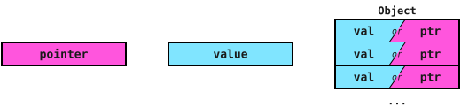

Visualization of a pointer (pink), primitive (blue) and an object
:::

I/O devices behave similarly to objects in that they also have an XLEN-wide length as well as XLEN-wide tags.
In contrast to objects, the length of an I/O device is fixed by the hardware and cannot be influenced by software.
For consistency, the tags of I/O devices are encoded the same way as the tags of objects.
They are undefined after reset and have to be set up correctly by the system management software using the [st](#st) instruction.
I/O devices are uniquely identified by their device number.

::: figure
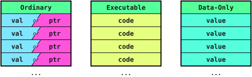

Ordinary, executable and data-only objects
:::

## Object tags {#isa_tags}

::: encoding
| implementation specific | scratch | permissions || kind ||||
| 31:8                    | 7:6     | 5           | 4   | 3    | 2         | 1          | 0        |
| :---------------------: | :-----: | :---------: | :-: | :--: | :-------: | :--------: | :------: |
| ...                     | ...     | r           | w   | io   | data only | executable | ordinary |
:::

The tags of an object or I/O device are represented by an XLEN-wide word which can be read and written by the system management software using the privileged [lt](#lt) and [st](#st) instructions.
They are made up of the kind bits, the permission bits, two scratch bits and the implementation specific bits.

The kind bits determine what an object may be used for. Exactly one of them is set for every object or I/O device.

Objects having their 'ordinary' bit set are denoted as ordinary objects.
Such objects may hold any data meaning both primitives and pointers may be stored in an object of this kind.
In order to enforce the separation of instructions and data however, instructions may not be fetched from such objects and executed afterwards.

Objects having their 'data only' bit set are said to be data only objects.
Data only objects, unlike ordinary objects, may not contain pointers.
Just as with ordinary objects, it is not allowed to fetch and execute instructions from such objects.
By keeping pointers out of data only objects, it is possible to achieve an improvement of memory access efficiency in some implementations.
Another advantage of objects not containing any pointers is the reduction of the effort caused by garbage collecting these objects.

Objects having their 'executable' bit set contain instructions.
No instruction may explicitly access the contents of an object of this kind. Only the processor may implicitly read from executable objects to fetch instructions.
This makes it necessary for system management software to load in code in the form of a data only object and then alter its kind using the *st* instruction.

The 'io' bit marks the tags as belonging to an I/O device as described in the [objects and I/O devices](#objects_devices) section.

The permission bits 'r' and 'w' state whether an object or I/O device may be read or written using load and store instructions.
Both may be set or cleared in any combination, except for executable objects which always have both permission bits cleared.

The two scratch bits are not interpreted by the hardware and may be used freely by the system management software.
All bits above the scratch bits are implementation specific. Some of them may for example be reserved by a hardware garbage collector.
Note that information only required by an implementation, like whether an object is a frame object, is not part of the tags on ISA level.

## Pointers and primitives {#data_vs_pointers}

The RISC-V I' ISA differentiates between two data kinds in the register file and in memory: references to objects or I/O devices, called pointers, and regular data, being denoted as primitives.

Pointers have a total of two separate fields. One of those is a reference field containing either an objects base address or the number of an I/O device.\
A pointers second field always contains an index which may point to any byte of the referenced object or I/O device.
The pointer encoding has to allow pointers to cover the entire address space of the processor of XLEN bits.

A primitive like a number or a character may be arbitrarily modified just as it is possible in RISC-V.

For a pointer, in contrast, some restrictions apply regarding the way in which it may be modified.
Arithmetic or logic operations on a pointer and a primitive like additions or bitwise inversions modify the pointer as a regular address would have been modified by the executed operation.
This modification is achieved by only altering a pointers index field while the reference field stays unchanged. The result of such an operation therefore is a pointer again.
Note that pointers having an index reaching out of the bounds of an object or I/O device are allowed in both the register file and in memory.\
Operations on two pointers are restricted to subtraction (*sub*) as well as the logic operations *and*, *or* and *xor*. They are only allowed in the case that both pointers reference the same object or I/O device.
Such an operation acts only on the indices of both pointers and its result is a primitive. Any other arithmetic operation on two pointers, like an addition or a shift, leads to an *IncompatibleTypeException*.
The same restriction applies to ordered comparisons of two pointers: they act only on the indices of both pointers and are only allowed if both pointers reference the same object or I/O device.
Trying to execute any of these operations on two pointers referencing different objects or I/O devices leads to an *IncompatibleTypeException*.
To check whether two pointers reference the same object, the [bso](#so_fam) instructions are provided.\
Ordered comparisons of a pointer with a primitive are not allowed either and lead to an *IncompatibleTypeException*.
Equality comparisons (*beq*, *bne*), in contrast, are always allowed. Two pointers are equal if they reference the same object or I/O device with the same index.
A pointer and a primitive are never equal. Thus, comparing a pointer with the *zero* register always yields 'not equal', which matches the semantics of a null pointer check in C.
Note that *seqz* and *snez* are realized using *sltiu*/*sltu* in RISC-V and are therefore ordered comparisons, which may not be used on pointers.
In order to write the result of an equality comparison into a register nonetheless, a branch using *beq* or *bne* has to be used:

```asm
    li    a0, 0
    bne   a1, a2, 1f      # works for any combination of pointers and primitives
    li    a0, 1
1:
```

<!-- OPEN FOR DEBATE: dedicated seq/sne instructions in zhm would turn this sequence into a single instruction.
     They are seen as an optimization rather than a necessity, so the branch is used for now. -->

::::::

:::::: imp

## Pointer Arithmetics {#imp_ptr_idx}

::: figure


Composition of a pointer
:::

::: figure
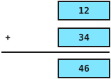
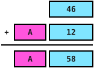
<!-- FIXME: the pointer plus pointer figures still show the old base address selection rule.
     Pointer plus pointer now yields a primitive for the same object and an exception otherwise. -->
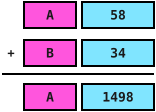
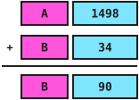

Different forms of arithmetics depending on the input types
:::

::::::

:::::: isa

## RISC-V I vs I' {#riscv_i_tick}

For the differentiation between pointers and primitives to be meaningful, RISC-ViO mandates that only pointers may be used to access memory via the object abstraction. The same is also true for accesses to I/O devices: Accesses to I/O devices are only possible via their corresponding pointers.
(Note that I/O devices only accept primitives. Pointers may not be written to I/O devices.)
This requirement influences all load and store instructions as listed below:

::: inline
- lb/lbu
- lh/lhu
- lw
- lwu (RV64)
- ld (RV64)
- sb
- sh
- sw
- sd (RV64)
:::

The main change for those instruction families lies in them requiring pointers to be used to select objects and I/O devices instead of memory locations.
Offsets from those pointers using the 12 bit immediate present in those instructions are still allowed.
Those offsets are added to the index of the pointer used to access the object to make up the offset used for the actual object or I/O device access.
Being explicit memory accesses in the case of pointers of memory kind, these instructions may only access ordinary as well as data only objects.
Pointers always occupy a whole XLEN wide, aligned element of an object.
Loading only part of an element holding a pointer using a narrower load (*lb*, *lbu*, *lh*, *lhu* as well as *lw*, *lwu* on RV64) leads to an *IncompatibleTypeException*.
A narrower store (*sb*, *sh* as well as *sw* on RV64) into an element holding a pointer first clears the whole element and then writes the stored bytes, overwriting the pointer.
XLEN wide loads and stores (*lw*/*sw* on RV32, *ld*/*sd* on RV64) work on elements holding pointers and primitives alike.
Whenever one of these rules is broken, the processor raises a hardware exception. Which exception is raised in which case is listed in the [exceptions](#exceptions) chapter.

<!-- FIXME (@Leyla): create a figure showing a load/store via pointer, index and offset -->

Since instructions are managed using executable objects, the semantics of even more instructions have to be altered:

::: inline
- auipc
- jalr
- jal
:::

The *auipc* instruction for example will emit a pointer instead of a primitive value.
Due to the access to executable objects being limited as described in the [object tags](#isa_tags) section however, access to constant data is not possible using this pointer.

The encapsulation of instructions also alters the semantics of *jalr*. Depending on the content of its source register, *jalr* behaves in one of two ways:
If the source register contains a pointer, this pointer has to reference an executable object. The program counter is then set to this pointer, with the immediate being added to its index.
For the separation of data and instructions, using a pointer to any other kind of object as jump target leads to an *IncompatibleTypeException*.
If the source register contains a primitive, *jalr* jumps to the index given by this primitive and the immediate inside the currently executed executable object.
In both cases, *jalr* will also, just as *jal* does, write a pointer to its destination register.
To make sure that a return address cannot be used twice, RISC-ViO mandates that the variant of *jalr* which realizes the *ret* pseudoinstruction has to null out the register *ra* except for its state tracking residue required for [frame ownership](#frame_ownership) after updating the program counter.

## Register file {#register_file}

The RISC-V ISA specifies 31 general-purpose registers and one special register, *zero*.
The RISC-ViO architecture adds additional requirements to this register file definition:

- each register has to be able to hold either a primitive of width XLEN or a pointer with a XLEN wide index.
- both *ra* and *sp* have to be able to hold colour information. (see [frames](#frames) chapter)

::: note
Note: The *zero* register has to contain the primitive value 0.
:::

# The zhm extension {#instructions}

In addition to the modifications of already existing instructions which are part of the RISC-V I base ISA, RISC-ViO introduces several instructions as an interface between software and hardware regarding objects.
Those instructions are all part of the zhm ("heap management") extension.

## Unprivileged instructions {#unpriv_instructions}

### Allocation: alc/alci/alc.d/alci.d {#alc_fam}

Since RISC-ViO manages objects on the ISA level, the ISA has to provide a means to create new objects and their corresponding pointers.
The creation of ISA level objects on the heap is achieved by the alc-instruction family which comes in four flavours.
In fact the alc instruction family is the only way to create new objects in user mode.
The next section provides a short description of those instructions alongside their bit encodings.
The objects allocated by the alc-instruction family are both readable and writable but not executable on allocation (their 'read' and 'write' bits are set).
Newly allocated objects only contain the primitive value 0.

In order for the system management software to influence where new objects are placed, the zhm extension introduces an additional machine mode CSR.
The CSR *malc* contains both the current allocation address, being the address of the object last allocated, as well as the heap limit, being the lowest address still part of the heap.
Those values are represented using a pointer, where the base address field contains the current allocation address and the index field contains the heap limit.
The CSR index of the *malc* CSR can be extracted from the [CSR table](#t_csr).

#### alc-instruction {#alc}

The *alc* instruction is the most basic form in its family. This instruction allows the allocation of an ordinary object where the size of the object is given by the value passed via rs2.
The size is given in bytes as per the value in rs2. Since objects are XLEN/8 byte granular, the size is rounded up to the next multiple of XLEN/8.

::: encoding
| 31:25   | 24:20     | 19:15 | 14:12 | 11:7     | 6:0     | Instruction |
| :-----: | :-------: | :---: | :---: | :------: | :-----: | :---------: |
| 0000000 | rs2 (src) | 00010 | 000   | rd (dst) | 0001011 | alc         |
:::

Assembly syntax: `alc rd, rs2` (rs2 holds the size in bytes)

When the *alc* instruction is used to allocate a frame by specifying *sp* as the destination register, its semantic is extended. In this case *alc* not only allocates a new frame object but also stores the old *sp* at index zero of the new frame object, making it the only field in the frame object which is not of primitive 0 value.

Note that the rs1 field of *alc* and *alci* is fixed to *sp* (00010).
Regardless of the destination register and regardless of what is actually encoded in this field, the decoder always reads *sp* via rs1 for these instructions, as the old *sp* has to be available in case a new frame object is allocated.
Since *alc.d* and *alci.d* may not allocate frame objects, this field is fixed to *zero* (00000) for them.

The alc instruction may trigger the following exceptions for the given events (xtval content):

- *HeapOverflowException*: Allocating the specified object would overflow the heap. (object_size as primitive)
- *IncompatibleTypeException*: rs2 contains a pointer, not a primitive (rs2)
- *ForbiddenDstException*: rd is ra (see [restricted registers](#restricted_regs)) (-)
- *GPAccessException*: rd is forbidden gp (-)

#### alci-instruction {#alci}

The *alci* instruction is a variation of the *alc* instruction. In contrast to *alc*, the size of the new object is given by the 12 bit wide immediate.
This immediate specifies the amount of pointers which can fit inside the object, meaning it is scaled by XLEN/8.
So for a XLEN of 32, it specifies the number of 32 bit words that fit into the object and is encoded as imm[13:2].
For a XLEN of 64, it specifies the number of 64 bit double words that fit into the object and is encoded as imm[14:3].
In assembly, the immediate is written as the size of the object in bytes (e.g. `alci a0, 16`), which has to be a multiple of XLEN/8. The assembler then encodes this size divided by XLEN/8.

::: encoding
| 31:25     | 24:20 | 19:15 | 14:12 | 11:7     | 6:0     | Instruction |
| :-------: | :---: | :---: | :---: | :------: | :-----: | :---------: |
| imm[13:2] / imm[14:3] || 00010 | 010   | rd (dst) | 0001011 | alci        |
:::

Assembly syntax: `alci rd, size` (size in bytes, a multiple of XLEN/8)

Please note that the *alci* instruction behaves the same way *alc* does when rd is *sp*.

The *alci* instruction may trigger the following exceptions for the given events (xtval content):

- *HeapOverflowException*: Allocating the specified object would overflow the heap. (object_size as primitive)
- *ForbiddenDstException*: rd is ra (see [restricted registers](#restricted_regs)) (-)
- *GPAccessException*: rd is forbidden gp (-)

#### alc.d-instruction {#alcd}

The *alc.d* instruction is a specialization of the *alc* instruction, allowing for the allocation of data only objects.
Note that it is also forbidden to use *alc.d* to allocate a new frame object.

::: encoding
| 31:25   | 24:20     | 19:15 | 14:12 | 11:7     | 6:0     | Instruction |
| :-----: | :-------: | :---: | :---: | :------: | :-----: | :---------: |
| 0000000 | rs2 (src) | 00000 | 001   | rd (dst) | 0001011 | alc.d       |
:::

Assembly syntax: `alc.d rd, rs2`

The *alc.d* instruction may trigger the following exceptions for the given events (xtval content):

- *HeapOverflowException*: Allocating the specified object would overflow the heap. (object_size as primitive)
- *IncompatibleTypeException*: rs2 contains a pointer, not a primitive (rs2)
- *ForbiddenDstException*: rd is sp or ra (see [restricted registers](#restricted_regs)) (-)
- *GPAccessException*: rd is forbidden gp (-)

#### alci.d-instruction {#alcid}

The *alci.d* instruction is the analogous form of *alci* regarding data only objects. It differs in the kind of allocated object and in that it also is prohibited from allocating frames.

::: encoding
| 31:25     | 24:20 | 19:15 | 14:12 | 11:7     | 6:0     | Instruction |
| :-------: | :---: | :---: | :---: | :------: | :-----: | :---------: |
| imm[13:2] / imm[14:3] || 00000 | 011   | rd (dst) | 0001011 | alci.d      |
:::

Assembly syntax: `alci.d rd, size`

The *alci.d* instruction may trigger the following exceptions for the given events (xtval content):

- *HeapOverflowException*: Allocating the specified object would overflow the heap. (object_size as primitive)
- *ForbiddenDstException*: rd is sp or ra (see [restricted registers](#restricted_regs)) (-)
- *GPAccessException*: rd is forbidden gp (-)

### Attribute query: qsz {#qsz}

The *qsz* instruction provides a means of reading an objects size in bytes as specified at its allocation time. For this, the source register has to contain a pointer.
Since object sizes are rounded up to multiples of XLEN/8 on allocation, the size returned by *qsz* is always a multiple of XLEN/8 as well.

::: encoding
| 31:25   | 24:20 | 19:15     | 14:12 | 11:7     | 6:0     | Instruction |
| :-----: | :---: | :-------: | :---: | :------: | :-----: | :---------: |
| 0000000 | 00000 | rs1 (src) | 100   | rd (dst) | 0001011 | qsz         |
:::

Assembly syntax: `qsz rd, rs1`

The *qsz* instruction may trigger the following exceptions for the given events (xtval content):

- *IncompatibleTypeException*: rs1 contains a primitive, not a pointer (rs1)
- *ForbiddenDstException*: rd is sp or ra (see [restricted registers](#restricted_regs)) (-)
- *GPAccessException*: rd is forbidden gp (-)

### Check object identity: bso {#bso}
Because ordered compares of two pointers referencing different objects is forbidden in this architecture, we provide a way for users to check for object identity to prevent undesired behaviour. The bso instruction takes two pointers in rs1 and rs2 and adds the displacement immediate to the pc's index if they reference the same object or does nothing if not.  
::: encoding
| 31:25   | 24:20 | 19:15     | 14:12 | 11:7     | 6:0     | Instruction |
| :-----: | :---: | :-------: | :---: | :------: | :-----: | :---------: |
| imm[12\|10:5]  | rs2 (src)| rs1 (src) | 111   | imm[4:1\|11]  | 0001011 | bso         |
:::

Assembly syntax: `bso rs1, rs2, offset`

The *bso* instruction may trigger the following exceptions for the given events (xtval content):

- *IncompatibleTypeException*: rs1 or rs2 contain a primitive, not a pointer (rs1 or rs2)

## Privileged Instructions {#priv_instructions}

With the instructions described above, it is impossible to break out of the restrictions given by the bounds check and pointer integrity safety measures. It is also not possible to influence object behaviour regarding permissions.
To enable the management of the processor system, which requires low level control over these features, additional instructions are available for all privilege modes above the user mode.

### Raw pointer access: sep/btd/itd/dtp {#raw_ptr_access}

In order to be able to create and inspect pointers a total of four instructions are provided. These allow for asserting that a register contains a pointer, reading out the integral parts of a pointer as well as creating arbitrary pointers.

#### sep-instruction {#sep}

The *sep* 'set if pointer' instruction allows for checking for the kind of value present in a register. When the register given by rs1 contains a primitive, a primitive of value 0 is written into the register given by rd.
Otherwise, a non 0 primitive value is written to this register.

::: encoding
| 31:25   | 24:20 | 19:15    | 14:12 | 11:7    | 6:0     | Instruction |
| :-----: | :---: | :------: | :---: | :-----: | :-----: | :---------: |
| 1111110 | 00000 | rs1(ptr) | 000   | rd(tag) | 1110011 | sep         |
:::

Assembly syntax: `sep rd, rs1`

#### btd-instruction {#btd}

The btd 'base to data' instruction allows for reading out a pointers base address. This primitive value is written into rd for the pointer given in rs1.

::: encoding
| 31:25   | 24:20 | 19:15    | 14:12 | 11:7    | 6:0     | Instruction |
| :-----: | :---: | :------: | :---: | :-----: | :-----: | :---------: |
| 1101111 | 00000 | rs1(ptr) | 000   | rd(dst) | 1110011 | btd         |
:::

Assembly syntax: `btd rd, rs1`

The *btd* instruction may trigger the following exceptions for the given events (xtval content):

- *IncompatibleTypeException*: rs1 contains a primitive, not a pointer (rs1)

#### itd-instruction {#itd}

The *itd* 'index to data' instruction allows for reading out a pointers raw pointer index. This primitive value is written into rd for the pointer given in rs1.

::: encoding
| 31:25   | 24:20 | 19:15     | 14:12 | 11:7     | 6:0     | Instruction |
| :-----: | :---: | :-------: | :---: | :------: | :-----: | :---------: |
| 1011111 | 00000 | rs1 (ptr) | 000   | rd (dst) | 1110011 | itd         |
:::

Assembly syntax: `itd rd, rs1`

The *itd* instruction may trigger the following exceptions for the given events (xtval content):

- *IncompatibleTypeException*: rs1 contains a primitive, not a pointer (rs1)

#### dtp-instruction {#dtp}

The dtp 'data to pointer' instruction allows for the assembly of arbitrary pointers. Both the base address and the index are set according to the values in registers rs1 and rs2 respectively. The result is stored in rd.
This way, *dtp* is also used to link a pre-existing, memory-mapped I/O device to a pointer.
The *st* instruction is then used to set the tags of this I/O device such that they represent how the I/O device may be used (see [objects and I/O devices](#objects_devices)).

::: encoding
| 31:25   | 24:20    | 19:15      | 14:12 | 11:7     | 6:0     | Instruction |
| :-----: | :------: | :--------: | :---: | :------: | :-----: | :---------: |
| 0111111 | rs2 (ix) | rs1 (base) | 000   | rd (dst) | 1110011 | dtp         |
:::

Assembly syntax: `dtp rd, rs1, rs2` (rs1 holds the base address, rs2 the index)

The *dtp* instruction may trigger the following exceptions for the given events (xtval content):

1. *IncompatibleTypeException*: rs1 contains a pointer, not a primitive (rs1)
2. *IncompatibleTypeException*: rs2 contains a pointer, not a primitive (rs2)

### Object tag access: lt/st {#lt_st}

In order for a system software to gain control over the tags that make up an objects traits, additional instructions are required. Both read and write access to these tags is possible using the instructions introduced below.

#### lt-instruction {#lt}

The *lt* instruction enables reading out the tags of an object by placing the tags of the object or I/O device pointed to by the contents of rs1 into the register rd in the form of a primitive.
For information on how these tags are encoded, please refer to the discussion of [tags on ISA level](#isa_tags).
*lt* always returns the tags on ISA level. How an implementation represents them in memory is never visible to software.

::: encoding
| 31:25   | 24:20 | 19:15     | 14:12 | 11:7      | 6:0     | Instruction |
| :-----: | :---: | :-------: | :---: | :-------: | :-----: | :---------: |
| 1110111 | 00000 | rs1 (ptr) | 000   | rd (tags) | 1110011 | lt          |
:::

Assembly syntax: `lt rd, rs1`

The *lt* instruction may trigger the following exceptions for the given events (xtval content):

- *IncompatibleTypeException*: rs1 contains a primitive, not a pointer (rs1)

#### st-instruction {#st}

The *st* instruction is the companion of the *lt* instruction, allowing object or I/O device tags to be written. For this, *st* sets the tags of the object or I/O device being referenced by the content of the rs1 register to the tags provided in rs2 in form of a primitive.
*lt* and *st* are completely symmetric: the tags returned by *lt* can be passed to *st* unchanged and vice versa.

::: encoding
| 31:25   | 24:20    | 19:15     | 14:12 | 11:7  | 6:0     | Instruction |
| :-----: | :------: | :-------: | :---: | :---: | :-----: | :---------: |
| 1111011 | rs2 (sd) | rs1 (ptr) | 000   | 00000 | 1110011 | st          |
:::

Assembly syntax: `st rs1, rs2` (rs1 holds the pointer, rs2 the tags)

The *st* instruction may trigger the following exceptions for the given events (xtval content):

1. *IncompatibleTypeException*: rs1 contains a primitive, not a pointer (rs1)
2. *IncompatibleTypeException*: rs2 contains a pointer, not a primitive (rs2)

### Memory clearing: clr {#clr}

To enable garbage collection in software, it is necessary to be able to clear out certain memory regions.
This is a consequence of mandating that newly allocated objects may only contain the primitive value 0.
A garbage collector implemented in software is able to use the *clr* instruction to ensure that this requirement is met.
This is achieved by this instruction writing the primitive value 0 of XLEN width to the memory address given by the contents of register rs1.
This address has to be aligned accordingly.

::: encoding
| 31:25   | 24:20 | 19:15    | 14:12 | 11:7  | 6:0     | Instruction |
| :-----: | :---: | :------: | :---: | :---: | :-----: | :---------: |
| 1111101 | 00000 | rs1(addr) | 000   | 00000 | 1110011 | clr         |
:::

Assembly syntax: `clr rs1`

The *clr* instruction may trigger the following exceptions for the given events (xtval content):

1. *IncompatibleTypeException*: rs1 contains a pointer, not a primitive (rs1)
2. *Store/AMO address misaligned*: primitive in rs1 is not aligned

# The not so stacked frames {#frames}

In order to protect the local data as well as control flow data of a function, RISC-ViO alters the concept of what is called a stack in conventional architectures.
To protect the stand-ins for this stack, the so-called frame objects or frames, from malicious or accidental modification by foreign functions, RISC-ViO introduces additional protection mechanisms for these frame objects.

Apart from objects for ordinary data storage the I' ISA also manages the stack as a series of objects. This partition of the stack in a single frame per function allows for further security mechanisms but also requires cooperation by the program.
Most notably, the stack is not grown by arithmetically modifying the stack pointer. Instead, the program has to manually allocate a new frame object. Once this frame object has been allocated, accesses to inside this object behave just the way the stack frame in RISC-V behaves.\
Due to the stack pointer register now containing a pointer, I' is able to protect older frame objects from accesses by arithmetical modification of sp.
The implications for the passing of function arguments between functions are outlined in the [calling convention](#chap_calling_convention) chapter.

Since every newly allocated frame object holds a pointer to its predecessor at index zero, the frame objects of a program form a singly linked list.
In contrast to a conventional stack, these frame objects do not have to lie next to each other in memory. Instead, they are placed on the heap just like any other object.
Returning to the previous frame object is achieved by loading *sp* from this slot, which makes the current frame object unreachable and allows it to be removed by the garbage collector.

## Structure {#are_obj}

Frame objects are based on ordinary objects but differ in the accesses which are allowed on them.
Most notably, frame objects can only be accessed through *sp* as described in the [restricted registers](#restricted_regs) section.
Frame objects are never data only which means the 'data only' flag is cleared.
To protect both the stack pointer *sp* as well as the return index *ra*, in frame objects special slots are reserved. For the 'stack' pointer *sp*, the pointer to the previous frame object, the first slot of XLEN size at byte index zero is reserved.
This is immediately followed by the *ra* slot which is also XLEN wide. For XLEN=32, this slot resides at byte index 4, for XLEN=64 at byte index 8.
In user mode, these slots of a frame object are only allowed to be used to store or load their respective register. Any other operation on these slots will lead to a *ForbiddenDstException* or *ForbiddenSrcException*.
Note that it is not only prohibited to store any other register than *sp* and *ra* in those slots, but also to store these registers anywhere else when not in a privileged mode.
This also holds for functions which do not save *ra* at all: the *ra* slot may never be used for anything else, which is why compilers have to place other spill slots behind it. The same restriction also applies when loading these registers.
These restrictions are enforced using *ForbiddenDstException* and *ForbiddenSrcException*.

::: figure
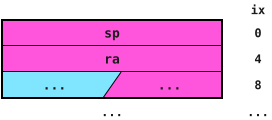

A frame object for XLEN=32
:::

All other slots are general purpose and access to them is not restricted in any way.

<!-- FIXME: setjmp/longjmp are not covered yet. User code cannot implement them, since it would have to copy ra
     out of its slot and write sp by hand. They need a supervisor service (or ISA support) that keeps the saved
     context in a protected object, otherwise a program could forge the saved return address. -->
<!-- FIXME: thread local storage (tp) is not covered yet. -->

## Calling convention {#chap_calling_convention}

As described in the introduction to this chapter, RISC-ViO denies foreign access to frame objects. As a consequence, the calling convention has to be modified slightly from the convention used by RISC-V.
Namely, it is not possible to pass function arguments on the stack. Instead, the following scheme is employed:

The registers *a0* to *a6* carry arguments, assigned just as in the conventional RISC-V calling convention (e.g. a 64 bit value takes a register pair for XLEN=32).
The register *a7* is never used as an argument register.
Arguments which would be passed on the stack in conventional RISC-V are stored in a so-called argument object instead.
The caller allocates this object using *alc*/*alci*, stores the remaining arguments at the offsets they would have had on the stack and passes a pointer to the argument object in *a7*.
Since arguments may be pointers, argument objects may not be data only. The callee loads its arguments through *a7*.
As nothing is ever passed on the stack, frame objects contain neither an outgoing argument area nor incoming arguments.

The variable arguments of variadic functions are packed into an object as well, using one XLEN wide slot per argument (2·XLEN aligned for 2·XLEN aligned types).
A pointer to this object is appended as the last fixed argument and is therefore passed in a register or in the argument object.

Return values and callee-saved registers follow the conventional RISC-V calling convention, with *ra* being saved in its slot at byte index XLEN/8 of the frame object.

## Frame ownership {#frame_ownership}

To achieve protection of frames from foreign accesses RISC-ViO uses so-called colour tags for both the *sp* and the *ra* register.
By updating those colours at critical points such as function entries/exits and frame allocations, the processor always knows whether the frame pointed to by the
*sp* register is owned by the currently executed function.
This state is called "regular", while the current function not being the owner of the current frame is denoted as the "irregular" state.

For *sp* as well as for *ra*, there are two colours: black and white. Those colours are an integral part of those registers and cannot be read or modified separately from their registers.
Also, when storing/loading *ra* and *sp* using *sw/lw*, their colour is also stored/retrieved to/from their slots.
An overview of the transition between those colours is given in the [colour transitions figure](#fig-colour-transitions).
On every function entry, signified by a call instruction (*jal* or *jalr* with *ra* as destination register), the processor flips the colour of ra from white to black or vice versa. The same also happens when a function is exited using *jalr zero, ra, 0 (ret)*. For *sp*, this takes place on every frame allocation using the *alc/alci* instructions.
Whether the processor is currently in the regular state (light blue), is given by the equality of the colours of ra and sp.
If the colours of *sp* and *ra* both were black for example, the processor would be in the regular state, allowing access to the current frame.

::: {#fig-colour-transitions .figure}
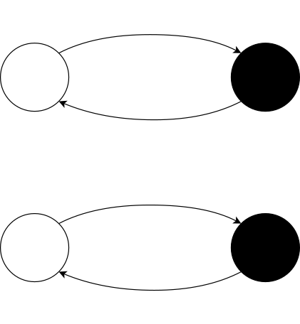

Colour transitions
:::

The [state transitions figure](#fig-state-transitions) provides two sample program flows for which the colour and therefore state transitions are shown.
Part a) of this figure shows the behaviour of the colour mechanism during the execution of a correct stream of instructions while part b) highlights how this mechanism catches bad program behaviour.
In part b) the colour mechanism spots function b trying to access function a's frame, which leads to the processor raising a *StateException*.

::: {#fig-state-transitions .figure}
 Transitions during normal program flow")
 Transitions during abnormal program flow with exception")

State transitions two instruction streams
:::

# Global offset table {#got}

The use of executable objects rules out jumps to fixed addresses. Loading and storing data at fixed addresses is incompatible with the object approach as well, since an integral address is a primitive and not a pointer.
In conventional architectures, addresses which are unknown at compile time are resolved using Global Offset Tables (GOTs).
In RISC-ViO, the GOT becomes the only way for a program to reach anything outside of its own code: functions of other programs and libraries, but also its own data, constants and string literals.
As a consequence, RISC-ViO programs never contain absolute address relocations like *R_RISCV_HI20*/*R_RISCV_LO12*.
All code is position independent and is linked as a position independent executable (PIE).

## Global pointer {#gp}

The GOT of a program is an ordinary object of its own. Unlike conventional GOTs, its slots do not hold integral addresses but pointers.
In RISC-ViO, the GOT is always accessible via the register *x3* (*gp*), which references index 0 of the GOT object.

RISC-ViO requires executable objects to hold a pointer to the GOT of the program they belong to. This pointer always has to reference index 0 of the GOT object.
In user mode, this pointer is not accessible directly but has to be set up by the system management software instead.
On every jump into another executable object using *jalr*, the hardware sets *gp* to the GOT pointer of the executable object being jumped into.
Since this also applies to returns using *ret*, a call into a shared library switches *gp* to the GOT of the library and the corresponding *ret* switches it back to the GOT of the caller.
Apart from this mechanism, *gp* is never written by user code (see [restricted registers](#restricted_regs)).

Note that *mret* and *sret* do not load *gp*. Before entering an executable object using one of these instructions, the system management software has to set *gp* to the corresponding GOT pointer itself.
The same applies to traps: on entering a trap handler, *gp* still references the GOT of the interrupted program.

Since loads relative to *gp* use the signed 12 bit offset of the load instruction and *gp* references index 0 of the GOT object, only the offsets 0 to 2047 are reachable.
This limits the GOT to 512 slots for XLEN=32 and 256 slots for XLEN=64. The first of those slots is reserved by the linker.

<!-- FIXME: with one GOT slot per static object (see loading a program), real programs will easily exceed 511 slots.
     Fine granularity is a must, so the limit has to be lifted. Putting a helper object into the last slot would
     work, but would ruin the exclusivity of gp, since the helper would be accessed through another register.
     Possible alternative: a dedicated GOT load instruction which uses gp implicitly. Without an rs1 field, it has
     a 17 bit immediate, which, scaled by XLEN/8, would reach 131072 slots for XLEN=32 while keeping gp exclusive. -->

## Accessing addresses {#static}

Addresses of functions and data objects, including string literals, constant pools and jump tables, are always loaded from the GOT:

```asm
lw      a0, %got_off(symbol)(gp)    # ld on RV64
```

To tell the linker that a GOT slot has to be created for a symbol, the assembler modifier *%got_off(symbol)* along with the relocation type *R_RISCV_GOT_OFF* is introduced.
The linker replaces *%got_off(symbol)* by the offset of the symbols slot from the start of the GOT, similar to how the assembler modifiers *%hi*, *%lo* etc. are handled.
These offsets are resolved completely at link time. Only the slots themselves require work at load time, using the standard dynamic relocations of RISC-V:
*R_RISCV_RELATIVE* for targets inside the program and *R_RISCV_32*/*R_RISCV_64* along with the symbol for targets outside of it.
A call and the address of the same function share a single slot.

Since code and read-only data are separate objects, jump tables can neither be part of the code nor hold absolute addresses.
Instead, their entries hold the distance of each target from the start of the function the jump table belongs to. The base of this distance is the address of the function itself, which is obtained using *auipc*.

## Making calls {#library_calls}

Since *ra* may only be written by jumps, the standard call sequence uses *t1* instead of *ra* as temporary register:

```asm
auipc   t1, %pcrel_hi(symbol)
jalr    ra, %pcrel_lo(symbol)(t1)
```

The compiler always emits this sequence, as it cannot know where a callee will end up. Instead, the linker decides whether a call stays pc-relative:

| Callee                                                                  | Call becomes                                 | GOT slot                                   |
| :---------------------------------------------------------------------- | :------------------------------------------- | :----------------------------------------- |
| defined in the programs own code and not preemptible                    | *auipc* + *jalr*, relaxable to *jal*         | none                                       |
| defined in a shared library, preemptible or forced through the GOT      | GOT call                                     | *R_RISCV_32*/*R_RISCV_64* or *R_RISCV_RELATIVE* |
| undefined weak                                                          | GOT call, guarded by the programs null check | the loader writes the primitive value 0    |

For a GOT call, the linker rewrites the *auipc* into a load from the GOT and sets the immediate of the *jalr* to zero. This way, the sequence keeps its length of 8 bytes:

```asm
lw      t1, %got_off(symbol)(gp)    # ld on RV64
jalr    ra, 0(t1)
```

GOT calls are never relaxed to *jal*.
There is no procedure linkage table (PLT) and no lazy binding: every slot is filled at load time and a GOT call loads its target inline.

## Loading a program {#loading}

Programs and shared libraries are loaded by a loader running in supervisor mode.
For every image, starting with the program and followed by every library it depends on, the loader performs the following steps:

1. For every static object in the data and read-only segments, an object of the corresponding size is allocated using *alc* and the contents of the static object are copied into it. Since allocated objects only contain the primitive value 0, this also covers zero-initialised data like *.bss*. Static objects from read-only segments never contain pointers in a PIE. They are therefore placed in data only objects whose write permission is revoked using *st* right after copying, since relocations never write to them.
2. The GOT is placed in an ordinary object of its own.
3. For every code segment, an ordinary object of XLEN/8 bytes plus the segments memory size is allocated. The GOT pointer is stored at index 0 of this object, the object is retyped as data only, the instructions are copied in starting at index XLEN/8 and the object is finally retyped as executable (see [executables](#execs)).

Then, starting with the libraries, the loader applies the dynamic relocations:

- *R_RISCV_RELATIVE*: the addend is an address inside the same image at link time. The slot is set to a pointer into the object holding the corresponding static object or code segment, with the index being the distance of the addend from the start of it. For code objects, an additional skew of XLEN/8 bytes has to be added as described in [executables](#execs). This is plain pointer arithmetic on objects created by the loader, so no *dtp* is required.
- *R_RISCV_32*/*R_RISCV_64*: the symbol is looked up in the global scope (program first, then libraries) and the resulting pointer is stored into the slot using an XLEN wide store. An undefined weak symbol results in the primitive value 0, an undefined strong symbol is an error.

Finally, the program is entered using a pointer into its code object. If this is done using *jalr*, *gp* is set to the GOT of the program by the hardware.
If the program is entered in user mode using *mret* or *sret* instead, the loader has to set *gp* to the GOT of the program beforehand.
The stack pointer *sp* needs no preparation either, since the first prologue of the program allocates a new frame object using *alc*/*alci*.
The only place where *dtp* is required is accessing the ELF files themselves, e.g. at a physical address where the boot code placed them.

In order for the loader to know where each static object begins and ends, the linker emits a data only header along with a size field in front of every static object in the data and read-only sections of an image, and every static object gets an entry in the GOT.
The headers are data only since the contents of an image are stored untagged. The loader then creates the actual objects as described above.
This way, bounds checks also apply between different static objects of a program, at the cost of one GOT slot per static object (see the size limit of the GOT in the [global pointer](#gp) section).

<!-- FIXME: the per-object headers are not implemented in the linker yet. The current toolchain allocates one object per
     segment, which only provides bounds checks at segment granularity. -->

The init arrays of a program are run by its startup code (*_start*), not by the loader.
Thread local storage, indirect functions (IFUNC), fini arrays as well as making relocated data read-only (RELRO) are not covered by this specification yet.

# Exceptions {#exceptions}

## Enforcing correct program behaviour {#gen}

To enforce the pointer based memory access scheme, the processor will raise an *IncompatibleTypeException* when a program tries to use a primitive value to access memory.
Since the object length is known on ISA level, the processor is able to raise a *IndexOutBoundsException* when an out of bound load or store instruction is executed.
In case of such an exception, *xtval* will contain the base pointer as well as the index which was beyond the object bounds.
The processor is also able to detect whether the destination object is compatible with the current access type by checking the permission tags of the object.
In consequence, *LoadAccessFault*, *StoreAccessFault* or *IncompatibleTypeException* are raised when the corresponding flag is not set as per [object tags](#isa_tags).
*LoadAccessFault*s are triggered when the 'read' flag is cleared while *StoreAccessFault* is raised in case of a store access to an object with cleared 'write' flag.
Trying to store pointers to a data only object marked by a set 'data only' flag will lead to a *IncompatibleTypeException*.
The same exception is triggered when trying to jump to an object which is not executable using *jalr*, when trying to do an arithmetic, logic or ordered comparison operation on two pointers referencing different objects or I/O devices, when trying any arithmetic operation other than *sub* on two pointers, when comparing a pointer with a primitive using an ordered comparison or when loading only part of an element holding a pointer.

Trying to access the register *gp* for anything other than as an access pointer in a memory instruction will lead to a *GPAccessException*.

To inform the software that an access to an ordinary or executable object would violate its bounds, a *JumpIndexOutBoundsException* is raised in case of an executable object or an *IndexOutBoundsException* in case of an ordinary object.
Should the heap onto which new objects are allocated on reach the end of its capacity, a *HeapOverflowException* is raised.

In the context of frame objects, a total of three exceptions are added to the exception list.
A *StateException* catches access to foreign frame objects as described in [frame ownership](#frame_ownership).
Even when a frame object is owned by the currently executed function, there are still two more exceptions possible: *ForbiddenDstException* is raised when trying to store anything else than *sp* or *ra* into their slots.
*ForbiddenSrcException* checks for using these slots as specified in case of load accesses as well as for *sp* being copied into another register (see [restricted registers](#restricted_regs)).

The *IncompatibleTypeException* is raised when a pointer is written to an I/O device using its corresponding pointer.

## Restricted registers {#restricted_regs}

Some registers play a special role in RISC-ViO, which is why only certain values may be written to them in user mode:

- *sp* only accepts pointers to frame objects. Such pointers are obtained by allocating a new frame object using *alc*/*alci* or by loading the *sp* slot of a frame object.
  Moving *sp* inside its frame object by arithmetic operations writing *sp* itself, like *add sp, sp, t*, is allowed.
- *ra* only accepts the results of call and return instructions as well as values loaded from the *ra* slot of a frame object.
- *gp* may only be used as access pointer of a memory instruction. It is never written by user code.

Writing any other value to *sp* or *ra* leads to a *ForbiddenDstException*, while any other access to *gp* leads to a *GPAccessException*.

Frame objects may only be accessed through *sp*. In user mode, *sp* may therefore only be used as base register of loads and stores, as source of arithmetic operations writing *sp* itself and as source of the stores to the *sp* slot of a frame object.
Using *sp* as a source of any instruction writing another register, like *mv rX, sp*, leads to a *ForbiddenSrcException*.
This way, a pointer to a frame object can never end up in any other register or in memory outside the frame chain, which is enforced by the hardware.
The exception lists of the individual instructions refer to this section.

## Exceptions in conjunction with CSR {#exc_csr}

Since RISC-ViO allows both pointers and primitive values to be stored in the registers and also organizes code using objects, some CSR also need to be able to hold pointers.
This is the case for *xtvec* and *xepc* due to executable objects and for *xtval* and *xscratch* due to pointers in general.
To access the components of these registers, the *csrw* instruction may be used in conjunction with the *dtp*/*btd*/*itd* instructions.
Apart from this slight modification as well as the expansion of available exceptions, exceptions and interrupts behave identical to the way they do in RISC-V.

## Exception masking {#priv}

The [exception table](#t_exc) provides an overview of the exceptions corresponding to the protection schemes introduced by RISC-ViO.
In order to allow higher privilege modes to gain the access required for system management, some exceptions are suppressed in certain privilege modes.

::::::

::: divider
ISA

---

implementation
:::

:::::: imp

# Primitives and pointers in the register file {#reg_fl}

Every RISC-ViO architecture requires a register file which is able to satisfy the requirements given in the [I'](#base_spec) chapter.
Apart from these requirements, RISC-ViO does not specify how a register file of an implementation of this architecture has to look like.
This leaves room for tailoring the implemented register file to the design constraints at hand.

::: note
(Please note that in this specification, pointers are written in the form x.y where x is a pointers base address and y is the index of the pointer. To graphically set apart pointers from primitives, pointers are drawn in various shades of pink and purple.
Primitives are not denoted in any special way in text form but drawn in light blue.)
:::

## Fields {#fields}

The subarchitecture implementation offered here is meant only as an example implementation and is focused on higher performance while requiring more hardware resources. The register sections required by the RISC-ViO specification are denoted with 'ISA' while sections introduced by this particular implementation are denoted with 'IMP'. In this implementation, the 'IMP' sections are exclusively made up of object header metadata drawn in green.

::: figure
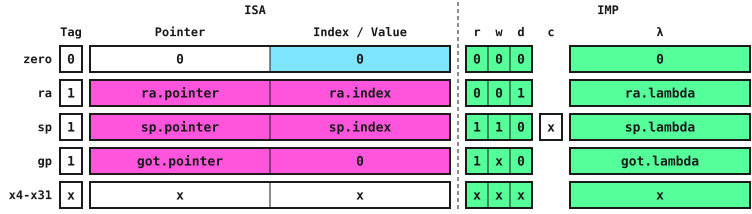

An example implementation of a RISC-ViO register file
:::

In the provided implementation, the hardware will update *gp* on every jump to another executable object. In case of exceptions, interrupts and code object changes due to *sret/mret*, it is the duty of the system management software to update *gp* accordingly.

## Colouring {#coloring}

As described in the [frames](#frames) chapter and as present in the requirements list in [I'](#base_spec), RISC-ViO calls for the ability to hold colour information for both the *ra* as well as the *sp* register.
The implementation presented here is able to satisfy this requirement using the fields as shown in the last section only. In this implementation, the colour 'black' is encoded as a cleared bit ('0') while 'white' corresponds to a bit which is set ('1').
Since the smallest possible instruction size specified by RISC-V is 16 bits or two bytes, the lowest bit of the index of *ra* always has to be 0.
This is why it is possible to encode the current colour of *ra* in this bit. For *sp*, the same is not true however since its index may be set to any value.
The colour of *sp* is instead stored in the current frames header copy in the register file. More specifically, the colour-bit in this header is used for storing *sp*'s colour.

## Flags and Tags {#flgs_tgs}

In order to distinguish pointers from primitives, the provided implementation uses a tag bit for all registers which may hold both primitives and pointers. Primitives are tagged as '0' while pointers are identified by a '1' bit.
Since on ISA level, RISC-ViO only distinguishes between pointers of memory and I/O kind, only a single bit in the register file is required to keep those pointer kinds apart.
This bit is interpreted as part of the pointer and is added to the right of the pointer base address or I/O device number for I/O pointers.

# Objects in memory {#hard_obj}

::::: columns

:::: column

## Headers {#headers}

Headers mark the beginning of every object. They hold all information about the object necessary to ensure proper handling of itself. Headers are always 16-Byte aligned.

::: figure
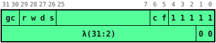

Header Bitmap on 32-Bit Architectures
:::

| Bits   | Sym. | Details                                                  |
| :----: | :--: | :------------------------------------------------------: |
| 31:30  | gc   | Reserved for the hardware garbage collector              |
| 29     | r    | Readable                                                 |
| 28     | w    | Writable                                                 |
| 27     | d    | Data-Only                                                |
| 26     | s    | Sanctuary                                                |
| 25:7   | sc   | Scratch space.<br>Shifted down to the scratch bits of the [object tags](#isa_tags) |
| 6      | c    | Color of frame objects.<br>See [Frames chapter](#frames) |
| 5      | f    | Frame object                                             |
| 4:0    | -    | Header identifier                                        |
|        |      |                                                          |
| 31:2<br>(63:3) | λ | Length of object<br>(only bits 31:2 on 32-Bit, 63:3 on 64-Bit) |
| _1_<br>_(2:1)_ | _-_ | _don't care_                                         |
| 0      | -    | Must be zero.<br>Guarantees a consistent memory model    |

_On a 64-Bit Architecture the upper bits of the header bitmap are shifted upwards to 64-Bit boundaries._

## Elements {#elements}

Elements of objects are tagged by the lowest Bit(s) in a chunk of memory.
On a 32-Bit architecture this chunk is 32 bits wide, on 64-Bit architectures 64 bits.

::: figure
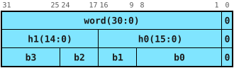

Word, half and byte locations in an ordinary object
:::

Primitives in ordinary objects are identified by the trailing *0*-Bit. If a Store is attempted, which would make the two uppermost bits of a chunk unequal (e.g. *bit-31 ≠ bit-30* on a 32-Bit Architecture)
then the primitive is stored to the current sanctuary object instead and the corresponding displacement pointer will be stored to the address the original store was attempted to.

::: figure
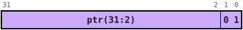

Pointer to displaced data
:::

These Pointers are identified by trailing *01*-Bits.

Pointers to objects are identified by trailing *0111*-Bits. They can be generated by allocation instructions and point to the head of ordinary, data-only and executable objects.

::: figure
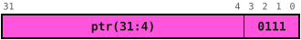

Pointer to an object
:::

If a store is attempted on a pointer that was modified by arithmetic instructions so that its index is unequal to zero, the pointer will be displaced into the current sanctuary object and only the displacement pointer
is stored to the original address the store was attemped to.

::: figure
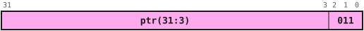

Pointer to a displaced Pointer
:::

These pointers are identified by trailing *011*-Bits.

Pointers to I/O-capabilities are identified by the trailing *01111*-Bits. They hold a device-id which identify what I/O-Device is referenced.

::: figure
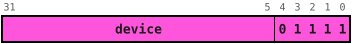

I/O-Pointer
:::

::::

:::: column

## Ordinaries {#ords}

Ordinary objects always start with a header and can hold every element kind defined.

::: figure
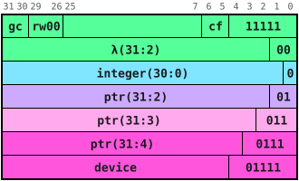

Ordinary object and its possible elements
:::

## Data-Only Objects {#data-onlies}

Data-only objects are identified by the data-only bit in the Header. Primitives inside of these objects are not tagged, so they make use of the whole 64|32 Bit per element.
Pointers are forbidden inside data-only objects.

Since primitives are stored tagged in ordinary objects but untagged in data-only objects, retyping an object holding data between these two kinds changes how its contents are interpreted.
A word of a data-only object with its lowest bit set would for example be read as a pointer once the object is retyped as ordinary.
System management software should therefore only retype objects between ordinary and data-only before filling them.

::: figure
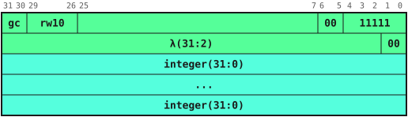

Data-only object
:::

## Executables {#execs}

Executables have only the data-only bit set in their header. This identifies them as an executable.\
As part of their header, executables have the pointer to their companion GOT stored at the third (double-)word of the object. The start of Code is then referred to as index 0 of the object.
It is stored in the same fashion as in data-only so they can harvest the full 64|32 bit of an element.

The GOT pointer always references index 0 of a separate GOT object. A pointer with a non-zero index would be displaced into the sanctuary object and could not be read as part of the header on a jump.

Note that the position of index 0 depends on the kind of an object: as long as an object is typed as ordinary or data only, index 0 refers to the GOT slot and the code starts at index XLEN/8.
Only once the object is retyped as executable, index 0 refers to the first instruction.
System management software building executable objects through the ordinary or data only layout therefore has to account for this skew of XLEN/8 bytes, e.g. when creating pointers into code.

::: figure
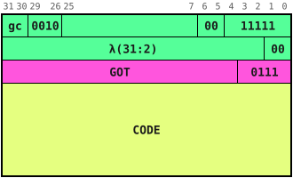

Executable Object
:::

## Sanctuaries {#sancts}

Sanctuaries only have the Sanctuary Bit set in their header. They are used as memory space for displaced primitives and displaced pointers and cannot be referenced by ordinary pointers.\
Displaced Pointers take two element slots, one for the base pointer and one for the index, thus are always aligned to 2-Element boundaries.
The base pointer is stored as an ordinary pointer and the index as data-only primitive.\
Displaced primitives only take one element slot being the (Double-)Word that was displaced. These kinds can be stored at any element position inside the Sanctuary.

<!-- FIXME: sanctuary objects need their own figure, this is still the data-only object figure -->

::: figure


Sanctuary Object
:::

::::

:::::

# Pointer and address generation {#ptr_addr}

The provided implementation example of the RISC-ViO architecture by using the object structures outlined above implies new requirements for a processor pipeline supporting this implementation.
In the next sections, a possible subarchitecture meeting those requirements shall be described.

## Allocations {#alcs}

In the presented implementation, all members of the alc instruction family place both ordinary and data only objects as well as frame objects on the heap.
There the objects lie in allocation order until a garbage collection cycle occurs. The CSR *malc* is used to keep track of the heap fill level and heap limit. *malc.ptr* keeps track of the newest objects start address while *malc.ix* contains the lower limit of the heap in form of an address.
In the process of such a cycle, objects may be moved or overwritten in case of not being required anymore.

The allocation process starts by calculating the address of the new object header.
This is given by rounding down the value given by the expression

$$
\mathrm{malc.ptr} - (2 \cdot \mathrm{XLEN}/8 + \mathrm{size})
$$

down to next number divisible by 16, where 2·XLEN/8 is the size of the object header (8 bytes for XLEN=32, 16 bytes for XLEN=64).
If this value is larger than malc.ix the new object fits inside the heap and malc.ptr is updated to this value.
In this case, a pointer tag is added to the newly calculated address and the resulting pointer value is written to the target register.
The initial index is set to zero.

To commit the header of this new object to memory, the so-called attribute cache is used.
This cache is located in the attribute stage located behind the memory stage and is mainly used to both retrieve and load object attributes.
In case of primitives with their two uppermost bits being unequal or pointers with non-zero index this cache is also used to both store and retrieve these kinds of data to and from memory.

::: figure
 Regular heap growth")
 Heap overflow")

Heap limits and growth.
:::

The given implementation uses sanctuary objects to cope with the requirement to distinguish between pointers and primitives in memory.
Any time a primitive with its two uppermost bits being unequal or a pointer with a non-zero index is stored, a slot of corresponding size and alignment in the current sanctuary object is used.
For primitives this alignment and size is XLEN/8 bytes while for pointers with index it is 2·XLEN/8 bytes.
The sample implementation has the sanctuary index point to the last used slot in the sanctuary object and decrements this index on every sanctuary slot allocation.

When the current sanctuary object is full, which is signified by the sanctuary index being zero, while a new sanctuary slot is required, a new sanctuary object is allocated.
For this, the current allocation address is decremented according to the implementation-dependant sanctuary object size and the sanctuary object address is set to this value.
Also, the sanctuary slot index is set to highest possible value for the new sanctuary object to be once again be filled from the top to the bottom.
In order to ensure the garbage collector being aware of this object, the attribute cache in the attribute stage also writes a header stub to the address at which the sanctuary object lies.
In the flags field of this header, the sanctuary bit marks this object as a sanctuary object.

In order to allow a system management software to control the allocation of sanctuary objects, a new CSR called *msad* is introduced. Consistent with *malc*, the pointer contained in this CSR has the address of the current sanctuary object as its base address field while the current allocation index in the sanctuary object is located in the index field of this CSR.
The CSR index of the *msad* CSR can be extracted from the [CSR table](#t_csr).

## Loading and storing a pointer {#load_store}

As the subarchitectural implementation requires some flag bit from the object header as well as its length or lambda field, those fields also have to be retrieved from memory when loading a pointer.
For this, the example subarchitectural implementation uses an additional pipeline stage called the attribute stage which is located behind the memory stage in the processor pipeline.\
The [instruction behaviour table](#t_instr_in_pipe) shows how this stage interacts with the stages that come before it, this section looks at this interaction in further detail.
After the memory stage has loaded a pointer, the attribute stage then loads the header being pointed to by the pointer base address. This header along with the actual pointer value is then handed over to the write-back stage which writes those fields into the register file.
In the given subarchitectural implementation, the attribute stage is used to accomplish additional tasks like loading full XLEN wide primitives, meaning primitives with their two uppermost bits being unequal, or a pointer with non-zero index from an object.
For the task of loading full XLEN wide primitives, it is the task of the attribute stage to load the actual primitive from memory instead of the memory stage.
This is necessary since the memory stage has to determine where this primitive is located in memory first by loading the according displacement pointer.
For pointers with a non-zero index, the attribute stage also has to become active. Since requiring both the loading of a pointers index as well as the header of the object pointed to, this operation takes two clock cycles however and therefore necessitates stalling the remaining pipeline until both operations have been completed.
In this situation, the attributes stage will load the pointer index before loading the object header and combining the loaded fields with the pointer value loaded by the memory stage and passing the combined register file entry to the writeback stage.

The process of storing register contents is analogous to the process of loading primitives as well as pointers regarding the fundamental tasks accomplished by the memory and attribute stages. The only difference other than those stages storing instead of loading is that the attribute stage might need to allocate a new 'Sanctuary object' to store XLEN wide primitives or pointers with non-zero index into.
This task is completed by a special subunit, which avoids the attribute stage having to stall the remaining pipeline when storing a XLEN primitive or pointer with non-zero index while also needing a new Sanctuary Object to be allocated.

## Bounds and Flag checks {#bounds}

As the outlined subarchitecture keeps the length of the corresponding object for each pointer in the register file, it is possible to check for an out of bound access as soon as the actual access index is available.
This can be the case as early as in the execute stage, which allows for early raising of *IndexOutBoundsException*s.
Since an objects flags which signify it as being readable, writeable and data only are also available as soon as the pointer to this object is available in the processor, the conditions for *LoadAccessFault* and *StoreAccessFault* exceptions can also be tested for just as early.

# Tables {#tables}

## Instructions (zhm extension) {#t_inst}

::: encoding
| 31:25     | 24:20    | 19:15    | 14:12 | 11:7    | 6:0     | Instruction |
| :-------: | :------: | :------: | :---: | :-----: | :-----: | :---------: |
| 0000000   | rs2(src) | 00010    | 000   | rd(dst) | 0001011 | alc         |
| imm[13:2] / imm[14:3] || 00010    | 010   | rd(dst) | 0001011 | alci        |
| 0000000   | rs2(src) | 00000    | 001   | rd(dst) | 0001011 | alc.d       |
| imm[13:2] / imm[14:3] || 00000    | 011   | rd(dst) | 0001011 | alci.d      |
| 0000000   | 00000    | rs1(src) | 100   | rd(dst) | 0001011 | qsz         |
| imm[12\|10:5] | rs2 (src)| rs1 (src) | 111 | imm[4:1\|11] | 0001011 | bso |
| 0111111   | rs2(ix)  | rs1(base) | 000  | rd(dst) | 1110011 | dtp         |
| 1011111   | 00000    | rs1(ptr) | 000   | rd(dst) | 1110011 | itd         |
| 1101111   | 00000    | rs1(ptr) | 000   | rd(dst) | 1110011 | btd         |
| 1110111   | 00000    | rs1(ptr) | 000   | rd(tags) | 1110011 | lt         |
| 1111011   | rs2(sd)  | rs1(ptr) | 000   | 00000   | 1110011 | st          |
| 1111101   | 00000    | rs1(addr) | 000  | 00000   | 1110011 | clr         |
| 1111110   | 00000    | rs1(ptr) | 000   | rd(tag) | 1110011 | sep         |
:::

## Object and pointer kinds {#t_op}

::::: columns

:::: column

#### Header


#### Primitive


#### Displacement pointer (primitive)


#### Displacement pointer (pointer)


#### Ordinary pointer


#### I/O-Pointer


::::

:::: column

#### Ordinary Object


#### Executable object


#### Data-only object


::::

:::::

## Exceptions {#t_exc}

<!-- FIXME: the xcause indices were moved from 16-23 to the custom use range 24-31, since 16-23
     partly collide with exception codes ratified by RISC-V (e.g. double trap, software check,
     hardware error). This is not implemented in hardware like this yet. -->

| *xcause index* | *Name*                      | *may be raised in privilege mode* |||
| ^^             | ^^                          | *user*                            | *supervisor* | *machine* |
| :------------: | :-------------------------: | :-------------------------------: | :----------: | :-------: |
| 24             | JumpIndexOutBoundsException | ✔                                 | ✔            | ✖         |
| 25             | GPAccessException           | ✔                                 | ✔            | ✖         |
| 26             | IndexOutBoundsException     | ✔                                 | ✔            | ✖         |
| 27             | HeapOverflowException       | ✔                                 | ✔            | ✖         |
| 28             | StateException              | ✔                                 | ✔            | ✖         |
| 29             | ForbiddenSrcException       | ✔                                 | ✖            | ✖         |
| 30             | ForbiddenDstException       | ✔                                 | ✖            | ✖         |
| 31             | IncompatibleTypeException   | ✔                                 | ✔<sup>1</sup> | ✔<sup>1</sup> |

::: notes
1. In supervisor and machine mode, the *IncompatibleTypeException* is only raised by the privileged instructions of the zhm extension (e.g. when trying to create a pointer from a pointer using *dtp*).
:::

## CSRs {#t_csr}

| *CSR index* | *Name* | *subfields*                       ||
| ^^          | ^^     | *ptr*                             | *index*                             |
| :---------: | :----: | :-------------------------------: | :---------------------------------: |
| 0xBC0       | MALC   | current allocation address          | heap limit address                |
| 0xBC1       | MSAD   | address of current sanctuary object | current index in sanctuary object |

## Example of a Heap {#t_heap}

::: {#heap .figure}
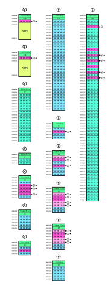{width=100%}
:::

## Instructions in a sample pipeline {#t_instr_in_pipe}

This table shows how a pipeline backend implementing the RISC-ViO architecture may look like.
For this, the fields of the content to be written to a register is shown in the EXecute, MEmory and the new ATtribute stage.
Also, for each stage the units which are active in this stage for the given instruction are listed. A result field value of 'pass' means that this pipeline stage will only pass along the value of rd from the prior stage while '~' means that rd is invalid and this instruction will not write anything to the register file.
The table lists the load and store instructions of RV32. On RV64, *ld* and *sd* behave like *lw* and *sw* in this table, while *lw*, *lwu* and *sw* behave like the sub-element loads and stores (*lb*/*sb* etc.).

|                            ||||| Fields and Actions by Stages ||||||||
|                            | register file indices |||       | EX                           || ME                   || AT first pass          || AT second pass ||
| Instruction                | rs1                   | rs2  | rd             | imm   | Actions                      | Results                                                    | Actions              | Results                          | Actions                | Results                         | Actions        | Results    |
| :------------------------- | :-------------------- | :--- | :------------- | :---- | :--------------------------- | :--------------------------------------------------------- | :------------------- | :------------------------------- | :--------------------- | :------------------------------ | :------------- | :--------- |
| lui                        | zero                  | zero | rd             | imm20 | ALU: add                     | rd: (T:prim, P:0, I:val, L:0, H:0)                         |                      | pass                             |                        | pass                            |                | pass       |
| auipc                      | zero                  | zero | rd             | imm20 | ALU: add                     | rd: (T:ptr, P:pc.ptr, I:val, L:pc.l, H:pc.hdr)             |                      | pass                             |                        | pass                            |                | pass       |
| jal                        | zero                  | zero | rd             | imm20 |                              | rd: (T:ptr, P:pc.ptr, I:pc.ix, L:pc.l, H:pc.hdr)           |                      | pass                             |                        | pass                            |                | pass       |
| jalr step 1                | rs1                   | zero | gp             | none  | AGU: addr                    | daddr                                                      | DC: load             | rd:(T:ptr, P:val, I:0, H:hdr, L:l) |                        | pass                            |                | pass       |
| jalr step 2                | rs1                   | zero | rd<sup>2</sup> | imm12 | DBU: b_tgt                   | rd: (T:ptr, P:pc.ptr, I:pc.ix, L:pc.l, H:pc.hdr)<sup>2</sup> |                      | pass                             |                        | pass                            |                | pass       |
| bcc                        | rs1                   | rs2  | zero           | disp  | ALU: comp DBU: (b_tgt)       | ~                                                          |                      | ~                                |                        | ~                               |                | ~          |
| arithi (any arith./logic op) | rs1                   | zero | rd             | imm12 | ALU: op=imm12 X rs1          | rd: (T:rs1.T, P:rs1.P, I:val, L:rs1.L, H:rs1.H)            |                      | pass                             |                        | pass                            |                | pass       |
| arithr (any arith./logic op) | rs1                   | rs2  | rd             | none  | ALU: op=rs2 X rs1            | rd: (T:val, P:val, I:val, L:val, H:val)<sup>1</sup>        |                      | pass                             |                        | pass                            |                | pass       |
| lb/lbu/lh/lhu              | rs1                   | zero | rd             | imm12 | AGU: addr                    | daddr                                                      | DC: lb/lbu/lh/lhu    | rd:(T:prim, P:0, I:val, H:0, L:0) |                        | pass                            |                | pass       |
| sb/sh<sup>3</sup>          | rs1                   | rs2  | zero           | imm12 | AGU: addr                    | daddr                                                      | DC: sb/sh            | ~                                |                        | ~                               |                | ~          |
| sb/sh<sup>4</sup>          | rs1                   | rs2  | zero           | imm12 | AGU: addr                    | daddr                                                      | DC: sw DU: alc_data  | caddr, six (sptr, aaddr)         | AC: sw (SA: alloc)     | ~                               |                | ~          |
| lw (primitive<sup>3</sup>) | rs1                   | zero | rd             | imm12 | AGU: addr                    | daddr                                                      | DC: load             | rd:(T:prim, P:0, I: val, H:0, L:0) |                        | pass                            |                | pass       |
| lw (primitive<sup>4</sup>) | rs1                   | zero | rd             | imm12 | AGU: addr                    | daddr                                                      | DC: load             | aaddr                            | AC: lw                 | rd: (T:prim, P:0, I:val, L:0, H:0) |                | pass       |
| lw pointer<sup>5</sup>     | rs1                   | zero | rd             | imm12 | AGU: addr                    | daddr                                                      | DC: load             | rd:(T:ptr, P:val, I:0, H:hdr, L:l) |                        | pass                            |                | pass       |
| lw pointer<sup>6</sup>     | rs1                   | zero | rd             | imm12 | AGU: addr                    | daddr                                                      | DC: load             | rd:(T:ptr, P:val)                | AC: lw                 | rd: ix_val                      | AC: lw         | rd: l, hdr |
| sw (primitive<sup>3</sup>) | rs1                   | rs2  | zero           | imm12 | AGU: addr                    | daddr                                                      | DC: sw               | ~                                |                        | ~                               |                | ~          |
| sw (primitive<sup>4</sup>) | rs1                   | rs2  | zero           | imm12 | AGU: addr                    | daddr                                                      | DC: sw, DU: alc_sadp | caddr, six (sptr, aaddr)         | AC: sw (SA: alloc)     | ~                               |                | ~          |
| sw pointer<sup>5</sup>     | rs1                   | rs2  | zero           | imm12 | AGU: addr                    | daddr                                                      | DC: sw               | ~                                |                        | ~                               |                | ~          |
| sw pointer<sup>6</sup>     | rs1                   | rs2  | zero           | imm12 | AGU: addr                    | daddr                                                      | DC: sw DU: alc_sadd  | caddr, six (sptr, aaddr)         | AC: sw (SA: alloc)     | ~                               |                | ~          |
| alc                        | sp                    | rs2  | rd             | none  | AGU: addr                    | rd: (T:ptr, P:val, I:0, L: val, H:val), aaddr,caddr        |                      | pass                             | AC: sw [object header] | pass                            |                | pass       |
| alci                       | sp                    | zero | rd             | imm12 | AGU: addr                    | rd: (T:ptr, P:val, I:0, L: val, H:val), aaddr,caddr        |                      | pass                             | AC: sw [object header] | pass                            |                | pass       |
| alc.d                      | zero                  | rs2  | rd             | none  | AGU: addr                    | rd: (T:ptr, P:val, I:0, L: val, H:val), aaddr,caddr        |                      | pass                             | AC: sw [object header] | pass                            |                | pass       |
| alci.d                     | zero                  | zero | rd             | imm12 | AGU: addr                    | rd: (T:ptr, P:val, I:0, L: val, H:val), aaddr,caddr        |                      | pass                             | AC: sw [object header] | pass                            |                | pass       |
| qsz                        | rs1                   | zero | rd             | none  | PGU: rd                      | rd: (T:prim, P:0, I:val, L:0, H:0)                         |                      | pass                             |                        | pass                            |                | pass       |
| bso                        | rs1                   | rs2  | zero           | disp  | ALU: comp DBU: (b_tgt)       | ~                                                          |                      | ~                                |                        | ~                               |                | ~          |
| dtp                        | rs1                   | rs2  | rd             | none  | AGU: addr                    | rd: (T:ptr, P:val, I:val), caddr                           |                      | pass                             | AC: lw [object header] | rd: (L:val, H:val)              |                | pass       |
| btd                        | rs1                   | zero | rd             | none  | PGU: rd                      | rd: (T:prim, P:0, I:val, L:0, H:0)                         |                      | pass                             |                        | pass                            |                | pass       |
| itd                        | rs1                   | zero | rd             | none  | PGU: rd                      | rd: (T:prim, P:0, I:val, L:0, H:0)                         |                      | pass                             |                        | pass                            |                | pass       |
| sep                        | rs1                   | zero | rd             | none  | PGU: rd                      | rd: (T:prim, P:0, I:val, L:0, H:0)                         |                      | pass                             |                        | pass                            |                | pass       |
| lt                         | rs1                   | zero | rd             | none  | PGU: rd                      | rd: (T:prim, P:0, I:val, L:0, H:0)                         |                      | pass                             |                        | pass                            |                | pass       |
| st                         | rs1                   | rs2  | zero           | none  | AGU: addr                    | aaddr                                                      |                      | ~                                | AC: sw [object header] | ~                               |                | ~          |
| clr                        | rs1                   | zero | zero           | none  | AGU: addr                    | daddr                                                      | DC: sw               | ~                                |                        | ~                               |                | ~          |

Abbreviations used in the table:

::::: columns

:::: column

- daddr: data cache address
- aaddr: attribute cache address
- caddr: malc current address
- six: sanctuary slot index
- sptr: sanctuary object pointer

::::

:::: column

- T: tag (prim=primitive, ptr=pointer)
- P: pointer value
- I: pointer index or primitive value
- L: object length
- H: object header
- DU: displacement unit (manages displacement to sanctuary objects)
- SA: sanctuary allocator

::::

:::: column

- DC: data cache
- AC: attribute cache
- AGU: address generation unit
- ALU: arithmetic logic unit
- DBU: dynamic branch unit
- PGU: pointer generation unit

::::

:::::

::: notes
1. The values of T, P, L and H are dependent on both the values of rs1, rs2 as well as the given operation, following the rule outlined in the [pointers and primitives](#data_vs_pointers) section.
2. For the ret variant of jalr, the target index of rd used for the writeback into the register file is ra while the target value is only the color bit in the index field with everything else being zero.
3. For bit XLEN-1 = bit XLEN-2
4. For bit XLEN-1 ≠ bit XLEN-2
5. For index = 0
6. For index ≠ 0
:::

::::::

# References {#chap_refs}

::: references
[^meyer_orisc]: M.Meyer: "A Novel Processor Architecture with Exact Tag-Free Pointers" in Proceedings of the 2nd Workshop on Application Specific Processors., 2003.
[^llvm_gep]: <https://llvm.org/docs/LangRef.html#getelementptr-instruction>, Last accessed 09.03.2025
:::

# Appendix {#appendix}

## Boot Process {#boot}

After system reset, all registers are initialised with the primitive value 0. Also, both *malc* and *msad* contain the value 0x0.0x0.
Regarding [frame ownership](#frame_ownership), the colour of *sp* is white (1) after reset while the colour of *ra* is black (0), which means that the processor starts up in the irregular state.

<!-- FIXME: the reset state of the colours (sp = 1, ra = 0) needs further discussion -->

The subarchitectural registers that contain the current executable object length and index also contain the value 0.

### Boot image {#boot_image}

The boot image is loaded at physical address zero. Since there is no loader yet at that point, all objects of the system management software are laid out in the image by the linker, including their headers.
Each object starts at a 16 byte aligned address, and the next object follows at the next 16 byte aligned address after the end of the previous one.

| Object                      | Kind       | Content                                                                                      |
| :-------------------------- | :--------- | :------------------------------------------------------------------------------------------- |
| code                        | executable | header with GOT slot at address zero, first instruction at address 0xC                      |
| read-only data              | data only  | constants and string literals, used in place                                                 |
| writable data (template)    | data only  | GOT, tables of pointers, initialised data and zero-initialised data                          |
| relocations                 | data only  | the dynamic relocations of the system management software                                    |
| files                       | data only  | one object per appended ELF file (program first, then libraries), ended by an empty object   |

All data objects of the image are data only, since the image holds every word untagged, just as data only objects store them in memory (see [data-only objects](#data-onlies)).
Read as ordinary objects, the same words would be interpreted differently and could even be mistaken for pointers.
As the appended files are read in place and stay in use while the program runs, the heap set up by *malc* must not overlap the image.

### Boot sequence {#boot_sequence}

Directly after reset, the program counter is not a pointer yet. In this raw mode, only straight-line code is possible. The system management software therefore starts as follows:

1. Both *malc* and *msad* are set to reasonable values using the *csrw* instruction.
2. An ordinary object of the size of the writable data template is allocated using *alc* and the template is copied into it word by word. This way, every word is stored the way ordinary objects hold primitives. Index 0 of this copy is the start of the GOT.
3. A pointer to the code object is created using *dtp*. Using *st*, the code object is retyped as ordinary, the pointer to the GOT is stored into its GOT slot at index 0 (see [executables](#execs)), and the object is retyped as executable again.
4. The system management software jumps to the instruction following the jump through a pointer into its own code object. This jump loads the attributes of the code object and, since it enters an executable object, sets *gp* to the GOT.

The jump of step 4 may for example look like this, with its target index being a constant:

```asm
0x7.0x0:  li      t0, 0b111     # create pointer to codeobject at address zero
0x7.0x4:  dtp     t0, t0, zero  # turn the primitive value into a pointer
0x7.0x8:  jalr    zero, t0, 12  # jump in there (should jump to the instruction just after this jalr)
```

From then on, the system management software runs in pointer mode:

5. The trap vector *mtvec* is set to a pointer into the code object.
6. The dynamic relocations of the system management software are applied. The linker could only write link-time addresses into the GOT and into initialised pointers, so each of them is turned into a pointer into the code object, the read-only data object or the copy of the writable data. Since the image is linked as a static PIE, only *R_RISCV_RELATIVE* occurs.
   This step cannot be skipped: the constant data of the system management software is only reachable through the GOT, and only the boot code can turn these numbers into pointers.
7. Since the processor starts up in the irregular state, a frame object has to be allocated using *alc* or *alci* before any function can be called. With compiled code, this is done by the prologue of the first function called.
8. The program and its libraries are loaded as described in [loading a program](#loading).
9. The program is entered in user mode: *mepc* is set to a pointer to its entry point, *mstatus.MPP* is set to user mode and *gp* is set to the GOT of the program, since *mret* does not load *gp*. Before executing *mret*, all frame objects of the system management software are released, so the frames of the program do not chain onto them.

From then on, the system management software only runs in traps.

## Supervisor services {#services}

User code reaches the services of the system management software using *ecall*.
The number of the requested service is passed in *a7*, its arguments in *a0* to *a2*. The result is returned in *a0*, while all other registers are preserved.
The standard services use the service numbers of Linux on RISC-V so they are easy to recognize, while RISC-ViO specific services use numbers of the form 0x7a6x.

| Service      | *a7*     | Arguments                          | Result                                                        |
| :----------- | :------: | :--------------------------------- | :------------------------------------------------------------ |
| read         | 63       | *a0* fd, *a1* buffer, *a2* length  | bytes read or −errno                                          |
| write        | 64       | *a0* fd, *a1* buffer, *a2* length  | bytes written or −errno                                       |
| exit         | 93       | *a0* status                        | does not return                                               |
| abort        | 0x7a61   | none                               | does not return                                               |
| word compare | 0x7a63   | *a0*, *a1* two words               | byte order result for primitives, 1 if either is a pointer    |
| type query   | 0x7a68   | *a0* pointer                       | normalized flags of the referenced object, 0 for a primitive  |

The word compare service allows *memcmp* to determine the byte order of two differing words without trapping on pointers, since user code can neither load single bytes of a pointer nor tell a pointer from a primitive.
The type query service gives user code access to the kind and permissions of an object, which only *lt* can read. Its result is normalized and never contains the raw tags.
The system management software may restrict the type query to certain code objects, e.g. those of shared libraries.

The trap handler serving these requests has to save and restore registers using XLEN wide loads and stores, since they may hold pointers.
After serving a request, the saved program counter is advanced by 4 and all registers except *a0* are restored unchanged, as compilers rely on this around every *ecall*.
Services receiving a buffer check that the argument is a pointer and that the whole range lies inside its object before accessing it.
The system management software itself does not use these services, since an *ecall* would trap into itself. Its own library functions access the hardware directly instead.

<!-- FIXME: the word compare service is still a proposal, and the bit layout of the normalized type query flags
     (readable, writable, data only, executable, valid) has to be fixed here. -->

## Implementation notes {#implemenation_notes_chap}

The provided behaviour of the example of an RISC-ViO implementation can be further specified. This list provides an incomplete list of recommendations for such an implementation:

1. The dtp instruction should only load the header of a pointer if a valid pointer is specified via the rs1 register. Otherwise, the header and length fields in the pipeline should be set to 0.

## Glossary and abbreviations {#abbrevs_gloss}

1. XLEN - base integer ISA width (i.e. 32 for RV32)
2. index - object field offset contained in a pointer
3. offset - object field offset being part of an instruction
4. tag - bits making up a kind information
5. flag - a bit for a singular permission
6. primitive - register or memory content which is not a pointer, like a number or a character
7. pointer - reference to an object or I/O device, made up of a reference field and an index
8. kind - the purpose of an object or I/O device as given by its tags (ordinary, data only, executable or io)
9. permission - right to read or write an object or I/O device, given by the 'r' and 'w' bits of its tags
10. frame (object) - object holding the local data of a function, taking the place of a stack frame in conventional architectures
11. colour - ownership information held by *sp* and *ra* in order to protect frame objects from foreign accesses
12. sanctuary (object) - implementation specific object holding displaced primitives and pointers
13. displacement pointer - implementation specific element in memory referencing a displaced primitive or pointer inside a sanctuary object
14. argument object - object holding the function arguments which do not fit into the argument registers *a0* to *a6*, passed in *a7*
15. GOT - global offset table, an ordinary object holding the pointers a program needs to reach functions and data outside of its own code
